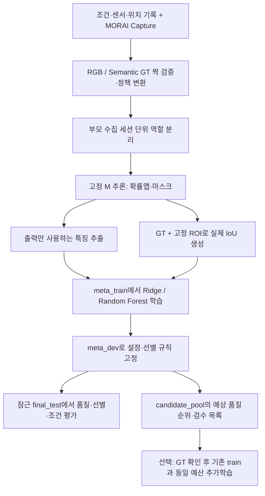

# GT 없는 분할 품질 추정과 검수 우선순위 선정 — 합의한 방향과 기술 초안

> 2026-11-03 · 현재 설계 초안 · 3인, 남은 기간 5주.
> **목표·TwinLiteNet+·전방 카메라 사용은 팀 합의.** M 체크포인트·특징·ROI·학습기는 구체화할 기술 초안이다.
> [3분할과 11/4 취합 공지](../03_팀운영/중간발표_3분할과취합공지_20261103.md)에 따라 세부 규약을 맞춘 뒤 동결한다.
> **ML 품질 추정기 구현·학습·성능 검증은 아직 미완료.** 기존 인지 모델과 시각화는 확보했다.
> 이 문서가 9월 A1 계획보다 우선한다. PCA/GMM, 위험 지도, DINO, 새 인지 아키텍처 비교는 필수가 아니다.

## 1. 목표와 연구 질문

고정된 TwinLiteNet+ **Medium(M)** 의 출력만으로 전체·관심 영역의 분할 품질을 추정한다.
낮은 예상 품질의 장면을 우선 검수하고, 실제 오류를 더 효율적으로 찾는지 검증한다.
MORAI Capture의 RGB와 Semantic GT는 학습 정답 생성·평가에 사용한다. 사용 시 GT는 요구하지 않는다.

1. 출력 기반 특징을 학습하면 단일 confidence/entropy보다 실제 IoU를 잘 추정하는가?
2. 고정 카메라의 위치를 반영한 ROI 특징은 전체 통계·동일 수의 단순 격자보다 도움이 되는가?
3. 같은 검수 예산에서 실제 저품질 장면을 더 많이 찾는가? 어떤 조건의 과신 오류를 놓치는가?

**실패 여부와 오류 관련 조건을 추정하는 연구다.** 날씨·시각이 실패의 원인이라고 자동 입증하지 않는다.
환경별 분석은 GT와 수집 기록으로 수행하고, 원인 가설은 장소·자세·객체 배치를 맞춘 추가 실험으로 확인한다.

## 2. 완료 기준과 확장 경계

| 범위 | 결과물 | 완료 판정 |
|---|---|---|
| 필수 | 전체·ROI별 품질 회귀 | 주행 단위 held-out MAE/순위, confidence 기준선 비교 |
| 필수 | 오프라인 검수 목록 | 같은 후보 pool의 예산별 실패 발견율, 중복 제거 명세 |
| 필수 | 조건별 한계 분석 | 환경별 표, 과신 오류/오경보 갤러리, 표본·주행 수 |
| 필수 | 재현 자료 | 모델·데이터·정책·ROI·feature·split의 버전과 해시 |
| 선택 | 동일 예산 추가학습 | Random 대 선별, 같은 M 초기값·기존 train·학습량, 고정 test |
| 선택 | 영상 재생 모니터 | 시간순 예상 품질과 이벤트 표시, 실제 측정 지연시간 |
| 향후 | 온라인 선택 수집 | 전후 구간 버퍼·중복 억제·무작위 감사 수집 |
| 향후 | 큰 모델·실차·fail-safe | 새 인지 모델에 대한 추정기 재검증, 대체 동작 효과의 별도 검증 |

오류 선별 효과는 인지 성능 향상과 다르다. 재학습 비교를 하지 않으면 후자를 달성했다고 쓰지 않는다.
실시간 동작·안전 보장도 현재 완료 결과로 제시하지 않는다.

## 3. 초기 실험 대상 M과 확인한 중간 결과

| 항목 | 확인값 |
|---|---|
| 모델 | TwinLiteNet+ Medium, binary `lane` + `drivable` |
| upstream | `90f1b8695ae311d5123b05f8534b2e11e42499d2` |
| checkpoint | `twinlite_medium_morai_v5_actor_negative_init_ema_b12_e18_20260906/best_mean.pt` |
| checkpoint SHA-256 | `5d233b525d95d45fc05dbf5469e92419401771a2f4b97b86be7f79fa3b9e762d` |
| 모델 로딩 | `src/common/bridge.py`, `ema_state_dict`, `eval()` |
| 기존 학습 데이터 | v5 actor-negative, train 26,001 / val 1,404 **카메라 이미지** |
| 입력 | RGB float32 `[B,3,384,640]`, [0,1], aspect ratio 유지 letterbox |
| 전방 기존 기하 | 원본 720×1280 → 360×640, 상하 12 px padding; 새 Capture는 실제 기하 확인 |
| 기존 학습 | 18 epoch, batch 12, lr 2e-4, weight decay 5e-4, seed 2026, AMP, EMA decay 0.9999 |
| 초기화 | 이전 v1 epoch-10 EMA 가중치에서 시작, optimizer/scheduler/EMA 재설정. 처음부터 학습 아님 |
| 기존 설정 | augmentation none, 유효 픽셀 동일 가중치, padding 제외 |
| 과거 결과 | 학습 `result.json`의 best 항목: drivable 0.983643, lane 0.893323, mean 0.938483 |
| 시각화 | 로컬 `outputs/inference_vis/v5b_val/`, 전방 468 frame × 3 views |

확인 근거: 기존 학습 `config.json`, `result.json`, 체크포인트 파일 해시, 시각화 `export_meta.json`.
공유 가능한 항목과 근거 파일 SHA는 [M 기준선 근거 JSON](./contracts/medium_baseline_evidence.json)에 정리했다.
원본 위치·파일 해시는 공개 저장소 밖 `external/source-path-map.local.json`과 로컬 자산 기록에 둔다.
과거 best 집계는 **이번 ROI 평가나 ML 추정기의 성과가 아니다**. 동일 체크포인트의 현재 평가 계약으로 재평가한다.

기존 시각화 CSV(소수 셋째 자리)에서 `front lane IoU < 0.7`은 89/468(약 19.0%)다.
이는 이미 개발·선정에 사용한 validation의 탐색 결과다. 새 독립 test의 실패율로 재사용하지 않는다.
조건별 주행 구간이 달라 장소와 날씨·시각이 섞여 있으므로 인과 결론도 내리지 않는다.

M을 선택한 이유는 기존 코드·가중치·시각화와 작은 실험 비용이다. 작은 모델이면 개선이 보장된다는 뜻은 아니다.
L의 과거 학습 성과를 이 품질 추정기나 선별 방법의 개선 효과로 제시하지 않는다.

## 4. 전체 파이프라인

실사용 경로는 `RGB → M → 출력 특징 → 학습한 추정기 → 예상 IoU·검수 점수`다.
GT 생성 경로는 실행 모듈에서 분리한다. Capture Mode는 일시정지/저속 수집 방식도 있으므로
연속 영상의 시간 간격을 가정하지 않는다. 시간적 특징은 시간·이동 간격을 확인한 별도 실험이다.

## 5. 모델·특징 설계

- 1행=전방 한 프레임. 기본 입력에는 RGB 품질, DINO/ImageNet, GT, 날씨·시각·위치·run ID를 넣지 않는다.
- `F_conf`: 두 head의 확률/불확실성 통계 14차원.
- `F_global`: 형태·경계·빈 예측 표시까지 30차원.
- `F_grid`: F_global + 2×3 균등 격자의 지역 통계, 78차원.
- `F_camera_roi`: F_global + 6개 카메라 기반 ROI의 같은 지역 통계, 78차원.
- `F_temporal`: 선택. 과거만 사용하고 장면 전환·긴 Capture 간격에서 상태를 초기화한다.
- 정답은 `lane_full`, `drivable_full`, `lane_road`, `drivable_road`의 IoU. 기본 선별 target은 `lane_full`.
- 각 target별 Ridge / RandomForestRegressor를 별도로 학습해 undefined 정답을 구분한다.
- 출력 `estimated_iou`와 `risk_score=1-estimated_iou`를 구분한다. risk_score를 실패 확률로 부르지 않는다.

초기 Ridge: alpha {0.1,1,10,100}, train에서만 표준화. 초기 RF: trees 300,
max_depth {4,8,None}, min_samples_leaf {5,10,20}, max_features {sqrt,1.0}, seed 2026.
소규모 search로 meta_dev에서 고정한다. test 결과를 보고 feature/ROI/임계값을 다시 고르지 않는다.
기계 판독용 특징 순서·target·기본값은 [계약 JSON](./contracts/quality_contract_v1.json)에 둔다.
실제 카메라 ROI 다각형은 아직 지정하지 않았다. 훈련·개발 프레임으로 작성·검토한 뒤 해시로 동결한다.
[ROI profile 초안](./contracts/roi_profile_template.json)은 미지정 상태이며 실행용 설정이 아니다.

강의 연결은 선형 회귀·정규화(Ridge), 전처리의 train/test 분리, 트리/앙상블(RF),
모델 선택과 튜닝이다. 강의 기법을 모두 사용하기 위해 군집·GP 등을 추가하지 않는다.

## 6. 팀원이 먼저 읽을 실행 문서

| 문서 | 내용 |
|---|---|
| [입출력 규약](./품질추정_입출력규약.md) | Capture·기하·예측·feature·GT label·모델·검수 manifest |
| [수집·평가·재학습](./평가_수집_재학습계획.md) | 조건 통제, 누수 방지, 지표·선별 예산·동일 예산 추가학습 |
| [3분할·취합 공지](../03_팀운영/중간발표_3분할과취합공지_20261103.md) | A 입력·정답 / B 품질 모델·학습 / C 선별·평가·개선 |
| [코드 이식·분담](./코드이식_분담계획.md) | 기존 코드와 차이, 33개 source 목록, 담당·의존성·인수 기준 |
| [논문·베이스라인](./참고논문_베이스라인.md) | 클론 revision·차용 범위·공식 코드 미확인 항목 |
| [5주 일정](../04_실행/5주_마일스톤_20261103.md) | 주차별 인수물·3인 담당·축소 조건 |
| [8분 중간발표](../07_발표/중간발표_설계와근거_20261103.md) | 검증된 중간 결과, 발표 시간, 다음 시각화 작업 |

## 7. 현재 구현 상태

기존: 수집·동기화·마스크 bake·dataset adapter·M 로더·추론 시각화가 있다.
새로 해야 함: 새 수집 메타데이터, 역할 split, ROI 동결, GT 독립 특징 추출, 영역 label,
Ridge/RF 학습, 검수 목록, 평가·추가학습 비교.
기존 `curate_perception_frames.py`는 정차/중복 선별이며 학습된 품질 추정기가 아니다.
이번 정리에서 대회 코드 이식·ML 학습·새 추론 이미지 생성·발표 슬라이드 제작은 실행하지 않았다.
