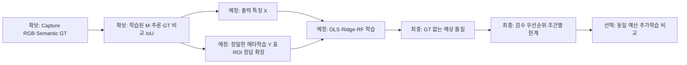

# 2번 설계 — 실제 중간 결과에서 최종 품질 추정 파이프라인으로

> **과거 v5 사례·강의 연결 참고 문서:** 아래 binary 출력·0.165/0.940 그림·89/468 통계는 v5에 해당한다.
> M 전체가 정지선을 출력하지 않는다는 뜻이 아니다. [M v6 본학습·정지선 수치](../05_구현계획/M_v6_정지선_재확인_20261103.md)를 확인했다.
> 현재 발표 모델·목차는 [8분 발표 정본](./중간발표_설계와근거_20261103.md), B 수식은 [100초 대본](./B_담당_슬라이드와대본_20261103.md)을 우선한다.

> 2026-11-03 · 강의계획서·원본 PDF 교안·기존 학습 기록·실제 시각화 재확인.
> **현재 결과는 기존 인지 모델·데이터·추론 평가다. 새 품질 추정기는 설계 단계다.**
> 이 문서는 [B 상세 설계](../05_구현계획/B_품질모델_학습설계_20261103.md)를 중간발표 관점에서 보강한다.
> 세부 ROI·추가 특징은 1번 결과와 취합한다. 그 전에도 아래 최소 입출력으로 2번 설계를 설명할 수 있다.

## 1. 교수님께 전달할 핵심 흐름

> “직접 수집한 RGB와 픽셀 GT로 TwinLiteNet+를 학습하고, 실제 추론·오류를 시각화했습니다.
> 평균 점수와 달리 장면에 따라 차선 품질이 크게 달랐습니다.
> 이제 그 출력의 통계와 GT 기반 실제 IoU를 짝지어, 수업의 회귀·정규화·앙상블로
> GT 없이 분할 품질을 추정하고 같은 검수 예산에서 실패 장면을 더 잘 찾는지 검증하겠습니다.”

이번 발표에서 전체 파이프라인·입출력·진행 상태를 먼저 보여준다. 모델 하이퍼파라미터 표는 보조 자료다.
기존 인지 모델 학습은 실험 기반이고, 수업 프로젝트의 학습 문제는 **출력 특징에서 실제 품질로의 지도학습**이다.

## 2. 지금 실제로 보여줄 수 있는 중간 결과

| 항목 | 확인 내용 | 발표 시 구분 |
|---|---|---|
| 기존 인지 모델 | TwinLiteNet+ Medium, 두 binary head | 새 품질 모델이 아닌 평가 대상 f0 |
| 학습 규모 | train 26,001 / val 1,404 카메라 이미지, front/left/right 공유 가중치 | 이번 품질 모델은 front만 사용. 과거 f0도 front만 학습했다고 말하지 않음 |
| 입력 | RGB 384×640 letterbox, float [0,1] | 기존 전방 원본은 720×1280 → 360×640 + 상하 12 px padding |
| 학습 기록 | 이전 v1 epoch-10 EMA에서 초기화, 18 epoch, batch12, lr2e-4, AMP/EMA | 처음부터 학습한 모델이라고 표현하지 않음 |
| 과거 학습 best 항목 | lane 0.893323, drivable 0.983643 | 3뷰를 포함한 과거 validation 집계. front별 frame 평균·새 test·새 ROI 점수와 다름 |
| 추론 시각화 | 468개 전방 frame과 같은 시점의 다른 view, RGB/GT/pred/error panel 존재 | 새로 추론한 결과가 아니라 기존 저장 결과를 재확인 |
| 탐색 실패율 | 소수 셋째 자리 CSV 기준 front lane IoU<0.7: 89/468 ≈19.0% | 반올림 기록·개발용 val 기준. 최종 일반화 성과로 재사용하지 않음 |

전체 프레임의 IoU를 GT로 채점하고 저장하는 기능은 이미 존재한다. 새로 필요한 것은 그 값을
float 특징 X와 정확히 결합한 메타학습용 Y 표로 동결하고, ROI 정답까지 확장하는 작업이다.
“GT 평가도 아직 없다”거나 “품질 추정기까지 이미 학습했다”는 두 표현 모두 현재 상태와 다르다.

근거 파일의 SHA와 수치는 [M 기록 JSON](../05_구현계획/contracts/medium_baseline_evidence.json)에 있다.
실제 파일 위치·이미지 선택은 공개 Git 밖 `external/B-midterm-evidence.local.json`에 기록한다.
원본 학습 기록·그림을 과목 레포에서 이미 생성한 것으로 바꾸어 설명하지 않고 결과의 귀속을 구분한다.

### 실제 이미지로 연결할 예시

기존 저장 패널 두 장을 열어 RGB·GT·예측·오류맵을 확인했다.

| 예시 | 실제 저장 점수(표시 정밀도) | 관찰 가능한 내용 |
|---|---|---|
| A: 맑은 오후 교차로 | lane 0.165, drivable 0.954 | 주행 가능 영역은 대체로 유지되지만 차선 누락이 큼 |
| B: 안개 조건의 곡선 도로 | lane 0.940, drivable 0.981 | 해당 프레임에서는 차선과 도로 분할이 비교적 잘 맞음 |

이는 선택한 두 사례의 관찰이다. “안개보다 맑은 날이 더 어렵다”는 일반 결론이나
“그림자가 원인이다”라는 인과 결론이 아니다. 높은 confidence의 오류인지도 아직 측정하지 않았다.
두 head를 따로 예측·평가할 필요와 환경 이름만으로 오류를 알 수 없다는 동기로 활용한다.

## 3. TwinLite 입력·출력·GT를 정확하게 설명하기

### f0 입력과 출력

```text
RGB 영상 [3,384,640]
        ↓ 고정 TwinLiteNet+ M
drivable logits [2,384,640]     lane logits [2,384,640]
        ↓ head별 softmax               ↓ head별 softmax
도로 확률맵 [384,640]            차선 확률맵 [384,640]
        ↓ p≥0.5                       ↓ p≥0.5
도로 예측 마스크                  차선 예측 마스크
```

여기서 2채널은 각 head의 background/foreground이다. softmax의 class 축을 따라 foreground 확률을 얻는다.
노랑·초록 overlay는 확률맵/마스크를 설명하기 위한 시각화이고 ML 입력 이미지는 아니다.
입력 특징은 float 확률에서 계산한다. 8-bit 확률 PNG를 읽어 학습 특징으로 역산하지 않는다.

### 실제 GT 정의

MORAI Semantic 영상의 클래스 색을 동결된 정책으로 변환해 별도의 GT 마스크를 만든다.

| head | v5 M의 정답 |
|---|---|
| lane | 흰 차선·노란 차선=1, 나머지=0. **정지선 제외** |
| drivable | asphalt·차선·횡단보도·정지선·노면표시 등 정책상 표면=1 |
| actor-negative | 보이는 차량·보행자·장애물은 drivable에서 유효한 0. 차체·하늘·보도도 비도로 |
| padding | 두 head의 정량 평가에서 제외 |

근거는 [동결한 v5 정책](../../config/perception_target_policy_v3_actor_negative.json)과 기존 task/loader다.
도로 GT는 정책상 분할 클래스이며 현재 경로 계획상 “즉시 주행해도 안전한 영역”이라는 뜻은 아니다.
후속 4-class 모델의 white/yellow/stopline 출력을 M의 binary 출력과 혼동하지 않는다.

## 4. 1번 결과를 기다리지 않아도 정할 수 있는 최소 학습 문제

기본 단위는 전방 프레임 하나다. 전체 유효 영상에서 두 확률맵의 통계로 시작한다.

| X: head별 7개 통계, 총 14개 | 설명 |
|---|---|
| p_mean, p_std | foreground 확률의 평균·표준편차 |
| confidence_mean | max(p,1-p)의 평균 |
| entropy_mean, entropy_p90 | 정규화한 이진 entropy의 평균·90분위 |
| margin_mean | abs(2p-1)의 평균 |
| uncertain_fraction | entropy>0.8인 비율, 0.8은 현재 초안 |

기하 유효 픽셀만 쓰며 GT·실제 IoU·날씨·시각·위치는 입력하지 않는다.
이 14개는 공통 [계약 JSON](../05_구현계획/contracts/quality_contract_v1.json)의 F_conf와 같다.
형태·ROI가 준비되면 30/78개로 확장하되 핵심 학습 문제는 바뀌지 않는다.

**Y는 실제 IoU다.** 예측 P와 GT G에 대해 `y=|P∩G|/|P∪G|`로 채점한다.
먼저 lane_full 하나로 학습하고 drivable_full·ROI target으로 확장한다.
둘 다 전경이 없으면 union=0이므로 null로 구분하고 target별 학습 가능 행만 적합한다.
미검출/오검출이 있으면 점수 0이 될 수 있다. null을 좋은 품질 1점으로 바꾸지 않는다.

학습 표의 개념은 `한 frame의 14개 특징 → 그 frame의 실제 차선 IoU`다.
정답을 자동으로 채점할 수 있으므로 품질 정답을 사람이 새로 매길 필요는 없지만
Semantic 변환·정렬·valid mask 자체의 감사는 필요하다.
현재 feature/label 표를 이미 완성했다고 말하지 않고 **생성 규약과 다음 구현물**로 설명한다.

## 5. 강의계획서·교안과 연결한 2번 모델

쪽수는 PDF 뷰어의 **물리 페이지, 1부터 시작**이다. main_notes의 인쇄 쪽수와 다를 수 있다.
강의계획서의 주차와 lec1 운영표가 달라, 운영 주차는 lec1 p.15를 기준으로 구분했다.

| 프로젝트의 선택 | 원본 자료 | 수업 내용을 어떻게 적용하는가 |
|---|---|---|
| 연속 IoU를 예측하는 지도학습 | Lecture3 p.3, p.5; main_notes p.9–10 | feature 벡터에서 연속 target으로의 회귀 |
| 선형 회귀 기준선 | Lecture3 p.5–7; main_notes p.9–10 | 최소제곱 목적함수, 학습된 가중치와 절편 |
| Ridge 비교 | main_notes p.136–137, regularization | 최소제곱에 L2를 더해 계수 크기·복잡도 제어 |
| 전처리·역할 분할 | Lecture2 p.40–42 | train/dev/test·scaling을 실제 주행 묶음에 적용 |
| 모델 선택·교차검증 | main_notes p.140–142 | 학습 오차가 아니라 held-out 성능으로 선택 |
| Random Forest 확장 | Lecture9 p.22, p.26–29 | 회귀 트리의 분산 감소, bootstrap, 무작위 특징, 예측 평균 |
| 작은 탐색 예산 | Lecture13 p.4, p.9–13 | 정규화/깊이/leaf 등의 하이퍼파라미터를 검증으로 선택 |
| 선택 실패 분류 | Lecture3 p.22–26 | IoU<tau의 이진 정답으로 Logistic Regression 비교 가능 |

자료 링크:
[강의계획서](../01_강의정보/기계학습%20강의계획서.pdf),
[lec1 운영표](../01_강의정보/기계학습%20lec%201.pdf#page=15),
[main_notes](../main_notes.pdf),
[Lecture2](../Lecture%20Note/Lecture%202%20-%20Data%20preprocessing.pdf),
[Lecture3](../Lecture%20Note/Lecture%203%20-%20linear%20and%20logistic%20regression.pdf),
[Lecture9](../Lecture%20Note/Lecture%209%20-%20decision%20trees%20and%20ensemble%20methods.pdf),
[Lecture13](../Lecture%20Note/Lecture%2013%20-%20Gradient-free%20optimization.pdf).

main_notes.pdf는 현재 로컬에 있는 참고 파일이며 Git 추적 여부와 저작권/공유 범위를 별도로 확인한다.
현재 공개 저장소에 업로드한 것으로 안내하지 않는다. 관련 내용은 기존 강의 정리로도 찾아볼 수 있다.
Lecture9/13은 보관된 전년도 교안이다. lec1 운영표상 11/14주 주제이므로 중간발표에서는
“이미 수업에서 배웠다”가 아니라 **기말까지 학습·적용할 범위**로 말한다.
수업에서 설명한 단순 무작위 frame 분할 예시를 연속 주행에 그대로 적용하지 않고 부모 세션 단위로 확장한다.

### 5.1 최소제곱 → L2 정규화 → 앙상블

선형 회귀는 `q_hat=b+w^T x`이고 `sum_i(y_i-b-w^T x_i)^2`를 최소화한다.
OLS를 교안과 직접 연결한 추가 기준선으로 두고, 같은 X의 Ridge와 비교하면 정규화의 효과를 설명할 수 있다.
공통 baseline 행렬의 대체가 아니라 설명·검증을 위한 B2-OLS 또는 B3-OLS 추가 비교다.

Ridge는 표준화한 z를 사용해 `sum_i(y_i-b-w^T z_i)^2 + alpha*||w||^2`를 최소화한다.
ROI가 겹치거나 비슷한 통계가 많을 때 계수를 제어하는 비교다. alpha는 dev/CV로 선정한다.
기울기법이나 선형 시스템 해법으로 학습할 수 있다는 것이 교안의 최적화 연결이고,
발표를 위해 새 optimizer나 신경망을 만들 필요는 없다.

RF는 여러 회귀 트리 `h_t(x)`의 평균 `q_hat=(1/T)sum_t h_t(x)`이다.
단일 트리의 과적합을 줄이려는 bagging·특징 무작위화를 적용한다. RF도 항상 좋아지는 것은 아니다.
**입력의 entropy**는 분할 모델의 픽셀 클래스 불확실성이고,
**회귀 트리의 분할 기준**은 target IoU의 오차/분산 감소다. 둘을 같은 entropy로 설명하지 않는다.

같은 X의 OLS/Ridge/RF로 학습기·정규화 효과를 보고,
같은 학습기의 전체/격자/카메라 ROI로 정보 추가 효과를 본다.
RF와 공간 특징을 동시에 바꾼 차이만으로 ROI가 유효하다고 주장하지 않는다.

### 5.2 분류 대신 회귀를 우선하는 이유

회귀는 IoU 0.1과 0.6의 차이를 보존하고 ROI별 점수와 검수 순위를 만들기 쉽다.
반면 평균 예측 오차가 낮아도 희귀 실패 선별이 좋다는 보장은 없다.
이를 C의 실패 AP·예산별 발견율로 함께 검증한다. 필요하면 `z=1[IoU<tau]`로 Logistic Regression을 추가한다.
`1-예상 IoU`를 실패 확률로 부르지 않는다. 실제 IoU의 실패 기준 tau와 경고 점수 기준 lambda도 구분한다.

## 6. 베이스라인 논문의 위치

| 참고 | 발표에서 연결할 부분 | 그대로 재현하지 않는 부분 |
|---|---|---|
| [MetaSeg](https://arxiv.org/abs/1811.00648) | 출력 확률 특징 위에 별도 선형 회귀/분류를 학습하는 구조 | 원래 segment adjusted IoU, 우리는 frame/ROI IoU |
| [SEE, ISCAS 2026](https://epapers2.org/iscas2026/ESR/paper_details.php?paper_id=2485) | frame/image별 품질을 RF로 추정하는 문제 설정 | 원본의 영상 품질·재구성 branch는 출력-only 설계에서 제외 |
| [Küchler 2024](https://arxiv.org/html/2401.09245v2) | 단순/비선형 학습기·특징 묶음 비교 | 부품 precision 분류·mask 삭제·gradient 특징은 주 과제와 다름 |

“최신 논문 전체를 복제한다”보다 **기존 문제 설정을 수업 기법으로 구현하고, 고정 카메라 ROI와
통제 가능한 수집 조건에서 유효성·한계를 검증한다**고 설명한다.

## 7. 진행 상태와 최종 산출물을 한 장에 연결하기



| 최종 산출물 | 구체적으로 보여줄 것 |
|---|---|
| 품질 모델 | 새 프레임의 전체/ROI 예상 IoU, 저장·재사용 가능한 모델 bundle |
| 품질 추정 결과 | 실제–예상 IoU 산점도와 OLS/Ridge/RF MAE·순위 비교 |
| 선별 효과 | 같은 5/10/20% 검수량에서 Random/confidence/ML의 실제 실패 발견율 |
| 인사이트 | 어느 조건·영역에서 f0가 틀리고, 그중 g가 놓치는 오류는 무엇인지 |
| 선택 개선 결과 | 동일 신규 GT 수·학습량에서 Random 추가와 선별 추가의 f0→f1 성능 차이 |

수치를 예측해 성공을 약속하지 않는다. 필수 산출물은 품질 추정·검수 효과·한계 분석이며,
추가학습 개선은 수행한 경우에만 결과로 제시한다. 온라인 수집·큰 모델·fail-safe는 향후 확장이다.

## 8. 후보 모델·YOLO를 언급한다면

현재 TwinLite만으로도 입력·정답·학습·실패·새 ML 문제의 연결이 가능하다.
YOLO는 필요할 때 “기존 자율주행 개발에서 객체 검출도 학습·평가했고, 이번 과제는 픽셀 GT와
ROI 품질 분석이 가능한 segmentation으로 범위를 정했다” 정도의 검토 이력으로 짧게 언급한다.
품질 추정기를 YOLO에 이미 적용했거나 두 과제의 성능을 공정하게 비교했다고 말하지 않는다.

확인한 기존 객체 검출 기록에는 E3 15종, 3뷰 4,126장·GT 11,464개의 고정 검증이 있다.
당시 RTX5070 TensorRT 평가의 Precision 94.5885%, Recall 87.8227%, Macro F1 91.4770%다.
현재 다른 GPU 재배포 성능으로 옮겨 쓰지 않는다. 이 수치는 **검출의 과거 평가**이며
분할 IoU나 이 과제의 새 ML 결과와 같은 지표가 아니다. 본문 8분에는 생략하고 질문용 부록이 적절하다.
비공개 원본의 위치·파일 해시는 로컬 evidence 대응표에만 둔다.

## 9. 중간발표용 연결 문장

> “현재까지는 시뮬레이터 데이터로 인지 모델을 학습하고 GT와 비교하는 단계까지 구현했습니다.
> 보시는 사례처럼 도로가 잘 분할돼도 차선을 크게 놓치는 장면이 있어 평균 점수만으로는 충분하지 않습니다.
> 다음 단계에서는 출력 통계를 입력, 실제 IoU를 정답으로 삼아 수업에서 다루는 선형 회귀를 적용합니다.
> L2 정규화와 앙상블로 모델 복잡도와 비선형 관계를 비교하고, 주행 단위 검증으로 모델을 선택하겠습니다.
> 최종적으로는 GT 없는 품질 점수와 검수 목록을 만들고, 같은 검수량으로 실패를 더 많이 찾는지 보여드리겠습니다.”

슬라이드에는 긴 수식보다 `실제 결과 → 출력에서 X 생성 → GT로 Y 생성 → 수업의 회귀/앙상블 → 최종 산출물`을 남긴다.
세부 특징 차원·ROI 좌표·탐색 범위는 1번과 취합할 제안임을 표시한다.
