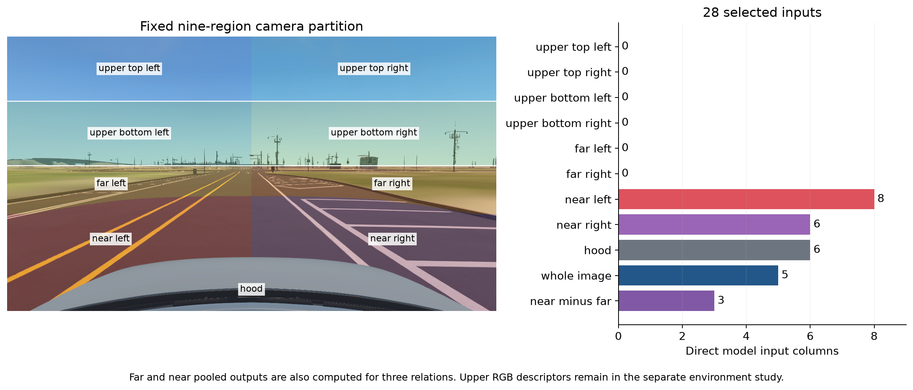

# 고정 ROI와 특징 추출

현재 ROI는 **`roi9-front-v1`**로 고정한다. 현재 Q 회귀 비교는28/34/52/49열, 환경 분류는 별도 RGB400 히스토그램이며 실제 채택 열·모델은 해당 인지 버전의 번들 manifest를 따른다. [28일 전체 원본 재생·환경 검증](../../experiments/환경검증_전체원본재생_20261128.md)이 최신 단위다. 아래28열의 정의·이전 CLI는 재현을 위해 유지하며 [f0 v3 레시피](../../../config/region_feature_recipe_v3.json)를 새 f1 모델에 자동 대입하지 않는다. 직전 원문은 [보존본](../guides_20261127/ROI와_특징추출.md)에 있다.

## 영역 정의와 의도

| 영역 | 의도와 현재 사용 |
|---|---|
| 상부 위층 좌우 | 하늘·조명·색 단서. 별도 환경 RGB 표현의 후보이며 품질 직접 열은 없음 |
| 상부 아래층 좌우 | 지평선 주변 건물·물체·표지판. 별도 환경 표현 후보이며 품질 직접 열은 없음 |
| 원거리 좌우 | 작은 차선·원거리 가시성. 주28열에서는 근−원거리 출력 관계의 재료로 사용. 별도31열은 진단 후보 |
| 근거리 좌우 | 가까운 노면의 색·구조·차선/주행가능 출력. 품질 입력의 중심 |
| 보닛 | 고정 물체의 조명·반사·색·잔차 단서. RGB6개 사용 |
| 전체 화면 집계 | 추가 마스크가 아니라 전체 픽셀의 출력·확률 통계. 상부·보닛의 오검출·불확실성도 기여 |

1280×720·고정 전방 카메라의 지평선 y=338, 상부 반분 y=169, 좌우선 x=640이다. 지평선과 보닛 사이를 1대2로 나눈다. [프로파일과 픽셀 마스크](../../../config/roi9_front_v1/profile.json)의 SHA-256은 `96871a98fc7ce4f268c4d9aacbc34603c720e4c7bf70964e5b238aa2375a9786`이다. 원·근거리는 영상 띠이며 실제 거리나 의미론적 도로 분할이 아니다. 카메라가 바뀌면 기하를 먼저 검증한다.



## f0에서 선정한28열과 f1 후보52열

11월28일 재적합에서는 f1의 GP와 RF 모두 `env52`를 선택했다. 아래 base28을 유지하고 상부 위층 좌우에서 밝기·대비·glare/dark 비율·밝기 범위·채도·청색−적색·색상 sin/cos9개씩, 보닛에서 기존과 중복되지 않는6개를 더한 **24개 RGB 요약**이다. 정확한52열 순서는 [선택 JSON](../../baselines/environment_cycle_20261128/g1_quality/quality_selection_frozen.json)의 `selected.GP.columns`다. 환경 군집용400열 전체를 품질 회귀에 넣은 것은 아니다.

이 선택은 Dev에서 고정한 연구 후보이며 통합 채택은 보류다. 새 확인에서 GP52/RF52 MAE는0.03653/0.03047로 Dev의 순위가 역전됐고, 낮은 IoU 예측이 유용한 실패 장면 검수로 이어지지 않았다. `region_feature_recipe_v3.json`은 f0의28열 정본으로 보존한다.

| 묶음 | 열 |
|---|---|
| RGB10 | 근좌 `chroma`, `blue_minus_red`, `edge_density`; 근우 `median_residual`; 보닛 `intensity`, `dark_channel`, `dark_fraction`, `intensity_median`, `blue_minus_red`, `edge_density` |
| 인지 출력14 | 근좌·근우 각각 `drivable_fraction`, `lane_fraction`, `lane_probability`, `lane_weighted_entropy`, `lane_weighted_probability`; 전체 화면의 차선 관련 마지막 네 통계 |
| 원본 확률1 | `global.top_entropy` |
| 관계3 | `near_minus_far.lane_fraction`, `near_minus_far.lane_probability`, `near_minus_far.lane_drivable_disagreement` |

RGB는 320×180 면적 축소 영상에서 계산하고, 출력 요약은 4×180×320 uint8 맵이다. 마킹 원본 확률은 4×384×640 float32에서 위아래 패딩12행을 제외한다. `lane_probability`는 흰·노란 확률 합의 영역 전체 평균, `lane_weighted_*`는 축소 맵의 예측 차선 점유율로 가중한 통계다. 빈 예측의 처리와 마진·엔트로피 정의는 [추출기](../../../src/quality_estimation/selected_region_features.py), [공간 함수](../../../src/quality_estimation/spatial_features.py), [기존 함수](../../../src/quality_estimation/roi10.py)를 따른다. 필터는 전체 영상에서 먼저 계산해 ROI 경계가 새 특징이 되지 않게 한다.

28열은 기존 RGB10·출력14에 재호가 추가한 원본 확률 3후보 중 **상위10% 엔트로피 평균만 유지**하고 근−원거리 관계3을 더한 구성이다. 최대 패치 엔트로피·차선 마진 제거는 공통 특징 비교에서 확인했다. 차선의 행 점유·내부 간격·argmax 차선 밖의 약한 확률 지지 등 형태21후보는 원거리 recall 일부를 개선했지만 주 전체 IoU가 나빠 이번 주 입력에서는 보류했다. 형태3개를 원거리31열 단일 과제 GP에 쓴 저속 후속도 확인했지만 새 확인의 MAE 이득은 사전 기준에 못 미쳤다.

원거리 직접 열이 없어도 관계를 계산해야 하며 상부 직접 열이 없어도 전체 확률에는 상부 픽셀이 포함된다. 결측 열을 0으로 남기는 방식이 아니라 **실제 남긴 열만 연결**한다. 합친 ROI의 분위수·조건부 통계는 원본 픽셀로 다시 계산하고 기존 열의 단순 평균을 쓰지 않는다.

## 원거리 보조의31열 후보

주 IoU 입력28열은 유지한다. 별도 원거리 recall용으로 근거리 출력10을 원거리 출력10으로 바꾸고 원거리 행 점유·내부 간격·argmax 차선 밖 약한 확률 지지3개를 더한31열을 시험했다. 중복을 제외하면 두 입력의 합집합은41종이다. 서로 다른 정답을 위한 특징 선정이며 온라인ROI IoU 계산을 추가한 것이 아니다. 저속 개발에서는 유망했지만 새 확인3도로의 MAE 이득0.00092가 사전0.005보다 작아 기본 대체로 채택하지 않는다. 별도 공간 보정 번들에는 진단 후보로 남긴다. [후속 비교](../../experiments/ROI9_원거리보조와_환경전이_20261126.md)

## 버전 쌍의 현재 실행

새 f1/g1은 `quality_estimation.infer_versioned_review`를 사용한다. 선택한 `--adaptation-run`과 같은 신원의 `--bundle`, RGB `--manifest`, `--data-root`, 새 `--output`을 명시한다. 번들이 순서 있는 열·인지 신원·GP·환경 중심·보정·정책을 검증한다. 현재 Q 단일 회귀의28/34/52/49열 채택 판정은 [품질모델 가이드](품질모델_학습과_불확실성.md)를 따른다.

환경은 현재 최소 밝기·대비·hue·채도 히스토그램400열을9영역+전체에서 별도 계산한다. 상부 위층 좌우·보닛 RGB27열은 이전 군집 대조다. 품질 입력과 중복되는 열은 한 번 계산하지만 두 표현의 목적과 선택 근거는 다르다. 새 실행의 출력 형식과 사후GT 연결은 [환경·검수 가이드](환경군집과_검수정책.md#실행과-사후-검수)를 따른다.

<a id="gt-없는-현재-실행"></a>

## f0의 GT 없는 실행 이력

26일 저속 실험 당시 주28열·별도31열 진단·보정v2의 재생은 아래 경로다. 주 품질 GP 입력은28열이고 진단/환경까지 함께 계산하는 당시 번들의 고유 열은89개다. 체크포인트·ROI·코드·모델/보정·정책을 함께 검증한다.

```bash
PYTHONPATH=src python3 -m quality_estimation.drive_bundle \
  --bundle "$REVIEW_BUNDLE" --simulator-release 26.R1
PYTHONPATH=src python3 -m quality_estimation.infer_review_images \
  --manifest "$RGB_MANIFEST" --data-root "$RGB_ROOT" \
  --feature-study "$REVIEW_BUNDLE/feature_study" \
  --calibration "$REVIEW_BUNDLE/calibration" \
  --policy "$REVIEW_BUNDLE/policy/policy_frozen.json" \
  --checkpoint "$PERCEPTION_CHECKPOINT" --simulator-release 26.R1 \
  --device cuda --output "$NEW_REPLAY"
```

출력은 `features.npz`, `predictions.jsonl`, 입력 사본·해시가 있는 `run.json`과 `_SUCCESS`다. 40프로파일 CPU는 `--device cpu`를 사용한다. [채택 범위와 그림](../../baselines/roi9_drive_20261126/README.md), [검수·사후GT](환경군집과_검수정책.md)를 따른다. 새 번들은 `review_bundle_v2_final`이며 오전 파일명과 섞지 않는다.

### 오전 단일 GP 번들의 재현

아래는 오전 `spatial_bundle` 결과를 재현하는 기존 명령이다. 새 보정 진단 번들과 서로 다른 파일 구성을 사용한다.

먼저 [개발 환경](개발환경.md)과 동결 번들을 준비한다. RGB 목록은 `sample_id`, `image`, `expected_sha256.rgb`, `session_id`, `view=front`를 가진 JSONL이다. 이미지 경로는 `RGB_ROOT` 기준이고 GT 필드는 필요 없다.

```bash
PYTHONPATH=src python3 -m quality_estimation.spatial_bundle \
  --bundle "$FROZEN_BUNDLE" --simulator-release 26.R1

PYTHONPATH=src python3 -m quality_estimation.infer_spatial_images \
  --manifest "$RGB_MANIFEST" --data-root "$RGB_ROOT" \
  --recipe "$FROZEN_BUNDLE/feature_recipe.json" \
  --model "$FROZEN_BUNDLE/quality_spatial_gp.npz" \
  --calibration "$FROZEN_BUNDLE/calibration_26r1.json" --simulator-release 26.R1 \
  --checkpoint "$PERCEPTION_CHECKPOINT" --device cuda --output-dir "$NEW_REPLAY"
```

컨테이너에서는 위 변수를 실제 마운트 경로에 맞춘다.

출력은 `X.npy`, `predictions.jsonl`, `timings.json`, 입력 목록 사본, 해시가 있는 `run.json`과 `_SUCCESS`다.

단일 프레임의 이미 계산한 맵을 쓸 때는 아래 경로다. 맵과 원본 softmax가 실제 같은 체크포인트·전처리·프레임에서 생성됐는지 별도 원장으로 확인한다. CLI에 해시를 선언하는 것만으로 맵의 출처가 증명되지는 않는다.

```bash
PYTHONPATH=src python3 -m quality_estimation.region_inference \
  --image front.png --head-maps heads.npy --marking-probability marking_probability.npy \
  --recipe "$FROZEN_BUNDLE/feature_recipe.json" --task quality_spatial_gp \
  --model "$FROZEN_BUNDLE/quality_spatial_gp.npz" \
  --calibration "$FROZEN_BUNDLE/calibration_26r1.json" --simulator-release 26.R1 \
  --perception-checkpoint-sha256 "$ACTUAL_PERCEPTION_SHA256" --output quality.json
```

오전 번들의 RF는 `--task quality_rf`와 같은 번들의 `quality_rf.joblib`을 쓴다. 학습 scikit-learn 버전이 필요하다. RGB에서 실행하는 새 GP 경로는 [SpatialRGBScorer](../../../src/quality_estimation/infer_spatial_images.py)가 체크포인트를 직접 열어 해시를 확인한다.

## 후보 재가공과 남은 특징 실험

새 372열 후보 팩은 [extract.py](../../../scripts/experiments/roi9_gp_20261125/extract.py)로 생성했다. 입력은 역할·원본RGB/Semantic 경로·해시가 있는 등록 index, 출력은 9영역 후보 X와 별도 정답·메타데이터다. GT는 X 계산 이후 연결한다. RGB180·출력80·관계88·원본확률3·형태21을 보관했다. 원본과 f0·전처리를 남겨 아직 계산하지 않은 특징도 재생성할 수 있다.

승현·재호의 다음 작업은 다음 순서다.

1. 버전별 동결28/52열의 재생값·원본/GT·사례와 해시를 대조한다. 이번에 개봉한 확인618장은 실패 이력으로 보존하며 새 특징을 고르는 Dev로 사용하지 않는다.
2. 새 개발 자료에서 표시·무표시·원거리 전용 장면을 구분할 RGB/상황 단서를 우선 비교한다. 날씨 분류 확률만으로는 노면표시의 존재가 보존되지 않는다. 무출력을 일괄 제외하면 차선을 전부 놓친 실제 실패도 놓치므로, 예상 표시 유무와 FP/FN 사례를 함께 검수한다. 원거리31열은 계속 진단 후보이며 온라인 ROI별 IoU를 추가하지 않는다.
3. 일부 띠의 좌우 합치기·관계 제거는 같은 데이터·모델·튜닝 예산에서 하나씩 대조한다. 새 9영역 정의 자체를 바꾸지 않고 집계 범위·열 버전을 남긴다.
4. 특징 변경 시 GP·RF 모두 재학습하고 원래 개발/보정 역할을 지킨다. 분석한 새 도로를 다시 미사용 평가로 부르지 않는다.

<a id="11월-24일-특징-선정-인계"></a>

## 환경 특징과 이전 버전

환경 분류는 품질 회귀와 별도 입력을 선정한다. v2의 날씨80·지정 시각160 히스토그램 성분, 상부 위층 좌우·보닛 RGB54 e-means는 이전 연구 인계물이다. `region_inference --task weather|hour|environment`는 **v2 명세와 v2 모델**을 함께 사용한다. v3 품질 모델의 28열에 자동으로 붙이지 않는다. [환경 가이드](환경군집과_검수정책.md)

7영역99열, `(9+전체)×12=120` 공통 후보, robust17, 24열v1·27열v2와 기존 후보 캐시 848/851열 재현 명령은 [24일 가이드 원문](../가이드_20261124_원문.md#roi와_특징추출), [당시 결과](../../experiments/ROI_9영역_특징선정_20261124.md)에 보존한다. 7·10영역 프로파일은 과거 재현용이다. 7영역 경계는 10영역 내부를 지나므로 요약값만으로 서로 정확히 복원할 수 없다.

인계는 순서 있는 열·ROI/인지/코드 해시·같은 ID의 특징표·모델·자료 역할·RF/GP 성적·선별 분모·계산비용이다. 최종 오프라인 채택 이후 온라인에 연결한다.
