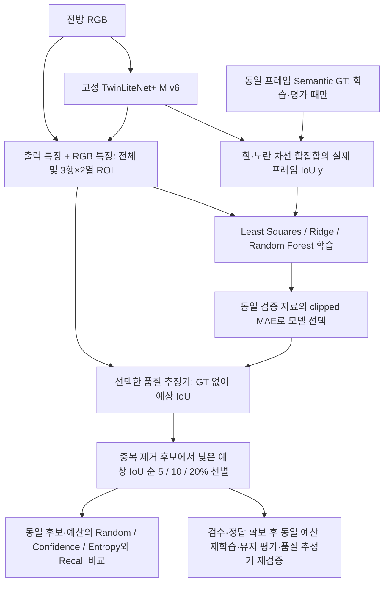

> 정리 전 원문이다. 현행 담당·일정·실행 경로는 [팀 문서 시작점](../README.md)을 따른다. 원문 경로와 보존 해시는 [이동 대응표](README.md)에 있다.

# 기계학습 기반 인지 품질 추정을 통한 딥러닝 인지모델 개선 데이터 플라이휠 — 현재 설계

**11월 23일 적용 순서.** 기존 데이터로 RGB 점수·검수 정책을 고정하고 사후 GT 평가와 인지모델 재학습·짝 품질모델 검증을 마친 뒤 단위 2·3의 온라인 연결에 착수한다. [오프라인 단계와 팀원별 실험·웹페이지 분담](데이터플라이휠_통합실험계획_3인분담.md)

> 2026-11-22 문서 검토 · 실험 기준 2026-11-16. 설계 출발점은 **2026-11-04 중간발표의 슬라이드와 발표자 노트**이며 이후 구현·실험으로 구체화했다.
> 현재 완료 상태와 우선순위는 [개발 현황](개발현황.md)을 따른다.
> 파일명은 기존 링크를 유지하기 위해 보존한다. 아래 내용은 11/3 초안을 대체한다.
> PPT SHA-256: `13e40f7bbd9a854d4c988f0a316c0cc024e73f937a7b502517314996b0942221`.
> **계획과 완료 상태를 구분한다.** 11/16 후속 개발 요청에 따라 X/y 생성·검증, 회귀 학습·GT 없는 추론·선별 평가를 구현·실행했다. 동일 예산의 인지 모델 갱신·예약한 최종 평가·기존 성능 유지 진단도 실행했다. [현재 결과와 한계](../experiments/품질추정_실험결과_20261116.md)를 따른다.
> 슬라이드 10~11 노트의 완료형 표현만으로 구현 완료로 판정하지 않는다. 발표 원본 없이도 개발할 수 있도록 핵심 계획을 아래에 옮겼다.

현재 통합 목표와 단계별 검증·개발 순서는 [데이터 플라이휠 개발 현황](통합_데이터플라이휠_개발현황_20261116.md)을 따른다.
11/4 발표 이후의 사용자 요청과 실험으로 구체화한 내용이 과거 선택 범위보다 우선한다.

## 1. 목표와 전체 파이프라인

실제 주행에는 GT가 없어 차선 인지 결과의 정확도를 즉시 알기 어렵고, 수집 영상을 전부 검수하기 어렵다.
고정된 TwinLiteNet+ Medium v6의 **출력과 원본 RGB에서 계산한 특징**으로 프레임별 차선 IoU를 추정한다.
예상 IoU가 낮은 장면을 우선 검수해 같은 예산에서 더 많은 저품질 장면을 발견하는지 검증한다.
기계학습·캡스톤디자인은 개발 결과를 공유하는 통합 프로젝트이며 이 저장소에서 개발한다. 교과목별 팀 구성은 [팀 운영](팀운영.md)을 따른다.

발표 슬라이드 5의 세 단계를 현재 통합 목표에 맞춰 구체화한다:

1. **차선 인지 모델 구현:** 주행 환경 설정 → RGB/Semantic GT 수집·데이터셋 구축 → 인지 모델 학습.
2. **기계학습 모델 구현:** 고정 인지 모델 추론 → 특징 X 추출 + GT로 정답 y 계산 → 회귀 모델 학습·비교.
3. **기계학습 모델 적용:** 데이터 추가 수집 → 중복을 줄인 후보 구성 → 품질 기반 선별·검증 → 정답 확보·동일 예산 인지 모델 재학습·평가 → 품질 추정기 재검증·갱신 채택 판단.

GT는 y 생성과 평가에만 쓴다. GT 없는 운용은 `RGB → M v6와 RGB 특징 → X → 예상 Lane IoU → 검수 순위`다.
실시간 성능 저하 감지·대응은 실시간성이 확보된 뒤의 확장이다. 현재 필수 구현 완료로 제시하지 않는다.

## 2. 확보한 인지 모델과 발표 수치

| 항목 | 최신 기준 |
|---|---|
| 인지 모델 f0 | TwinLiteNet+ Medium **M v6**, best_mean EMA, 선택 epoch **11** |
| 체크포인트 SHA-256 | `a26311b3af4e92880f632509eff3c81defc1b95135f5b463c7a08e5b6e23d24b` |
| 출력 | drivable 2클래스 + road_marking 4클래스(background / white_lane / yellow_lane / stopline) |
| 데이터 | train **26,001**, validation **1,404** 카메라 이미지; front·left·right 포함 |
| 학습 | **18 epoch** 완료. 선택 epoch 11과 구분 |
| 입력 | 너비 640 × 높이 384, RGB float32, aspect ratio 유지 letterbox |
| 전방 validation 누적 IoU | 흰 차선 **77.69%**, 노란 차선 **86.19%**, 정지선 **87.32%** |
| 새 품질 추정기의 범위 | **전방 한 프레임**의 통합 Lane IoU |

[검증 근거](../baselines/M_v6_정지선_재확인_20261103.md)와 [근거 JSON](../baselines/medium_v6_baseline_evidence.json)을 따른다.
위 수치는 과거 학습 validation의 픽셀 누적 교집합/합집합이다. 프레임 IoU 평균·새 독립 test·품질 추정기 성능이 아니다.
v5 그림·89/468 등의 과거 수치를 v6 결과로 바꿔 적지 않는다.

## 3. 특징 X와 정답 y — 발표 슬라이드 10~11

| 구분 | 채택한 계획 |
|---|---|
| 출력 특징 | 차선 확률(Confidence), Entropy, 차선 예측 면적 비율, 연결된 영역 수 |
| RGB 특징 | 평균 밝기, 어두운 픽셀 비율, 밝기 대비, 경계 밀도 |
| 공간 집계 | 영상 전체 + **좌우 2칸·높이 3칸**, 즉 **3행×2열의 고정 ROI 6개** |
| 한 행 | 전방 한 프레임의 특징 벡터 X와 실제 IoU y, sample_id로 대응 |
| 정답 | 흰·노란 차선을 합친 예측 마스크와 GT 마스크의 프레임 IoU |
| 제외 클래스 | 배경과 정지선은 통합 Lane 마스크에서 0. 정지선도 인지 모델이 출력하지만 이번 회귀 목표에는 포함하지 않음 |

노면표시 4클래스 argmax 결과에서 white/yellow를 합친다. `p_white+p_yellow >= 0.5`와 같은 마스크라고 가정하지 않는다.
ROI는 **특징 계산 영역**이다. 발표에서 제시한 회귀 정답은 프레임 전체 Lane IoU 하나이며, ROI별·도로·정지선 IoU 회귀는 필수 범위가 아니다.
GT·실제 IoU·FP/FN·날씨·시각·위치·run ID는 X에 넣지 않는다. RGB 밝기 등의 관측값은 X에 포함한다.

발표에 없는 세부사항은 이번 X/y 구현에서 정했다. **8종×(전체+6 ROI)=56차원**이며
confidence/entropy 집계·밝기/경계 임계값·ROI 경계·padding·빈 차선 처리를 [실행 스키마](../contracts/quality_xy_v2.json)에 고정했다.
기존 14/30/78차원 설계를 재사용하지 않았다.
현재 합의와 미정 항목은 [입출력 규약](../contracts/품질추정_입출력규약.md) 및
[계획 JSON v2](../contracts/quality_plan_v2.json)에 기록한다. JSON v2는 실행용 계약이 아니다.

## 4. 모델 비교·데이터 선별 — 발표 슬라이드 13~16

- **Least Squares(OLS), Ridge, Random Forest**를 같은 X/y 학습 자료로 비교한다.
- 같은 검증 자료에서 예상 IoU를 **[0,1]로 제한한 후 MAE**를 계산하고 가장 낮은 모델을 선택한다.
- 전처리·표준화는 학습 자료에만 fit한다. 모델 설정은 검증 자료로 정하고 final_test에서 다시 선택하지 않는다.
- 연속 영상의 중복을 줄인 동일 후보군을 만들고, 낮은 예상 Lane IoU 순으로 **5%·10%·20%**를 검수한다.
- **Random / Confidence / Entropy / Proposed ML**을 같은 후보·프레임 수로 비교한다.
- 주요 선별 지표는 **Recall@예산 = 선택한 실제 저품질 프레임 수 / 전체 후보의 실제 저품질 프레임 수**다.
- 현재 실험의 실제 저품질 정의는 **IoU<0.7**로 고정했다. 운용 경보 cutoff는 개발 자료에서 별도로 정하며, 두 기준 모두 안전 기준으로 해석하지 않는다.
- 날씨·시간대별 성능과 과신 오류를 분석한다. 조건별 차이를 인과 효과라고 단정하지 않는다.

인지 모델 재학습·평가는 전체 파이프라인에 포함된다. 슬라이드 16 노트의 “여건이 된다면”은 발표 당시 범위다.
현재 통합 프로젝트에서는 품질·선별 검증에 이어 동일 예산 재학습과 성능 유지·품질 재검증을 연결한다.
재학습 효과는 실제 비교에서 확인한 범위만 보고한다.
데이터 역할·누수 방지와 상세 평가 절차는 [평가 계획](평가_수집_재학습계획.md)을 따른다.

## 5. 일정·역할

슬라이드 17 기준: **W10 모델 학습 → W11 모델 비교·선택 → W12 성능 검증 → W13 데이터 선별·인지 모델 재학습 → W14 결과 분석**.
이는 발표 당시 계획이다. 현재 주차의 완료 실적이나 새 달력 날짜로 환산하지 않는다.
[마일스톤](5주_마일스톤_20261103.md)에 인수물과 선행 과제를 정리했다.
[팀 운영](팀운영.md)의 A 입력·정답 / B 모델·학습 / C 선별·평가 역할을 유지하며 실명은 임의 배정하지 않는다.

## 6. 현재 구현 상태와 다음 작업

| 항목 | 2026-11-16 확인 상태 |
|---|---|
| 기존 데이터·M v6·평가 근거 | 확보. 최신 계획의 고정 인지 모델과 발표 수치를 확인 |
| 수집·가공·인지 모듈 | 기존 코드 재사용. X/y 생성은 원본 Semantic과 v6 cache를 프레임마다 대조하며 26R1 ROS 수집 연계는 후속 작업 |
| ML 레포 기본 로더·시각화 | `src/common/bridge.py`의 M v6 기본값·task별 head 연결 적용. 시각화는 argmax 흰·노란 합집합과 4클래스 ID 보존. 과거 validation 6시점×3뷰 실행 확인 |
| v6 task 지원 부품 | `src/twinlite_morai/tasks.py`에 4클래스 spec·head 조정 함수 존재. 기본 로더에서 사용. 실행 검증 범위는 개발 환경 문서에 기록 |
| 품질 추정용 X/y 구성 | **구현·실행 검증**. 출력+RGB·3행×2열 ROI의 56차원 X와 단일 Lane IoU y. [실행·검증 기록](X_y_데이터셋.md) |
| OLS/Ridge/RF·품질 추론·선별 평가 | **구현·개발 실험 실행**. train-only 전처리, 부모 그룹·픽셀 중복 검사, 모델·선택 이력 보존, RGB 단독 추론, 5/10/20% 선별 비교. [실행법](회귀학습_선별평가.md) |
| 선별 후 인지 모델 재학습 | **구현·개발 실험 실행**. 동일 정답 수·업데이트 수, 복수 seed와 replay-only 대조군을 비교. 선별 효율과 인지 개선을 별도 해석. [실행법](선별자료_인지모델_재학습.md) |
| f1 이후 품질 재보정·버전 연결 | **구현·개발 검증**. f1용 X/y와 g1 bundle, 명시적 인지모델 이력 검사, 개발 전용 경보·채택 판정 구현. 새 주행1,371행 및 추가661행의 버전 쌍 검증 실행 |
| 26R1 ROS·실시간 대응·독립 환경 | **후속 검증**. 오프라인 구현을 실시간 폐루프나 다른 환경의 일반화 성과로 제시하지 않음 |

부모 세션·노출 역할을 반영한 품질 split과 세 회귀 모델 비교를 실행했다.
새 조건의 개발 자료에서 모델을 선택하고, 선택에 사용하지 않은 그룹의 잠금 평가를 완료했다.
같은 지도·물리 세션 및 일부 가까운 위치를 공유하는 한계와 기존 조건의 성능 감소도 기록했다. 26R1 ROS 수집 연계는 후속 작업이다. 추가 구현 범위는 [코드 이식 계획](코드이식_분담계획.md)을 따른다.

## 7. 이전 초안과의 차이

| 11/3 초안 | 11/4 발표로 갱신한 계획 |
|---|---|
| v5 binary 모델 중심 | M v6, drivable 2 + road_marking 4 |
| 출력-only, RGB 특징 제외 | 출력 특징 + RGB 밝기·대비·경계 특징 |
| 카메라 의미 영역 ROI 및 2행×3열 비교 | 전체 영상 + 3행×2열 고정 ROI |
| 14/30/78차원 고정 | 발표의 8종 특징을 7영역에 적용한 56차원으로 구현 |
| lane/drivable 및 road ROI 4개 정답 | 흰·노란 차선 합집합의 프레임 IoU 하나 |
| Ridge/RF 중심 | OLS 기준선부터 Ridge/RF까지 동일 데이터 MAE 비교 |

`quality_contract_v1.json`과 `roi_profile_template.json`은 이전 v5 초안의 이력으로 보존한다.
그 안의 클래스·특징·ROI·target을 현재 구현의 기본값으로 사용하지 않는다.
