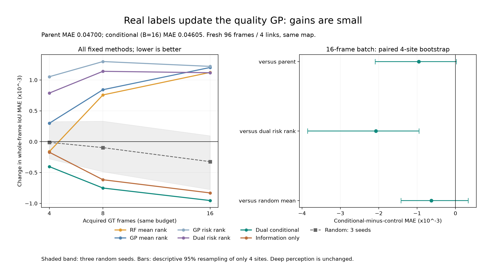
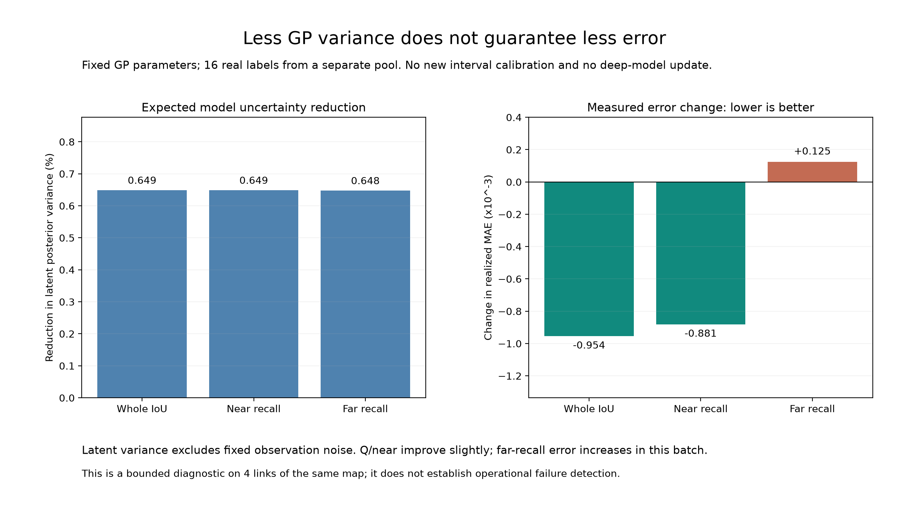

# 실제 라벨 획득·조건부 품질 GP 갱신 근거

[전체 보고](../../../experiments/GP_조건부_라벨획득_20261126.md)의 집계다. **인지모델 f0·주28열 GP는 유지**한다. 같은 부모 GP에 어떤 실제 라벨을 더하는가를 비교했으며 딥러닝 재학습 결과가 아니다.

| 근거 | 내용 |
|---|---|
| [프로토콜](protocol.json), [동결 목록/모델](frozen_updates.json), [소스 바인딩](source_binding.json) | GT 없는 선택,9방법×3예산, 실제 풀 GT로 만든27갱신 상태를 새 촬영 전에 동결. 실행 시점 해시와 Git 소스 일치 |
| [새96장 전체 성적](prospective_metrics.json) | 모든 방법·예산·과제·위치별 MAE와 raw 포함률, 관측/잠재 분산, 작은4위치 bootstrap. 최종 정책을 새로 선택하지 않음 |
| [부모 불확실성](parent_uncertainty.json), [고정 GP/RF](parent_quality_control.json) | GP0.04700·RF0.04829. 갱신 전 동일2,480장·28열 비교와 조건부 획득 결과를 구분 |
| [수집 범위](collection_scope.json) | 품질 학습/이전26R1 위치와 분리된 새 촬영. 모든 과거 경로와 분리된 새 지도는 아님. 복원·통신 인수 범위 |
| [ID 수정 검증](id_namespace_validation.json), [등록 감사](inventory_audit.json) | raw ID 충돌을 원본 보존/논리 namespace로 수정. 전체85팩·23,430고유ID/픽셀, 신규26R1 624장 |
| [그림 영수증](figure_receipt.json), [공개 파일 해시](receipt.json) | PNG2560×1440·16:9. SVG/원본/프레임별 산출물/갱신 모델은 실험 볼륨 |

조건부16장은 전체 IoU MAE0.04605였지만 부모/무작위 대비 차이의 위치 bootstrap 구간은0을 포함했다. 위험확률 순 대조보다 나았다는 결과를 일반적인 개선이나 인지 재학습 효과로 확장하지 않는다.

분산 감소는 기대 정보량이다. 실제 근거리/전체 오차와 원거리 오차의 변화가 달랐고, 갱신 후 재보정도 아직 하지 않았다. 주 v3 모델·기존 선택 정책·학습 승인false를 유지한다.
