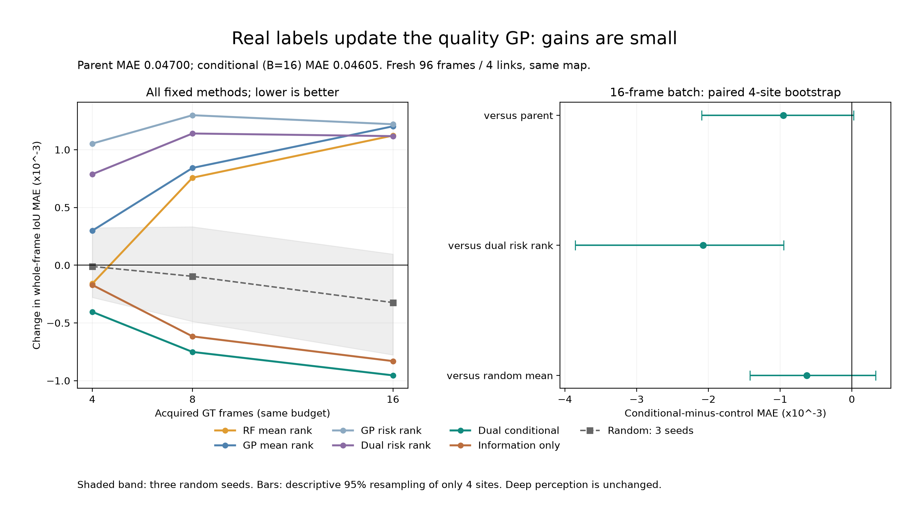
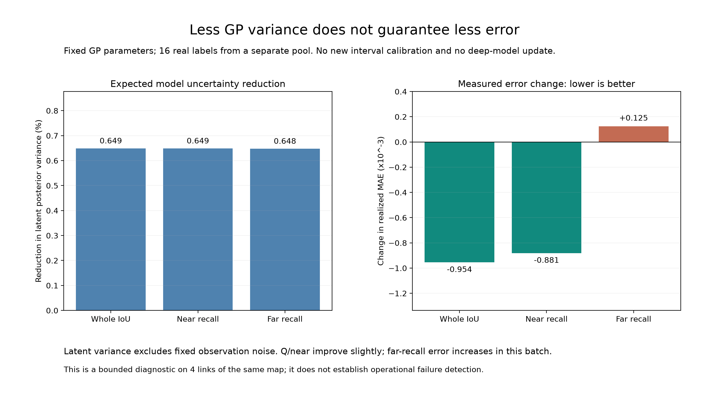

# 실제 정답을 붙인 GP 조건부 갱신과 선별 비교

**GP 공분산을 이용해 중복을 줄여 고른 자료에 실제 정답을 붙이고, 품질 GP의 사후분포를 갱신했다.** 새로 촬영한96장에서 전체 IoU MAE는 갱신 전0.04700, 조건부 선별16장 갱신 후0.04605였다. 이득은 작고 무작위 대비 우위도 불확실하다. 주28열 GP와 검수 정책을 교체하지 않는다.

이 실험은 **품질 추정기의 라벨 획득·갱신**이다. 딥러닝 인지모델은 v6 EMA f0 그대로이며 인지모델 재학습 효과를 측정한 것이 아니다. [공개 근거](../baselines/roi9_gp_20261126/acquisition/README.md) · [현재 기준선](ROI9_GP와_26R1_검증_20261126.md)

## 1. 분산을 줄이는 것과 정답으로 평균을 갱신하는 것을 나눴다

선별 단계의 조건부 갱신은 아직 보지 않은 정답을 만들지 않는다. 선택된 자료가 주변 후보와 얼마나 중복되는지 GP 공분산으로 계산해 다음 선택의 기대 정보량을 낮추는 과정이다.

이번에는 선택 목록을 고정한 뒤 실제 풀 GT를 붙였다. 부모 GP의 표준화·커널·과제 상관·잡음은 고정하고 다음 Gaussian 조건부 갱신을 계산했다.

```text
mu_new = mu + C_test,S (C_SS + R)^(-1) (y_S - mu_S)
Sigma_new = Sigma - C_test,S (C_SS + R)^(-1) C_S,test
```

`S`는 실제 정답을 받은 프레임/과제다. 정답은 전체 IoU·근거리 recall·원거리 recall이고, 미정의 정답은 관측에서 제외한다. `C`는 부모 GP의 잠재함수 사후 공분산, `R`은 원래 출력 단위의 고정 관측 잡음이다. 기본 원리는 [GPML 2장](https://gaussianprocess.org/gpml/chapters/RW2.pdf)의 Gaussian 회귀 조건부 분포다. 이번 다과제/단위 변환 구현은 작은 밀집 GP 전체 재계산과 수치 대조했다.

[ConditionedSpatialGP](../../src/quality_estimation/conditioned_spatial_gp.py)는 부모 NPZ 해시와 실제 관측을 사용해 만든 갱신 상태를 저장한다. 선택 단계와 달리 평균도 실제 잔차로 바뀐다. 실행 시 새 GT를 읽는 온라인 기능은 아니다. [학습 전용 동결 소스](https://github.com/ahnsh03/2026-2-ML/commit/785d681cfe4139716ba0145f310072f43e4a9268)는 촬영 전 기록한 소스 해시와 일치한다. Git 커밋은 실행 후 기록했으며 날짜를 소급하지 않았다.

## 2. 같은 부모·같은 라벨 예산으로 고정했다

- 부모는 f0·ROI9·28열·공통2,480장으로 적합한 기존 GP다. 새 라벨 풀은 부모 품질 학습/보정에 사용하지 않은 이전26R1 평가96장·4위치다. 이 풀 자체는 이미 살펴본 자료다.
- RF 평균 순, GP 평균 순, GP 위험확률 순, 전체/원거리 위험확률 혼합, 혼합 조건부 선별, 정보량만 사용, 무작위3시드의 **9방법**을 비교했다. 기존 혼합 예산의 약70%/30% 규칙을 유지했다.
- **4·8·16장**을 각각 같은 부모에서 선택하는 독립 배치로 시험했다. 각 예산은 순차 누적 학습이 아니다. 정보량만 사용하는 대조도 잠재 Q 공분산을 썼다.
- 선택 컨테이너에는 `X·ID·RF 예측·열 순서`만 있는 NPZ와 동결 모델/보정만 제공했다. 풀 GT를 마운트하지 않았고, Y가 추가된 입력 팩은 거부하도록 검증했다.
- 목록을 고정한 뒤 실제 정답을 붙여 **27갱신 상태를18:41:23 UTC에 동결**했다. 새 평가 첫 촬영은18:42:43 UTC였다. [목록·모델 동결](../baselines/roi9_gp_20261126/acquisition/frozen_updates.json)

## 3. 26R1에서 추가96장을 수집했다

6날씨×[05·08·13·20시]×4위치다. 품질 학습 위치와 계획 지점의 최소 이격은135.5m, 전체 링크 이격은73.9m였다. 실제 촬영 위치는 이전26R1 위치와 최소51.0m, 획득 풀과56.8m 떨어졌다.

**모든 과거 주행과 멀리 떨어진 도로는 아니다.** 과거 보관 주행까지 포함하면 최소18.5m였다. 사전 프로토콜의 “previously captured” 문구는 구현보다 넓었고, 실제50m 제외는 이전26R1 계획을 대상으로 했다. 따라서 품질 학습 위치 밖에서 새로 촬영한 같은 지도 검증으로 해석한다. 새로운 지도나 모든 과거 이력에서 미관측인 도로의 일반화를 주장하지 않는다. [지리 범위](../baselines/roi9_gp_20261126/acquisition/collection_scope.json)

조향 없이 Keyboard/Park 정지 촬영을 유지했고 원본 RGB·Semantic·Depth·Instance와 상태·해시를 E 실험 볼륨에 보존했다. 수집 후 원래 위치·Sunny13·Keyboard/Park를 복원·확인했다. 26R1 native ROS나 실제 좌우 조향을 인수한 실험은 아니다.

## 4. 모든 방법의 전체 IoU MAE

| 획득 방법 | 4장 | 8장 | 16장 |
|---|---:|---:|---:|
| RF 평균 순 | 0.04684 | 0.04776 | 0.04812 |
| GP 평균 순 | 0.04730 | 0.04784 | 0.04820 |
| GP 위험확률 순 | 0.04805 | 0.04830 | 0.04822 |
| 전체/원거리 위험확률 혼합 | 0.04779 | 0.04814 | 0.04812 |
| **혼합 조건부 선별** | **0.04660** | **0.04625** | **0.04605** |
| 정보량만 사용 | 0.04683 | 0.04638 | 0.04617 |
| 무작위3시드 평균 | 0.04699 | 0.04691 | 0.04668 |

갱신 전 GP는0.04700이다. 비교의 대상은 **같은 품질 GP를 어떤 실제 라벨로 갱신하는가**다. RF 평균 순도 GP의 획득 대조이며 RF를 재학습한 결과가 아니다. 참고로 변하지 않은 품질 RF의 같은96장 MAE는0.04829였다. [부모 GP/RF](../baselines/roi9_gp_20261126/acquisition/parent_quality_control.json) · [27개 전체 성적](../baselines/roi9_gp_20261126/acquisition/prospective_metrics.json)

16장 조건부 선별의 Q MAE 변화는 −0.00095, 약 **−0.095%p IoU**로 작다. 네 위치 모두에서 위험확률 혼합보다 좋아졌지만, 부모 대비95% 위치 bootstrap 구간은 [−0.00209, 0.00002], 무작위 평균 대비는 [−0.00142, 0.00033]으로0을 포함했다. 작은4위치의 기술적 대조이지 확정적인 보편 우위가 아니다. 위험한 자료만 추가하는 것과 대표성·중복까지 고려해 추정기를 개선하는 것은 다른 목적임을 보여준다.



## 5. 불확실성은 실제 오차 개선을 보장하지 않았다

조건부16장은 Q/근/원거리 잠재분산을 각각 약0.65% 낮췄다. 관측 잡음은 그대로이므로 전체 관측분산 감소는 Q 기준 약0.13%였다. **고정 모형에서 기대되는 분산 감소와 실제 오차 변화는 다르다.**

| 과제 | 부모 MAE | 조건부16장 후 |
|---|---:|---:|
| 전체 IoU | 0.04700 | 0.04605 |
| 근거리 recall | 0.05891 | 0.05803 |
| 원거리 recall | 0.07694 | 0.07706 |

원거리 오차는 조금 나빠졌다. 큰 σ를 전반 인지 실패, 작은 σ를 원거리만 약한 장면으로 해석하지 않는다. σ는 품질 추정기의 불확실성이며 현재 인지 오류의 정답이 아니다. 현재 공유 입력 커널의 과제별 분산 감소 양상도 비슷했다. 공간 유형은 평균·근원 대비·검증된 확률을 함께 쓰고, 포함률/정책 이득을 따로 확인한다.



갱신 후에는 보정을 다시 적합하지 않았다. 파일의 raw Gaussian 포함률을 새 보정 완료나 OOD 보장으로 읽지 않는다. 갱신/보정/정책의 최종 채택은 별도 검증이다.

## 6. 등록 ID 문제와 보존 검증

새 촬영에 사용한 site400~403 ID가 이전 보정 컬렉션과 겹쳤다. 픽셀과 파일은 달랐고 당시 계산은 실험 팩별로 이뤄졌지만 전역 ID로 재사용할 수 없는 상태였다. **원본 파일·manifest를 보존하고** 새 자료의 논리 ID/site에 `acq_20261126__`를 붙였다. 원래 capture ID/site는 별도 필드로 남겼다.

새 등록기로 다시 추출한28열·27모델의 평균/공분산/MAE는 모두 같았다. 선택하지 않은 일부 RGB/관계 후보에는 최대3.73e−9의 재계산 수치 차이가 있었고 정답·카운트·픽셀은 같았다. 등록기는 기존 전체 index와 ID 충돌·4채널 누락을 거부하고, 계획기도 제외 계획에 이미 있는 site ID를 사전에 거부한다. [ID 검증](../baselines/roi9_gp_20261126/acquisition/id_namespace_validation.json)

현재 전역 등록은 **85팩·23,430개 고유 ID/픽셀**, 신규26R1 촬영은 **624장**이다. 새96장의384개 원본 파일 해시·해상도와 전체 정답/카운트를 대조했다. 기존528장과 재가공한 f1의384장을 새로운 물리 프레임으로 중복 집계하지 않는다. [자료 감사](../baselines/roi9_gp_20261126/acquisition/inventory_audit.json)

## 7. 다음 작업

27일 결합에서는 주28열 f0/g0를 유지한다. 원태는 조건부/위험/무작위 선별을 다른 개발 도로에서 비교하고 보정·환경군 정상 지원과 목적함수를 확정한다. 이번 새 평가를 정책 튜닝에 다시 쓰면 이후에는 진단 자료로 분류한다. 재호는 선정 특징·공간 사례·입력 비용을, 승현은 승인된 자료의 학습 manifest와 충분한 replay/동일 예산 인지 재학습·f1/g1 평가를 연결한다.

이번 결과를 인지모델 개선 증거로 대신하지 않는다. 오프라인 갱신 채택과 기존 성능 유지까지 확인한 뒤26R1 실시간 연결로 간다. 30일 오프라인 판정과12월4일 수치·영상·영어 프로젝트 페이지 마감은 유지한다. PNG는2560×1440의16:9이고 SVG/상세 출력/모델은 E 실험 볼륨에 있다.
