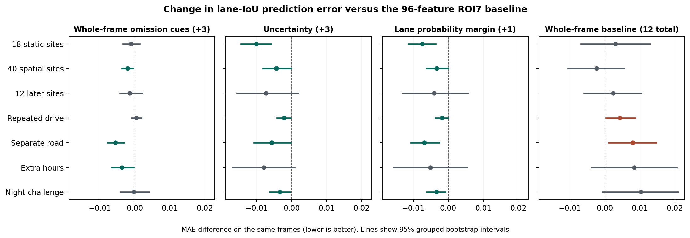

# 고정 ROI 7영역의 차선 IoU 예측과 실패 선별 실험

**다음 미사용 도로 평가에 고정할 구성은 ROI 7영역과 전체 화면 기본 96열에 전체 화면 불확실성 3개를 추가한 99열 RF다.** 97열 경량 후보는 전체 화면 차선 확률 차이 하나만 더하고도 사전 채택 기준을 통과했다. 7개 영역에서 어떤 장면이 위험한지 나타내는 입력을 만들고, 품질 모델이 프레임 전체 차선 IoU 하나를 예측한다. 차선 분할 모델은 고정했다.

14,331장의 원본을 재계산했다. 기본·확장·축소를 합쳐 RF 21개 피처 구성, 세 시드, 구역 교차검증과 전체 학습을 합쳐 RF 252회 및 고정 설정 GP 4회를 적합했다. 이후 추가 주행 6,970장은 이미 학습한 모델로만 채점했다. 이 자료는 14,331장에 포함된다.

[후보의 정확한 입력 순서와 모델 해시](../baselines/roi7_features_20261124/candidate.json) · [전체 비교 수치](../baselines/roi7_features_20261124/summary.json) · [재현 코드](../../scripts/experiments/roi7_features_20261124/)

## 어떤 특징을 계산했나

기본 96열은 **7개 ROI와 전체 화면, 총 8곳 × 같은 통계 12개**다. ROI는 상단 좌·우, 원거리 좌·우, 근거리 좌·우, 후드다. 전체 화면은 여덟 번째 통계 집계 범위다.

| 출처 | 통계 |
|---|---|
| RGB 8개 | 평균 밝기, 평균 색차(픽셀의 최대 채널값−최소 채널값), 밝기 표준편차, 다크 채널 중앙값, 평균 국소 대비, Sobel 선명도, 아주 밝은 픽셀 비율, 중앙값 필터 적용 전후 차이의 평균 |
| 인지 모델 출력 4개 | 주행 가능 영역 비율, 예측 차선 면적 비율, 흰색+노란색 차선 확률 평균, 4클래스 엔트로피 평균 |

**불확실성 3개는 전체 화면에서 한 번씩 계산한다.** 첫 번째는 엔트로피가 높은 상위 10% 픽셀의 평균이다. 두 번째는 32×32 픽셀 창을 16픽셀 간격으로 훑었을 때의 최대 평균 엔트로피다. 세 번째는 모델이 차선으로 분류한 픽셀마다 가장 높은 클래스 확률에서 두 번째로 높은 확률을 뺀 값의 평균이다. 차선 예측 픽셀이 없으면 0을 쓴다. 3개 모두 패딩을 제외한 640×360 출력에서 구한다. 기존 96열 안의 엔트로피 평균은 전반적인 모호함을, 이 3개는 특히 모호한 픽셀·국소 구간·차선 판정의 확신도를 나타낸다.

누락 후보 3개는 차선 픽셀이 2개 이상인 영상 행의 비율, 처음과 마지막 차선 검출 행 사이에서 가장 길게 빈 구간의 상대 길이, 최종적으로 차선 밖으로 분류됐지만 차선 확률 합이 0.20 이상인 픽셀 비율이다. ROI별 실험은 실제 도로를 보는 원거리·근거리 좌우 네 영역에 각각 같은 정의를 적용했다. 이 특징들은 정답을 몰라도 계산할 수 있는 **누락 단서**다.

## 주요 비교 결과

MAE는 예상 IoU와 실제 IoU의 차이 절댓값을 평균한 값으로 낮을수록 정확하다. 아래 수치는 RF 세 시드 평균이다. 주 진단 열은 5개 자료 묶음에 같은 가중치를 주었다.

| 입력 구성 | 열 수 | 학습 구역 3-fold MAE | 별도 개발 MAE | 주 진단 5묶음 MAE |
|---|---:|---:|---:|---:|
| 전체 화면 통계만 | 12 | 0.08528 | 0.04362 | 0.08399 |
| ROI7 기준 | 96 | 0.09740 | 0.04682 | 0.08176 |
| 기준 + 전체 화면 누락 3개 | 99 | 0.09757 | 0.04941 | 0.07969 |
| 기준 + 원거리·근거리 좌우 누락 12개 | 108 | 0.09465 | 0.05455 | 0.07870 |
| 기준 + 차선 확률 차이 1개 | 97 | 0.09068 | **0.04200** | 0.07689 |
| 기준 + 불확실성 3개 | 99 | 0.09050 | 0.04251 | 0.07532 |
| 기준 + 불확실성 3개 + 전체 화면 누락 3개 | 102 | 0.09089 | 0.04463 | **0.07408** |

전체 화면 12열은 개발과 CV에서 좋은 점수를 냈지만, 주 진단 평균이 기준보다 나빠졌고 한 묶음에서는 시드에 따라 최대 0.0121 악화됐다. RGB 단독 64열과 인지 출력 단독 32열의 개발 MAE는 각각 0.07484, 0.04956이었다. 전체 화면과 영역별 신호를 유지하는 데 근거가 있다.

### 어느 도로에서 차이가 났나

아래는 미리 정한 대표 시드 23411의 MAE다. 마지막 열은 **99열 불확실성 모델−96열** 차이의 95% 구간이다. 후속 12위치와 추가 시간에서는 평균 오차가 낮았지만 위치 묶음 간 변동이 커서 구간에 0이 포함됐다.

| 평가 자료 | 프레임 | 기준 96열 | 확률 차이 97열 | 불확실성 99열 | 99−96 차이의 95% 구간 |
|---|---:|---:|---:|---:|---:|
| 기존 18위치 | 864 | 0.08505 | 0.07753 | 0.07489 | [−0.01443, −0.00585] |
| 공간 진단 40위치 | 960 | 0.09297 | 0.08965 | 0.08865 | [−0.00818, −0.00001] |
| 후속 12위치 | 576 | 0.08957 | 0.08548 | 0.08227 | [−0.01563, +0.00198] |
| 반복주행 3회 | 1,448 | 0.07217 | 0.07033 | 0.06998 | [−0.00415, −0.00021] |
| 별도 도로 2회 | 273 | 0.06686 | 0.06001 | 0.06117 | [−0.01073, −0.00008] |
| 같은 12위치의 추가 시간 | 72 | 0.09403 | 0.08888 | 0.08606 | [−0.01697, +0.00084] |
| 야간 진단 | 288 | 0.09293 | 0.08957 | 0.08957 | [−0.00623, −0.00053] |

GP에서도 99열의 MAE가 96열보다 주 진단 다섯 묶음 모두에서 낮았다. 다만 GP를 이번 연구의 기본 모델로 다시 선정하는 실험은 수행하지 않았다. 반복주행 1,448장 중 649장, 야간 진단 288장 중 180장은 학습 위치에서 25m 이내였다. 기존 18위치·공간 40위치·후속 12위치·별도 도로에는 그 거리 내 프레임이 없었다.



### 실패 선별에서 얻은 것

- 주 진단 5묶음의 전체 순위에서 각 묶음 하위 10%를 고르면 96·97·99열 모두 **414개 검토 중 414개 실패**를 골랐다. 실제 실패는 총 2,806장이므로 이 예산에서 찾은 비율은 **14.75%**다. 검토한 프레임의 적중률과 모든 실패에 대한 재현율은 분모가 다르다.
- 같은 날씨·시간 조합 안에서 따로 검토하면 대표 시드의 96→99열 적중은 기존 18위치 **60→68/96**, 후속 12위치 **59→65/96**, 별도 도로 **23→25/30**이었다. 반복주행은 **148→147/151**이었다. 집단별로 예산을 배정하는 운영 방식에 따라 이득이 달랐다.
- 64프레임 창별 검토에서는 반복주행이 **149→151/159**, 별도 도로는 **29→29/30**이었다. 실제 IoU가 0.65 이상 0.75 미만인 경계 사례의 MAE는 반복주행에서 **0.0535→0.0442**였지만 기존 18위치에서는 **0.0710→0.0765**였다. 별도 도로 273장에는 이 범위의 프레임이 **3장**뿐이었다. 따라서 경보 임계값 주변의 개선 여부는 별개의 검증 문제로 남는다.

## 추가 주행에서 99열과 102열을 직접 비교한 결과

주 진단에서 102열의 평균 오차가 99열보다 0.00124 낮게 나와, 그 차이가 다른 주행에서 반복되는지 확인했다. 이 단계에는 그동안 후보 선정과 본 실험의 채점에서 제외한 기존 보관 주행 24회와 환경 전환 주행 2회를 모두 사용했다. 데이터나 모델을 추가 학습에 사용하지 않았다. 각 묶음의 MAE가 모든 시드에서 0.003 이상 더 낮아지고 전체·64장 창별 검토 적중 수가 유지될 때 102열을 택하기로 먼저 기록했다.

| 추가 주행 | 프레임 / 실제 실패 | 96열 MAE | 97열 MAE | 99열 MAE | 102열 MAE | 99→102열 창별 적중 / 예산 |
|---|---:|---:|---:|---:|---:|---:|
| 고정 조건 24회 | 6,002 / 3,694 | 0.07124 | 0.06639 | 0.06592 | 0.06530 | 555→557 / 648 |
| 환경 전환 2회 | 968 / 398 | 0.07697 | 0.06830 | 0.06702 | 0.06615 | 81→82 / 106 |

표는 대표 시드 23411이다. 세 시드의 MAE 차이(102−99)는 고정 조건에서 -0.00068~-0.00060였고, 환경 전환에서 -0.00114~-0.00087였다. 추가 3열은 사전에 정한 채택 기준을 충족하지 못했다. 따라서 다음 독립 도로에는 99열을 고정한다.

- 고정 조건에서 96→99열 전체 10% 검토는 601→601 / 601, 창별 검토는 529→555 / 648였다.
- 환경 전환에서 96→99열 전체 10% 검토는 96→97 / 97, 창별 검토는 78→81 / 106였다.

## 무결성 확인

- 학습·개발·보정·진단·추가 주행 전체 14,331장의 표본 ID와 디코딩한 RGB 해시에 중복이 없었다. 인접 프레임과 반복 촬영 위치는 포함한다.
- 앞 단계 29개 묶음에서 3장씩 총 87장을 뽑아 저장된 인지 맵에서 복원한 공식 96열과 대조했다. 단일 피처의 최대 절대 차이는 0.00000102였다. 공개된 7개 진단 묶음의 RF 기준 MAE와 이번 계산의 최대 차이는 0.00000355였다.
- 이전 전체 화면 실험과 겹치는 4,385장의 실제 IoU와 TP·FP·FN이 전부 일치했다. 같은 프레임에서 전체 화면 누락 3개도 최대 차이 0.000000024 이내로 일치했다. ROI 단위 테스트 5개가 통과했다.

## 재현과 판정 범위

비교의 기준은 저장소 커밋 `0436821`, `roi7-front-v1`, TwinLiteNet+ Medium v6 EMA epoch 11이다. 고정 RF는 트리 128개, 최소 잎 크기 8, 분할 시 열 비율 0.5를 사용했다. 세 시드는 23411·23412·23413이다. GP는 저장소의 Matérn 3/2 모델과 고정 설정으로 비교했다.

1. 원본 RGB·Semantic 해시와 디코딩한 RGB 해시를 대조한다. 7영역 마스크와 모델 가중치 해시를 검사한다. RGB와 인지 출력으로 특징을 만들고, Semantic은 전체 프레임의 흰색·노란색 차선 IoU 정답을 만드는 데 쓴다. 시간·날씨·위치도 모델 입력에서 제외한다.
2. 6개 학습 구역 1,728장에서 모델을 학습하고 구역 단위 3-fold로 검증한다. 2개 개발 구역 576장에서 추가·축소 후보를 고른다. 두 역할 사이 최소 거리는 30.1m이고, 내부 fold의 최소 거리는 40.3m다. 별도 576장 중 실제 정상 프레임에서 점수 하위 10%에 해당하는 경보 기준을 구한다.
3. 나머지 4,481장은 기존에 보관한 진단 자료다. 주 비교는 기존 18위치, 공간 진단 40위치, 후속 12위치, 반복주행 3회, 별도 도로 2회의 다섯 묶음에 같은 가중치를 준다. 같은 12위치의 추가 시간과 야간 진단은 보조 결과로 본다. 여러 시간대에 같은 위치를 다시 찍은 정지 장면과 같은 도로에서 연속 촬영한 주행 장면을 포함한다.
4. 추가 채택 조건은 개발 MAE와 내부 CV MAE가 모두 감소하고, 세 시드 각각에서 주 비교 다섯 묶음 평균 MAE가 0.003 이상 감소하고, 개별 묶음 악화가 0.003 이내이며, 합계 실패 선별 건수가 유지되거나 증가하는 것이다. 축소 후보는 개발·CV 기준선 오차 차이 0.002 이내에서 가장 적은 열을 우선해 고른 뒤 같은 개별 악화·선별 조건을 적용한다. 허용폭은 이번 비교를 위한 실험자 선택이다.
5. 선별은 예상 IoU 오름차순으로 검토한다. 각 자료에서 실제 IoU < 0.7을 실패로 정의한다. 기본 예산은 프레임의 10%를 올림한 수다. 5%·20%, 같은 날씨·시간 내 10%, 세션별 64프레임씩 끊은 창에서의 10%도 계산했다. 추정 오차 차이의 구간은 같은 위치 또는 50m 격자 단위로 2,000회 짝지어 재표집한 기술적 95% 구간이다. 여러 후보를 비교했고, 이 구간은 분석한 도로 안의 변동을 반영한다.
6. 두 번의 후보 선정 규칙, 전체 21개 구성의 개발 수치, 프레임 묶음별 성능과 해시는 함께 보존했다. 검토했던 데이터로 내린 로컬 연구 결론이며 최종 일반화 검증에는 미사용 도로가 필요하다.

저장소 루트의 WSL 환경에서 아래 순서로 실행한다. `CHECKPOINT`에는 해시가 일치하는 v6 가중치 경로를 지정한다.

```bash
export PYTHONPATH=src OPENBLAS_NUM_THREADS=1 OMP_NUM_THREADS=1 PYTHONDONTWRITEBYTECODE=1
scripts=scripts/experiments/roi7_features_20261124
out=outputs/roi7_reproduction
python3 "$scripts/extract.py" ../ML_data/ML "$CHECKPOINT" "$out"
python3 "$scripts/evaluate.py" develop "$out"
python3 "$scripts/followup.py" develop "$out"
python3 "$scripts/evaluate.py" diagnose "$out"
python3 "$scripts/followup.py" diagnose "$out"
python3 "$scripts/audit.py" ../ML_data/ML "$out" --previous outputs/feature_ablation_20261124
mkdir -p "$out/reserve"
sha256sum "$out"/{lock,followup_lock,results,followup_results}.json "$scripts/transfer_protocol.json" > "$out/reserve/frozen.sha256"
python3 "$scripts/extract.py" --reserve-motion ../ML_data/ML "$CHECKPOINT" "$out/reserve"
python3 "$scripts/transfer.py" ../ML_data/ML "$out"
python3 "$scripts/summarize.py" "$out" "$out/summary"
```

이전 전체 화면 실험 팩이 없는 환경에서는 감사 명령의 `--previous` 인자를 생략한다. 파일별 무결성 기록·모델·프레임별 기본 실험 예측은 로컬 `outputs/roi7_features_20261124/`에 있다.
