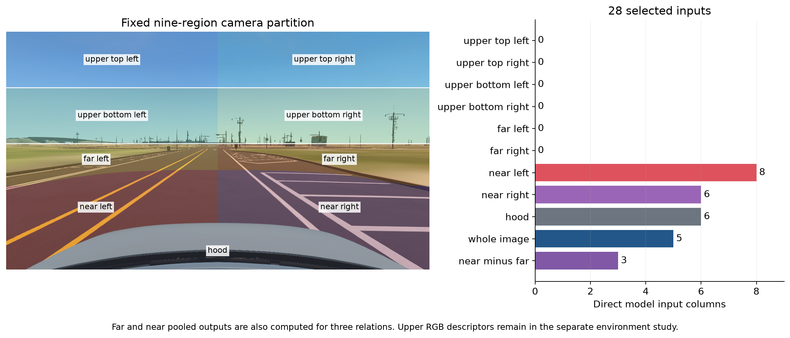
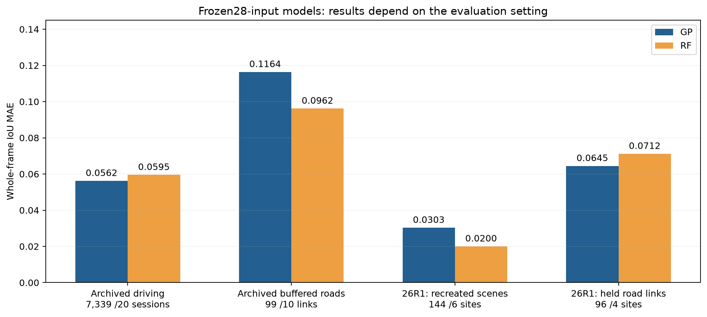
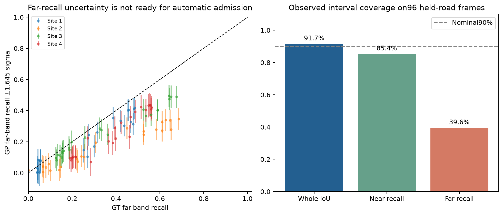

# 9영역 특징 선정·공간 GP와 26R1 전환 검증

2026년 11월 25–26일 실험이다. **9영역·공통 28열·GP를 27일 첫 결합 기준선으로 고정한다.** RF는 같은 입력의 대조군으로 유지한다. 새 26R1 도로에서는 GP가 더 좋았지만, 다른 보관 도로에서는 RF가 좋았다. GP의 원거리 예측구간이 충분히 보정되지 않아 공간 점수는 진단용이다. 최종 검수 정책·인지 재학습 채택·실시간 ROS 연결은 완료되지 않았다.

전체 표·그림은 [공개 근거 묶음](../baselines/roi9_gp_20261126/README.md), 실제 열·모델·보정 해시는 [v3 명세](../../config/region_feature_recipe_v3.json), 실행은 [ROI 가이드](../guides/ROI와_특징추출.md)를 따른다. 24일 27열 v2와 환경 특징 연구는 [당시 결과](ROI_9영역_특징선정_20261124.md)에 보존한다.

## 1. 고정한 것과 질문

- ROI는 `roi9-front-v1`이다. 1280×720 영상의 상부를 y=169에서 반반 나눈 두 층·원거리·근거리 각 좌우와 보닛으로 화면 전체를 배정한다. 원·근거리는 영상 띠이며 실제 거리나 의미론적 도로 마스크가 아니다.
- 인지모델은 **TwinLiteNet+ Medium v6 EMA**다. SHA-256은 `a26311b3af4e92880f632509eff3c81defc1b95135f5b463c7a08e5b6e23d24b`이며 실험 내내 바꾸지 않았다. 이번 CUDA 역전파 확인은 합성 입력의 호환성 검사이며 인지모델 재학습 실험이 아니다.
- 주 정답은 패딩을 제외한 **전체 화면 흰색·노란색 차선 합집합 IoU 하나**다. 온라인 ROI IoU 계산은 추가하지 않았다.
- 품질 입력에는 GT·날씨·시각·위치가 들어가지 않는다. 환경 라벨은 조건별 평가에만 연결한다. 환경 군집용 RGB54, 날씨 80·시각 160 히스토그램 성분은 v2의 별도 연구이며 이번 26R1 검증에서 재선정하지 않았다.

질문은 재호의 원본 확률 특징이 9영역에서도 유효한지, 근·원거리 관계가 도움이 되는지, GP 불확실성으로 전반 저하와 원거리 누락을 구별할 수 있는지, 새 GPU·시뮬레이터에서도 재현되는지다.

## 2. 자료 역할과 누수 통제

기존 79개 팩 **22,806장**을 RTX50 환경에서 다시 추론했다. 기존 진단·학습 자료 14,955장과 추가 보관 자료 7,851장(정지 512·주행 7,339)이다. 신규 26R1 336장을 더해 등록된 팩은 **82개·23,142장**이다. 이는 새로 수집한 장수나 독립 표본 수가 아니다. 파일·ID·픽셀 중복 집계는 [자료 inventory](../baselines/roi9_gp_20261126/data_inventory.json)에 있다.

| 역할 | 수와 사용 범위 |
|---|---|
| 1차 특징 비교 학습 | 기존 6지리구역 1,728장. 개발 576장, 별도 보정 576장 유지 |
| 확대 품질 학습 | 입력 조건으로 먼저 고른 2,496장 중 근거리 GT가 없어 세 정답을 만들 수 없는 16장 제외, **RF·GP 공통 2,480장** |
| 확대 학습 구성 | 기존 1,152 + 이미 진단한 추가 624 + 보관 주행 720에서 시작. 예전에 평가한 624장은 이번 모델의 학습분이며 새 평가로 재사용하지 않음 |
| 보관 반복주행 평가 | 20세션 7,339장. 반복 경로이므로 새 지도 일반화 검증이 아님 |
| 보관 별도 링크 진단 | 10링크 99장. 접근 가능한 이전 위치와 링크 간격을 적용한 보관 진단군이며 새 지도 아님 |
| 26R1 설정 전이 | 6기존 학습 위치 × 6날씨 × 4시각 = **144장**. 이전 품질 학습 장면을 재생성한 설정 전이군 |
| 26R1 보정 | 별도 4자세 × 6날씨 × 4시각 = **96장**. 모델 가중치 고정 후 구간 보정에만 사용 |
| 26R1 품질 학습 미사용 링크 | 4링크 × 6날씨 × 4시각 = **96장**. 보정과 모델을 고정한 다음 촬영·채점 |

확대 학습은 위치 6군집을 3fold로 묶고 25m embargo를 적용했다. 실제 fold 최소 거리는 26.0m 이상이다. 표준화·상수 열 제거는 학습 fold에서만 적합했다. 다만 앞선 연구에서 고른 24열을 출발점으로 개발 자료까지 보고 특징을 축소했으므로 **특징 선택까지 완전히 중첩된 CV 결과는 아니다**.

새 링크는 확대 학습 후보 좌표에서 최소 254.3m, 전체 링크에서 최소 205.0m 떨어진 곳을 GT 없이 선정했다. 모든 과거 진단 좌표에서 떨어진 링크는 확보하지 못해, 촬영 전에 기준을 **동결된 품질 학습 자료에서 떨어진 링크**로 수정하고 실패한 최초 계획도 보존했다. 같은 물리 지도와 과거 맥락을 사용하므로 처음 보는 지도·전혀 미탐색 도로라고 부르지 않는다. 인지모델 f0의 과거 노출과 품질 회귀의 학습 노출도 다른 개념이다.

## 3. 특징 실험과 최종 28열

RGB 180·출력 80·관계 88·원본 확률 3·형태 21의 **372개 후보 열**을 원본에서 계산했다. 모든 조합 sweep 대신 출력 전용·RGB 전용·기존 결합·거리 관계·형태 추가·전 영역 확대 등 의도별 9구성과 RF·GP를 비교하고, 유망한 작은 구성에서 묶음 제거를 진행했다. 원본 확률 요약은 재호의 상위 엔트로피·최대 패치 엔트로피·차선 마진이다. 형태 후보는 예측 행 점유, 내부 간격, 도로 밖 예측 등이다.

| 구성 | GP 그룹 CV 전체 IoU MAE | 개발 MAE | 해석 |
|---|---:|---:|---|
| 이전 27열 | 0.07516 | 0.04086 | 원본 확률 3개를 모두 포함 |
| 거리 관계 포함 32열 | 0.07326 | 0.04199 | 원거리 누락 보조 예측도 확인 |
| 형태 포함 33열 | 0.07841 | 0.04654 | 원거리 보조 정답은 일부 좋아졌지만 주 IoU 악화 |
| **선정 28열** | **0.07374** | **0.03969** | 원본 확률은 상위 엔트로피 하나만 유지, 거리 관계 3개 추가 |

위 표는 1,728장 단계의 특징 비교다. 최종 2,480장 모델의 독립 성적과 섞지 않는다. 123·263열 확대와 특징군 균등 가중이 주 IoU를 안정적으로 개선하지 못했다. 형태 특징을 무의미하다고 결론내리지는 않는다. 원거리 보조 예측만을 위한 후보로 남긴다. [후보 비교](../baselines/roi9_gp_20261126/feature_screen.json) · [축소 단계](../baselines/roi9_gp_20261126/feature_pruning.json)

| 최종 묶음 | 실제 열 |
|---|---|
| RGB 10 | 근거리 좌 `chroma`, `blue_minus_red`, `edge_density`; 근거리 우 `median_residual`; 보닛 `intensity`, `dark_channel`, `dark_fraction`, `intensity_median`, `blue_minus_red`, `edge_density` |
| 출력 14 | 근거리 좌우 각각 `drivable_fraction`, `lane_fraction`, `lane_probability`, `lane_weighted_entropy`, `lane_weighted_probability`; 전체 화면의 마지막 네 차선 통계 |
| 원본 확률 1 | 전체 화면 `top_entropy`: 패딩을 제외한 마킹 엔트로피 상위 10% 평균 |
| 관계 3 | `near_minus_far.lane_fraction`, `lane_probability`, `lane_drivable_disagreement` |

9영역 중 일부에 직접 입력 열이 없어도 된다. 원거리는 관계 계산, 상부는 전체 화면 확률 통계에 기여한다. 직접 입력을 뺐다는 것은 해당 픽셀을 전부 무시한다는 뜻이 아니다. 분위수·가중 통계는 합쳐진 원본 픽셀에서 계산하고 ROI 통계의 단순 평균으로 대체하지 않았다.

## 4. GP를 적용한 방식

품질 GP의 정답 벡터는 `z=(Q, R_near, R_far)`다. Q만 주 출력이며 나머지는 오프라인 GT로 학습한 누락 진단 보조 정답이다. `R=TP/(TP+FN)`이므로 오검출을 평가하지 않는다. 근거리 recall이 높다고 근거리 precision이나 전체 인지 품질까지 좋다는 뜻은 아니다. 두 띠의 GT 차선이 각각 50픽셀 이상일 때만 공간 유형을 집계했다.

표준화 공간에서 `Cov(f(x),f(x′)) = k_Matern3/2(x,x′) B`, `B=(1−ρ)I+ρ Corr_train(z)`를 사용했다. Kronecker 고유분해로 정확 추론한다. B는 학습 정답 상관의 축소 추정이며 자유로운 모든 B 원소를 주변우도로 학습한 논문의 완전 재현은 아니다. 최종 길이 배수 2.8·잡음 분산 0.05·ρ=0.4다. 동일 입력·가중치 조건의 ρ=0과 특징군 가중·가산 커널을 대조했다.

`D=R_near−R_far`, `Var(D)=Σ_nn+Σ_ff−2Σ_nf`로 원·근거리 대비의 불확실성을 계산한다. GT 없이 전체 저품질 확률 `P(Q<0.7)`와 근거리 유지·원거리 약화의 결합 확률을 반환한다. 후자는 `Q≥0.7, R_near≥0.8, R_far<0.5`인 진단 사건도 별도로 제공한다. 숫자 기준은 실험 정의이며 운행 실패 판정 기준으로 확정하지 않았다.

관측 σ에는 GP 잡음이 포함되고 잠재함수 σ는 별도다. 보정 자료의 중앙 잔차로 평균을, 표준화 절대 잔차의 90% 분위수로 구간 폭을 조정하며 `DΣD`로 공분산의 양의 준정부호를 유지한다. 이는 경험적 Gaussian 모멘트 보정으로, 분포 이동에서 포함률을 보장하지 않는다. 0~1 밖 Gaussian 질량도 있는 근사다. 점 MAE의 기본값은 **원시 GP 평균을 [0,1]로 제한한 값**이며 보정된 평균과 위험 점수는 따로 저장한다.

확률·분위수·다변량 CDF, 조밀한 Kronecker 해와의 대조, 공분산·대비, 저장·재로딩을 수치 검증했다. 이론 출처는 [GPML](https://gaussianprocess.org/gpml/chapters/RW2.pdf), [다과제 GP](https://proceedings.neurips.cc/paper_files/paper/2007/file/66368270ffd51418ec58bd793f2d9b1b-Paper.pdf)다.

## 5. RF와 GP의 성적과 불확실성 가설

RF·GP는 같은 28열과 같은 2,480장을 학습했다. 확대 학습에서는 GP36설정(등방18·특징군 균등18), RF12설정을 탐색했다. 이 단계는 튜닝 횟수를 맞춘 대조가 아니다. 보관 평가군은 확대 학습 전에 이미 점수를 확인한 후속 진단 자료이므로 이번 확대 모델의 독립 검증이라고 부르지 않는다. 아래는 원시 평균의 전체 IoU MAE다.

| 평가군 | 장수 / 독립 단위 | GP | RF |
|---|---|---:|---:|
| 보관 반복주행 | 7,339 / 20세션 | **0.05622** | 0.05953 |
| 보관 별도 링크 진단 | 99 / 10링크 | 0.11639 | **0.09618** |
| 26R1 기존 학습 장면 재생성 | 144 / 6위치 | 0.03031 | **0.02002** |
| 26R1 품질 학습 미사용 링크 | 96 / 4링크 | **0.06445** | 0.07117 |

반복주행의 GP는 기존 1,728장 학습 모델 0.06273에서 0.05622로 개선됐다. GP−RF의 세션 매크로 MAE 차이는 −0.00335, 세션 bootstrap 95% 구간은 [−0.00534, −0.00133]이다. 반복 경로 20세션의 결과로 새로운 지도의 우위를 주장하지 않는다. 4링크 결과는 독립 단위가 작고 도로마다 순위가 달라 **최종 채택을 보장하는 결과가 아니다**. [군집별 짝 차이](../baselines/roi9_gp_20261126/paired_group_differences.json)

GT 날씨·시각을 알고 그 조건의 학습 IoU 중앙값만 반환하는 강한 조건 대조군도 주행 MAE 0.12419였다. 조건 안에서 GP 순위가 유효한지를 추가 집계했다. 이는 단순 날씨 라벨 예측보다 많은 정보를 사용한다는 근거지만, 완전한 조건 독립성이나 인과적 설명은 아니다. [조건 통제](../baselines/roi9_gp_20261126/condition_control.json)

**“큰 σ는 전반 저하, 작은 σ는 원거리만 저하” 가설은 채택하지 않는다.** 원거리 약화 중 `−σ_Q`로 근거리 유지 사례를 구분한 AUC는 보관 주행 0.573, 26R1 재생성 0.280, 미사용 링크 0.411이다. 방향이 일관되지 않았다. 반면 근거리 예측 평균은 각각 약 0.970·0.987·0.997의 AUC로 두 유형을 구별했다. 주행의 정확한 AUC는 [방향을 명시한 가설 검증](../baselines/roi9_gp_20261126/sigma_hypothesis.json)을 따른다. σ는 인지 실패 위치의 정답이 아니라 품질 회귀의 불확실성이다.

26R1 미사용 링크에서 90% 구간 포함률은 새 보정 후 **Q 91.7%, 근거리 recall 85.4%, 원거리 recall 39.6%**였다. 원거리 예측이 과신 상태다. 결합 확률의 Brier는 공분산 사용 0.23160, 같은 주변분포의 대각 공분산 0.23222로 차이가 작다. 원거리 평균의 순위가 좋다는 것과 확률이 보정됐다는 것을 구분한다. 원거리 점수로 자동 제외·재학습 승인하지 않는다.

사후 정답 분포를 확인하니 학습2,480장 중 원거리 recall≥0.5는113장(4.6%), 새 보정96장에는0장, 새 평가96장에는25장이었다. 마지막25장의 보정 후 평균 예측은0.382, 실제 평균은0.589,90%구간 포함률은0%였다. 이 불균형은 보정 실패의 원인 후보이며 인과관계를 입증한 것은 아니다. 원거리 GT 픽셀 수와 절대오차의 순위상관은−0.020으로, 단순한 GT 희소성만으로 설명하기도 어렵다. [정답 지원 사후 진단](../baselines/roi9_gp_20261126/spatial_target_support.json)과 [분포 그림](../baselines/roi9_gp_20261126/13_far_target_support.png)을 보존했다. 이 분석에서는 모델·보정·정책을 바꾸지 않았다.

## 6. BO·조건부 선별과 현재 파이프라인

BO는 온라인 프레임 채점에 넣지 않았다. 630개 가산 커널 설정 공간에서 같은 초기 6관측·총 18회·같은 그룹 CV 목적함수로 expected-improvement BO와 무작위를 비교했다. 둘 다 초기 설정이 최선이었고 가산 커널은 동결한 기본 GP보다 개발 IoU가 나빴다. 이번 예산에서 BO의 이득은 확인하지 못했다. 가산 커널과 BO의 방법 출처는 [Duvenaud 등](https://proceedings.neurips.cc/paper_files/paper/2011/file/4c5bde74a8f110656874902f07378009-Paper.pdf), [Snoek 등](https://proceedings.neurips.cc/paper_files/paper/2012/file/05311655a15b75fab86956663e1819cd-Paper.pdf)이며 코드와 목적함수는 프로젝트 구현이다. [탐색 기록](../baselines/roi9_gp_20261126/additive_bo_random.json)

보관 주행 7,339장을 64프레임 창으로 나누고 창마다 10%를 올림해 **실제 예산 805장(10.97%)**으로 비교했다. 전체 풀에서 정확히 10%를 고른 실험이 아니다.

| 정책 | IoU<0.7 발견 | Q≥0.7·근거리 recall 유지·원거리 약화 진단 |
|---|---:|---:|
| GP 낮은 평균 | 638 | 151 |
| GP 저품질 확률 | 640 | 151 |
| RF 낮은 평균 | 620 | 149 |
| GP 두 목적 확률 | 532 | 256 |
| GP 두 목적·조건부 분산 갱신 | 482 | 305 |

두 목적 정책은 예산 70% 올림을 전체 저품질, 나머지를 공간 진단에 배분했다. 조건부 정책은 후보를 고를 때 Schur complement로 남은 분산을 갱신한다. 라벨을 받기 전에 가짜 평균 갱신을 하지 않는다. 공간 진단을 더 찾는 대신 전체 저품질 발견은 줄어드는 절충이다. 원거리 약화를 운행 실패로 세어 합친 precision을 주 성과로 쓰지 않는다. 무작위·고유 위치·분모는 [전체 정책 표](../baselines/roi9_gp_20261126/review_tradeoff.json)에 있다.

이미 진단한 624장 중 192장을 조건부 분산으로 고른 품질 정답 취득도 재생했다. 작은 개선이 있었지만 이미 열어본 풀의 후향 실험이며 신규 온라인 active learning 성과가 아니다. [정답 취득 대조](../baselines/roi9_gp_20261126/label_acquisition.json)

구현은 `infer_spatial_images` → `review_spatial` → `join_spatial_gt`다. GT 자료 루트를 제공하지 않은 새 26R1 RGB144 재생 환경에서 추론·후보 선택을 먼저 마치고 GT를 나중에 연결했다. 기능 인수에서는 세션당 작은 예산이 두 목적을 모두 포함하도록 20%를 써 각 정책 30장을 연결했다. 이 30장 기능 검사는 위 805장 과학 비교와 다르다. 원본·모델·열·마스크·GT 팩 해시를 대조하며 **후보와 GT 연결 결과 모두 `admission_approved=false`**다.

## 7. RTX40/50과 26R1 인수 범위

- 5070Ti(sm_120)에서 이전 Torch 2.1.2/cu118 GPU 커널은 실행되지 않았다. 별도 **rtx50: Torch 2.7.1/cu128**, **rtx40: Torch 2.1.2/cu118** 이미지를 만들고 자동·명시 프로파일을 유지한다. rtx40의 CPU 의존성·모델 로딩은 검사했지만 실제 40 GPU는 이번 환경에 없었다.
- 5070Ti의 실제 v6 순전파와 합성 입력 역전파·optimizer를 통과했고 체크포인트는 바뀌지 않았다. 기존 14,955장의 인지 IoU 최대 차이는 0.0005115, 0.7 판정 전환은 0건이었다. 동일 품질 가중치에 옛/새 특징을 넣었을 때 GP 점수 최대 차이는 0.0005312, 0.7 전환은 0건이었다.
- RGB24의 rtx40 CPU·rtx50 GPU 전체 재생 최대 특징 차이는 1.86e−8, 점수 차이는 1.93e−7이다. 동일 144개 X의 GP 추론 차이는 7.3e−13 이하다. 이는 GPU 하드웨어 간 직접 비교가 아니다. warm 배치 시간만으로 온라인 FPS를 주장하지 않는다. [런타임 근거](../baselines/roi9_gp_20261126/runtime_verification.json)
- 현재 시뮬레이터는 실행 파일·화면에서 **26.R1.H3**를 확인했다. 이전 자료의 `25.S4.MolitComp03` 출처는 사용자 진술이며 과거 실행 파일을 재검증하지 않았다. 신규 336장에 버전을 기록했다. 현재 화면의 렌더링 품질LOW·30FPS를 확인했고 이전 자료의 렌더링 설정은 재검증하지 못했다. 재생성144장은 같은 위치/날씨/시각의 설정 전이 확인이며 버전만의 인과 효과를 분리한 실험이 아니다.
- gRPC 저장 요청이 타임아웃되어도 파일은 생성되는 현상을 관측했다. 정지 수집에서만 고유 파일명·완전한 4채널·안정된 파일 크기·해시·이미지 디코딩·촬영 전후 자세/날씨/시각/Park/저속 확인을 통과한 자료를 등록했다. 실패·고아 파일은 남기고 등록에서 제외했다. 실시간 동기 수집이 해결됐다는 뜻은 아니다. 수집 후 원래 위치·Sunny13·Keyboard/Park 상태로 복원했다.
- UDP 프로파일은 26R1 **payload27/전체59바이트**, 이전 **23/55**다. MoraiCmdController771과 JSON `egoCtrlMode=3`을 UDP `control_mode=2`와 구분한다. 내부 `CtrlCmd.steering` rad→정규화 변환 후 26R1에서 한 번 부호 반전한다. [설정과 미검증 항목](../../config/morai/README.md)
- 실제 ROS 메시지·휠 필드·저속 좌우 회전·피드백 부호는 아직 인수하지 않았다. 자동 주행 제어를 검증한 것으로 보고하지 않는다. 수집용 ROS 컨테이너와 새 인지 GPU 이미지는 별개다.

## 8. 다음 판정까지 남은 일

1. **27일:** 28열·동결 GP·26R1 보정 번들로 팀원 재생을 맞춘다. 재호는 원본/GT/누락 사례를, 원태는 보조 정답 정의·공분산·원거리 보정 실패를 검토한다.
2. **원거리 정상·저하 구분:** 별도 정상 위치/가시성 자료와 원거리 보조 특징을 확보하고 타깃별 커널·이분산/변환·보정을 제한된 후보로 비교한다. 이미 채점한 96장은 이후 개발 자료다. 새 독립 확인 자료가 필요하다.
3. **검수 정책:** .7 공통 벤치마크와 환경 내 정상 기준을 구분한다. 어둡거나 먼 곳의 낮은 IoU를 전부 실패로 선언하지도, 환경 기준을 낮춰 실제 근거리 오류를 숨기지도 않는다. 군집·σ·BO는 같은 예산·정상 오경보·누락·고유 위치를 함께 검증한다.
4. **30일:** 오프라인 검수 → 사후 GT → 충분한 선별 학습량/기존 replay의 인지 재학습 → 기존·신규 성능 유지 → 새 인지모델에 맞춘 X/y·품질모델·보정 재적합을 마쳐 채택/보류한다. 오늘 GP 실험을 새 인지모델 개선으로 표현하지 않는다.
5. **그 다음:** 채택된 버전만 26R1 ROS 수신·온라인 추론·큐 저장에 연결한다. 40/50 각각 가능한 환경에서 검증하고 12월 4일까지 수치·영상·영어 8분 발표·공개 사이트를 완성한다.

원본·상세 로그·학습 구성원·동결 번들은 실험 볼륨에서 보관한다. Git에는 공개 집계·특징 명세·재현 코드·그림만 둔다. [데이터 등록](../guides/데이터_등록과_특징정답.md) · [일정과 담당](../guides/일정과_역할.md)
