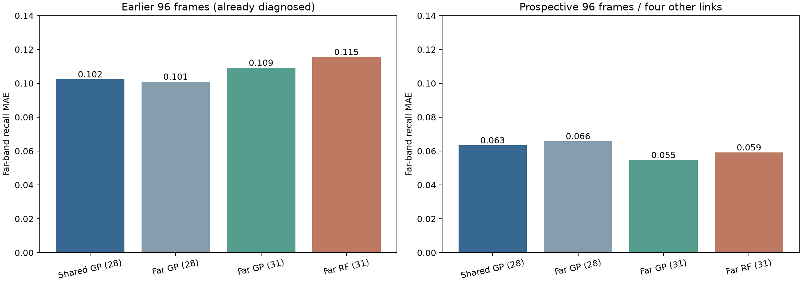
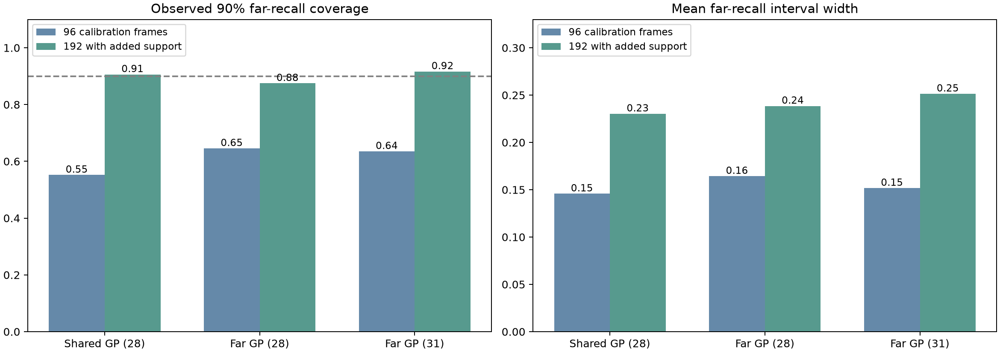
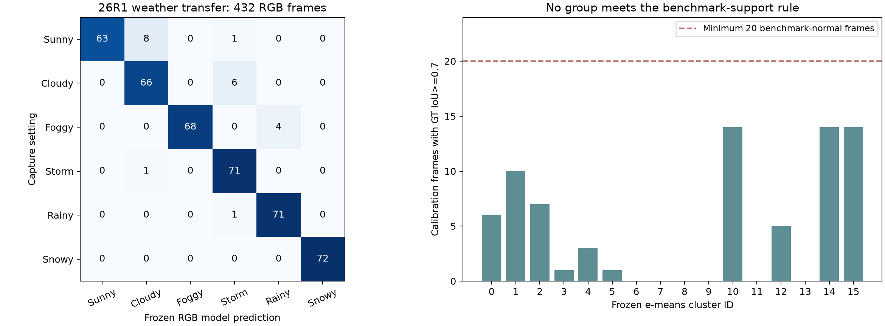

# 원거리 보조 GP·보정 지원·환경 표현의 26R1 후속 검증

**전체 IoU를 추정하는 9영역·28열 GP는 그대로 유지한다.** 후속 실험에서는 원거리 recall 전용 31열 GP와 보정 자료 보강을 시험했다. 새 4개 링크에서는 전용 GP의 오차가 줄었지만, 앞서 진단한 도로에서는 악화됐다. 구간 포함률을 높이는 것과 결합 확률을 정확하게 만드는 것도 달랐다. 전용 GP는 추가 진단 후보이며 자동 검수·학습 승인용으로 채택하지 않는다.

[앞선 28열 기준선](ROI9_GP와_26R1_검증_20261126.md)을 만든 뒤 진행한 별도 단위다. 공개 근거는 [후속 묶음](../baselines/roi9_gp_20261126/followup/README.md), 구현은 [실험 스크립트](../../scripts/experiments/roi9_gp_20261125/README.md)에 있다. 인지모델 f0는 Medium v6 EMA로 고정했고 새로 재학습하지 않았다.

## 1. 질문과 자료를 먼저 구분했다

첫 실험의 보정 96장에는 원거리 recall≥0.5인 사례가 없었지만 평가 96장에는 25장이 있었다. 이 자료를 이미 확인했으므로 새 방법의 독립 평가로 다시 쓰지 않았다.

1. **원거리만을 위한 입력·학습 목적**을 분리한다. 전체 IoU에 좋은 특징이 원거리 누락 추정에도 최선인지는 별도 문제다.
2. 기존 보정 위치 중 원거리 recall이 높았던 지리 구간을 골라 26R1에서 **96장을 추가 보정용으로 수집**한다. 이전 보정 GT를 이용한 의도적 보강이며 배치 환경의 대표 표본이나 포함률 보장이 아니다.
3. 모델과 192장 보정값을 고정한 뒤, 이전 평가·보정 위치와 50m 이상 떨어진 다른 **4개 링크·96장**을 촬영·평가한다. 품질 학습 위치와의 최소 점 이격은 180.2m, 전체 링크 이격은 158.1m였다. 같은 지도이며 새로운 지도 일반화 실험은 아니다.

모델·특징은 17:19 UTC, 보정은 17:29:53 UTC에 동결했고 새 평가 촬영은 그 뒤 시작됐다. 실패한 수집·응답과 재개 과정도 남겼다. [동결·촬영 영수증](../baselines/roi9_gp_20261126/followup/collection_and_lock.json)

후속 수집은 보정96+평가96=192장이다. 1차336장과 합친 신규 26R1 자료는 **528장**, 기존 자료까지 등록한 합계는 **23,334장·84팩**이다. 6날씨×[05·08·13·20시]를 유지하고 RGB·Semantic·Depth·Instance 전방 원본과 상태·해시를 보존했다.

## 2. 원거리 전용 특징과 GP/RF

전체 품질 GP와 같은 2,480장을 사용했다. 3지리fold·25m embargo를 그대로 유지하고, 각 특징 구성에서 GP12·RF12설정을 같은 원거리 recall MAE로 비교했다. 새 평가나 보정 성적으로 특징을 고르지 않았다.

| 원거리 입력 후보 | GP CV MAE | RF CV MAE | GP 개발 MAE |
|---|---:|---:|---:|
| 기존 품질28열을 그대로 사용 | 0.06745 | 0.08044 | 0.03484 |
| 품질28+근/원 형태6 =34열 | 0.06031 | 0.06205 | 0.04252 |
| **원거리 출력으로 교체+형태3 =31열** | **0.05175** | **0.05775** | 0.03932 |

선정은 학습 CV로 했다. 개발 도로에서는 28열 전용 GP가 더 좋았으므로 특징 효과가 도로에 따라 달라짐을 함께 기록한다. [동일 예산 후보 비교](../baselines/roi9_gp_20261126/followup/far_feature_comparison.json)

31열은 RGB10·전체 출력4·원본 상위 엔트로피1·근−원거리 관계3을 유지하고, 근거리 출력10을 **원거리 좌우 출력10**으로 바꾼다. 여기에 원거리 전체의 `row_coverage`, `internal_gap`, `soft_outside`를 추가한다. 마지막 항목은 **argmax 차선 마스크 밖에서 흰색+노란색 확률이 0.2 이상인 픽셀 비율**이며 도로 밖 차선 비율이 아니다. 형태 통계는 실패 판정 규칙이 아니라 학습 입력이다.

주 품질28열과 보조31열을 함께 계산하면 중복을 제외한 입력은 **41종**이다. ROI는 9영역 그대로이며 전체 IoU용 입력을 41열로 변경한 것이 아니다. [선정 열·해시](../baselines/roi9_gp_20261126/followup/far_frozen_models.json)

## 3. 서로 다른 입력의 GP를 결합한 가정

원래 GP는 동일한 28열 커널과 과제 공분산으로 전체 IoU·근거리 recall·원거리 recall을 추정한다. 후속 전용 GP는 31열의 다른 커널 공간에서 원거리 recall만 추정한다.

비교용 합성 분포는 원래 GP의 Q/근거리 주변분포를 유지하고 원거리 주변분포만 교체했다. 두 블록 사이 공분산은 0으로 둔다. 이는 **별도 GP 사이의 독립 가정**이며 원래 GP가 학습한 근/원거리 상관을 보존한 방법은 아니다. 새 원거리 분산에 옛 교차 공분산을 그대로 붙이면 양의 준정부호가 깨질 수 있어 사용하지 않았다. [구현과 검증](../../src/quality_estimation/spatial_composition.py)

주 정답은 전체 IoU 하나, 보조 정답은 오프라인 GT의 영상 띠 recall이다. 실행 중 GT나 ROI IoU를 계산하는 방식은 아니다. 원거리 recall은 정밀도·오검출을 평가하지 않는다.

## 4. 새 4개 링크에서 확인한 결과

| 원거리 추정기 | 이전96장: 이미 진단함 | 새96장: 동결 뒤 촬영 |
|---|---:|---:|
| 원래 3과제 GP의 원거리 출력 | 0.10231 | 0.06332 |
| 원거리 전용 GP28 | 0.10091 | 0.06575 |
| **원거리 전용 GP31** | 0.10914 | **0.05464** |
| 원거리 전용 RF31 | 0.11548 | 0.05912 |

숫자는 **원거리 recall MAE**이며 전체 IoU MAE가 아니다. 새 4개 링크 모두에서 GP31이 RF31보다 좋았지만, 기존 GP 원거리 출력과 비교하면 2곳에서 좋아지고 2곳에서 나빠졌다. GP31−기존 GP의 위치 매크로 차이는 −0.00868이고 bootstrap95% 구간은 [−0.02823, 0.01088]이다. 작은 4곳의 결과로 전반적 우위를 주장하지 않는다. [위치별 짝 차이](../baselines/roi9_gp_20261126/followup/paired_far_effects.json)

같은 새 자료의 **전체 IoU**는 기존28열 GP0.07781·실제 품질 RF0.07818로 비슷했다. 원거리 RF31은 전체 IoU용 RF와 다른 모델이다. [주 품질 대조](../baselines/roi9_gp_20261126/followup/primary_quality_control.json)

## 5. 보정 자료를 늘린 효과와 남은 문제

보정 자료의 원거리 recall≥0.5 사례를 0장에서 15장으로 보강했다. 같은 GP31의 새 평가 결과는 다음과 같다.

| 보정 | 명목90% 구간 포함률 | 평균 구간 폭 | 정상Q·근거리 유지·원거리 약화 사건 Brier |
|---|---:|---:|---:|
| 원래96장 | 63.5% | 0.1518 | 0.12153 |
| 보강한192장 | **91.7%** | **0.2514** | 0.12914 |

포함률은 좋아졌지만 구간이 넓어졌고 결합 사건 확률은 나빠졌다. 원래 3과제 GP도 보정 보강 후 원거리 포함률이 55.2%→90.6%로 좋아졌다. 따라서 포함률 이득을 전용31열 GP만의 효과라고 설명하지 않는다. 기존96장 진단군에서는 보강 후에도 포함률이 원래 GP70.8%·GP31 68.8%에 머물렀다.

**주변 구간의 포함률, 점 오차, 결합 확률, 같은 예산의 데이터 선별은 서로 다른 평가 항목**이다. 원거리 GP31의 σ와 절대오차 순위상관도 새 자료에서 약0.13으로 약했다. 큰 σ를 인지 실패 위치의 정답으로 해석하지 않는다. [새 성적](../baselines/roi9_gp_20261126/followup/prospective_far_metrics.json) · [이전 진단군](../baselines/roi9_gp_20261126/followup/previous96_diagnostics.json)

## 6. 환경 특징·e-means의 26R1 전이

v2의 날씨80·시각160 히스토그램 RF와 상부 위층 좌우/보닛 RGB54 e-means를 **재학습하지 않고** 26R1 RGB432장에 적용했다. 환경 입력에는 Semantic·IoU·인지모델 출력이 필요 없다. 날씨·시각은 사후 평가 라벨이다.

- 날씨 정확도 **95.1%**, 지정 시각 정확도 **80.6%**였다. 시각을 `<6시 또는 ≥18시`와 그 밖으로 나눈 시계 기준 대조는99.8%였다. 이 대조는 가시성·운행 정상성의 정답이 아니다.
- e-means16개 중15개에 배정됐고 최대 군집 비율은12.0%였다. 실제 날씨/시각과의 NMI는0.543/0.455였다. 군집이 정확한 날씨 라벨인 것은 아니다.
- 보정192장을 군집별로 나누면 기존의 **IoU≥0.7 샘플20장·2위치 이상** 조건을 만족한 군집은 **0개**였다. 따라서 환경별 임계값을 채택하지 않고 공통 기준으로 되돌려야 한다. IoU≥0.7을 운행 정상으로 확정하는 것도 아니다.

태그를 만들 수 있다는 사실이 환경별 검수 정책의 이득을 증명하지는 않는다. 충분한 위치별 정상 지원과 가시성/근거리 오류 정의가 먼저다. [환경 전이](../baselines/roi9_gp_20261126/followup/environment_transfer.json) · [군집별 지원](../baselines/roi9_gp_20261126/followup/environment_support.json)

이전 RF joblib은 NumPy2.5.5·scikit-learn1.9.1 환경에서 적합한 파일이었다. legacy40 환경의 NumPy1.24·scikit-learn1.3에서는 로딩되지 않았다. 이번 전이는 적합 환경과 맞춘 CPU 환경에서 수행했다. 이후 학습된 트리를 바꾸지 않고 [RF 호환 NPZ](../baselines/roi9_gp_20261126/portable/README.md)를 만들었고, 40·50 환경에서 품질96장·환경432장의 예측/확률 차이0을 확인했다. 환경 표현의 이식성을 검증한 것이며 정책 이득을 추가 입증한 것은 아니다.

## 7. 수집 안정성과 다음 작업

26R1에서 저장 요청 타임아웃 후 파일만 생성되다가 일부 구간에서 다른 RPC도 응답하지 않았다. 시뮬레이터를 종료하지 않고 gRPC 서비스만 같은 포트로 재연결해 회복했다. 원인이나 실시간 해결책을 확정하지 않는다. 승인된 프레임만 재개 대상에서 제외하고 실패·고아 파일은 보존했다. [남은 계획 생성기](../../scripts/experiments/roi9_gp_20261125/remaining_capture.py)는 중복ID·버전·누락 채널을 검사하고 작은 묶음으로 나눌 수 있다.

추가192장 수집 후 원래 위치·Sunny13·Keyboard/Park를 다시 복원·검증했다. 실제 UDP 조향이나 26R1 native ROS의 휠 필드를 인수한 실험은 아니다.

27일 첫 결합에서는 **주 품질28열 GP를 유지**하고, 전용 원거리31열은 선택 가능한 진단 후보로 검토한다. 원태는 결합 확률 보정·동일 예산 검수·환경군 정상 지원을 검토하고 재호는 형태 정의·사례·입력 비용을 확인한다. 인지모델 갱신 뒤 버전 쌍과 재학습 성능 유지까지 오프라인에서 완성한 다음 온라인으로 간다. 30일 채택 판단·12월4일 최종 수치/영상/영어 페이지 일정은 유지한다.
