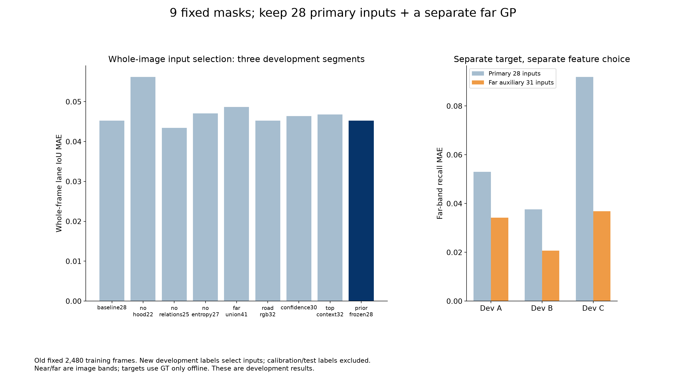
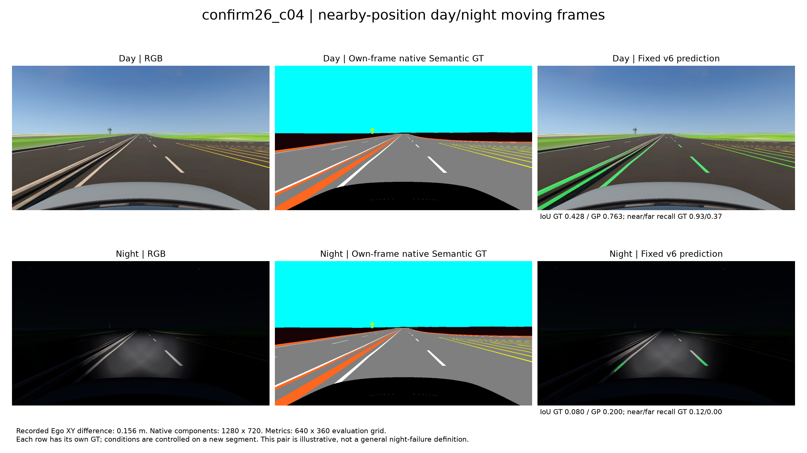
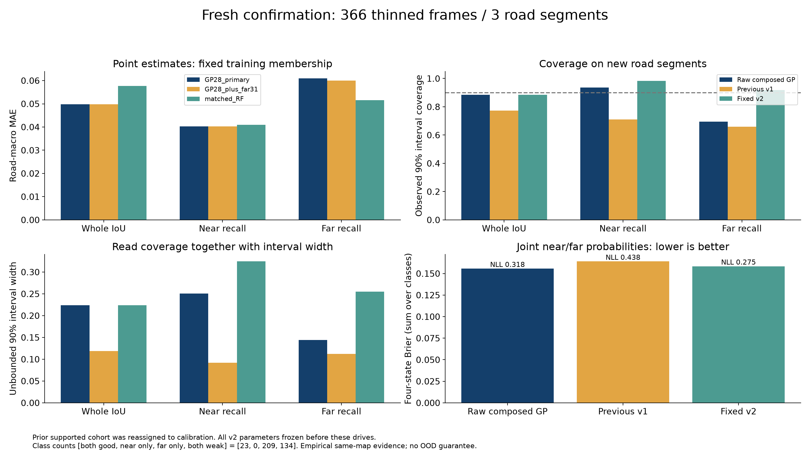

# 9영역 저속 주행·특징 선정·검수와 공간 확률 보정

2026-11-26 주행 실험 기록. Medium v6 EMA는 고정했고, 이번에 인지모델을 추가 학습하지 않았다. 현행 인계의 최종 수치는 아래 확인 실험과 [공개 집계](../baselines/roi9_drive_20261126/results.json)를 함께 따른다.

9영역과 전체 IoU용28열 GP를 유지한다. 별도 원거리 recall용31열 GP는 보조 진단으로 검증하며, 합집합은41개다. 환경 RGB54를 별도로 계산하면 총89개 고유 특징이다. 이번 주행에서 전체 IoU 예측과 공간 진단의 성과가 다름을 확인했으며, 새로운 공간 확률·환경 임계·검수 혼합을 자동 채택하지 않는다.

MAE는0–1 IoU/recall 단위이며 별도 표시가 없으면 주행 구간에 같은 가중치를 준 macro 값이다. 수천 프레임을 수천 독립 도로 표본으로 해석하지 않는다.

## 이번에 정한 기준

| 항목 | 결정 |
|---|---|
| 영역·주 품질 모델 | 고정9영역·28열 GP 유지. 동일 입력 RF를 대조군으로 보존한다. |
| 원거리31열 | 개발·앞선 후속에서는 좋았으나 새 확인의 MAE 이득0.00092로 사전0.005 기준 미달. 기본 원거리 대체로 채택하지 않는다. |
| 검수 기준 | 전체IoU0.7의 공통 확률순. 환경별 하향 임계·공간 예산 혼합은 채택하지 않는다. |
| 공간 보정 | v2의 별도28+31 진단 번들을 보존한다. 경험적 포함률·NLL 기준은 통과했지만 구간이 넓어졌고 전체 실패 분류나 자동 학습 승인에 쓰지 않는다. |
| 완료하지 않은 범위 | 이번 인지 가중치 추가 학습·최종 유지성 판정·live ROS 통합은 별도다. |

[실행 구성과 판정 범위](../baselines/roi9_drive_20261126/runtime_manifest.json), [그림 목차](../baselines/roi9_drive_20261126/README.md)를 먼저 확인한다.

## 자료 역할과 실제 주행

| 자료 | 구간 / 회차 | 원본 / 3m 후보 | 현재 용도 |
|---|---:|---:|---|
| 개발 | 3 / 45 | 1,044 / 361 | 특징 비교·선택 |
| 원래 보정 | 3 / 45 | 1,048 / 366 | v1 적합; 지원된 일부는v2 보정 |
| 주평가 | 3 / 45 | 1,051 / 366 | v1 고정 후 평가, 원결과 보존 |
| 추가 조건 | 같은 주평가3 / 12 | 291 / 102 | 고정4조합의 조건 민감도 |
| 표시 차선 후속 | 새3 / 45 | 1,056 / 368 | v1 평가 후 v2 보정용으로 전환 |
| 새 확인 | 새3 / 45 | 1,051 / 366 | v2 고정 후 확인, 이후 재적합 없음 |
| 합계 | 고유15구간 / 237 | **5,541 / 1,929** | 원본 전체와 평가 후보를 별도 보존 |

개발·보정·평가 각3구간×5날씨×3시각으로135회 주행했다. 원본3,143장,3m 경로 진행거리 간격 후보1,093장이다. 개발1,044/361, 보정1,048/366, 평가1,051/366장이다. 추가 조건(주평가15조합 밖4조합)은 같은 평가3구간의12회·291/102장으로, 새 도로의 반복 검증이나 과거 품질 학습에 없던 날씨의 검증으로 부르지 않는다. 원시 Q MAE는0.03488이었지만 같은 희소 차선 구간의 영향을 받는다. 지도 안의 새 구간이며 전체 링크·인지 학습 장면이 미사용이었다고 주장하지 않는다.

주평가의 실제 위치는 기존 촬영 위치와25m 이상, 품질 학습2,480장과125.4m 이상 떨어졌다. 같은 새 구간의 날씨·시각 변경은 통제 대조이며 기존 영상의 재수집과 구분한다. GP/RF는 기존 동일2,480장만 학습했다. 새 개발은 특징 선정, 별도 보정은 보정/정책, 주평가는 고정 후 검증에 사용했다.

26R1 UDP 명령27/전체59byte, 차량상태216/전체245byte와 송신 조향 반전을 사용한다. 위치 변화 대비 native 속도 적분 비율 약3.59로 km/h를 확인하고3.6으로 나눴다. 직접 ROS 메시지·충돌 피드백·전체 경로 운행 인수와는 구분한다. Native 저장 RPC 미응답과 제어를 분리하고 Windows relay의0.6초 watchdog을 사용한다.

정규 분석 기준 총237회·원본5,541장·3m 간격1,929후보를 확보했다. 기록된 차량 이동은 합7.266km, 목표4km/h·최대5.648km/h, 최대 횡오차0.166m였다. 짧은 구간별 수집의 합이며 전역경로 완주가 아니다. 단순 throttle/brake 제어의 속도 진동은 기록에 남아 있다.

카메라 노출 시각은 제공되지 않았다. 공통 저장 요청·파일별 최초 관측·차량 상태·4채널 해시를 보존한다. 개발의 Sunny13·61프레임에서는 자기 GT 경계가 모두 인접 프레임 GT보다 RGB 경계와 잘 맞았다(중앙값0.538 대1.243px). 하드웨어 동기화가 증명된 결과는 아니다.

## 특징 선정

후보8종을 같은 지리 CV/튜닝 횟수로 RF·GP 비교했다. 보닛 제거는 개발 GP 전체 IoU MAE0.0453→0.0562로 나빠졌다. 관계 제거25열은 전체 IoU만 약0.0018 좋아졌으나 보조 정답을 포함한 사전 채택 기준을 만족하지 못했다. 상부 RGB·원거리 RGB·확률 후보 확대도 채택 근거가 없었다.

주28열은 RGB10·출력14·상위 엔트로피1·근−원거리 관계3이다. 원거리31열은 근거리 출력10을 원거리 출력10으로 바꾸고 원거리 행 점유·내부 간격·약한 외곽 확률 지지3개를 추가한다. 개발 원거리 recall MAE는0.0609→0.0305였다. RGB180·출력80·관계88·원본확률3·형태21의372후보와 RGB/GT를 남겨 이후 재가공한다. 모든9영역에서 모든 특징을 넣지는 않는다.

## 주평가 결과와 정답 지원

전체 IoU MAE는 GP0.07993, 동일28열 RF0.10659였다. RGB54만 쓰는 GP0.45937, e-means 군집의 과거 IoU 중앙값0.44496, 날씨·시각 GT 중앙값0.43918이었다. 마지막 대조는 GT 메타데이터를 쓰는 분석용이며 온라인 입력이 아니다.

주평가 두 구간의 전체 차선 GT 중앙값은59·69픽셀, 예측 차선 중앙값은0이었다. GT가500픽셀 이상인122장은 한 구간뿐이며 GP/RF MAE0.02326/0.04430이다. 희소 GT 장면의 낮은 IoU를 운행 실패나 유용한 재학습 대상으로 자동 해석하지 않는다. 원거리31열은 전체 주평가에서는 원래 GP보다 나빴으므로 개발 이득만으로 일반적 우위를 주장하지 않는다.

근거리 정답 지원137장, 원거리306장, 두 정답이 함께 지원되는126장/2구간이다. 한 구간은4장뿐이다. 근거리 recall MAE0.23666으로 새 장면의 과신 문제가 남았다. 원거리31 recall MAE0.04489, 같은31열 RF0.02388이었다. 공간 네 상태의 실제 분모는[0,0,84,42]로 정상/근거리만 약한 상태를 검증하지 못했다.

원래 v1 보정 LOCO의90% 포함률은 전체 IoU74.9%·근거리94.7%·원거리91.8%였다. 주평가에서는84.7%·60.1%·86.7%였다. 네 상태 Brier0.500195→0.500001의 작은 변화와 NLL3.8398→4.6053 악화를 함께 본다. 추가 잔차 상관의 이득은 사실상 수치 오차 수준이다. 공간 보정의 자동 검수 채택 근거가 아니다.

## 검수 기준·환경과 BO

전체 IoU0.7은 공통 벤치마크이며 근거리 recall0.8/원거리0.5는 별도 공간 진단이다. 각 띠의 GT가50픽셀 미만이면 해당 공간 성적을 성공으로 집계하지 않는다. 온라인에는 GT·ROI IoU를 입력하지 않는다.

기존 RGB54 공식 e-means16중심을 고정하고 RGB 거리만으로 정책군3개로 합쳤다. 근거리 precision/recall≥0.9·전체 precision≥0.9의 참조 장면이30장/2도로 이상인 군집만 기준 후보를 계산한다. 낮군의 참조 IoU가 높아0.7을 낮출 이유가 없었고, 야간 정상 참조는 부족했다. 거리 초과·지원 부족은 공통 기준으로 돌아간다.

BO8회/무작위8회는 같은4초기 관측으로 정책 혼합을 비교했으나 이득이 없었다. 기존 정책은 공통 저품질 확률이다. 주평가 같은39슬롯에서39개의 IoU<0.7을 골랐고 무작위100시드 평균은30.1개였지만, 희소 GT와 공간 약화의 별도 분모를 함께 해석한다. 인지모델 재학습 성과로 대신하지 않는다. 같은 예산의 쉬운 저품질 장면이 많아 선별39/39를 일반적 탐지 정확도나 GP 불확실성의 추가 이득으로 해석하지 않는다.

## GT 지원 후속과 보정 자료 전환

표시 차선이 충분한 후속3구간의3m 간격368장에서는 전체 IoU MAE가 GP0.04480·RF0.04983이었다. 근거리 recall은 GP0.04248·RF0.03917로 RF가 조금 좋았다. 원거리 recall은 주28열 GP0.09189→원거리31열 GP0.05663으로 개선됐고 같은31열 RF는0.08284였다. 도로3개에서 원거리31열이 주28열보다 좋았다. 네 상태 분모는[112,0,134,122]로 근거리만 약한 상태가 여전히 없었다.

원래 v1 보정은 원시 GP의90% 포함률 Q91.1%·근거리85.1%·원거리62.7%를64.6%·69.3%·58.6%로 더 낮췄다. 보정 구간의 성적만으로 새 도로의 보정을 채택하지 않는다. 이 후속 자료는 이후 보정 개발용으로 명시적으로 전환하고 새 확인 구간과 분리했다. 후속 결과는 v1에 대한 사전 고정 비교이지만 v2의 미사용 평가가 아니다.

기존 모델·특징·보정·정책은 유지한다. 원평가 후 GT지원량만으로3새구간을 고르는 조건부 후속이다. 기존촬영위치 최소거리는10m로 완화하되 품질학습50m/이번기존구간40m를 요구했다. Sunny13의8·16·24m 위치 모두에서 전체GT500·근/원GT100 이상을 만족한 첫3후보를 사용한다. 원래 주평가의 교체나 새로운 지도 검증이 아니다.

주평가의366장 중239장은 저품질 확률이 정확히1로 포화됐다. 별도 후보로 Gaussian GP의 기대 부족량 E[(tau-clip(Q,0,1))+]와 근거리 유지 조건의 원거리 기대 부족량을 구현했다. 기존정책을 바꾸지 않고 보정 OOF만으로 설정을 고정한 뒤 후속에 비교했다. 사후분포 적분·보정 평균만 사용·원시 GP 평균·RF 평균의 같은 가중치 비교에서 모두39개의 저품질/근거리 약화 장면을 찾았고 원거리만 약화된 장면은0개였다. 기대 부족량 또는 불확실성 활용의 추가 이득은 확인되지 않았다. 표본의 사건 구성이 쉬웠을 수 있으므로 검수 이득을 일반화하지 않는다.

## 고정 보정 v2와 새 도로 확인

기존 보정 자료와 GT 지원 후속의 전체GT≥500·근/원GT≥100인612장/5도로를 보정용으로 사용했다. 주평가와 추가 조건 평가를 넣지 않았다. 전체IoU의 평균·분산은 원시 GP 그대로 두고, 근/원거리만 도로별 중앙 잔차와 표준화 잔차90% 분위수를 사용했다. 구간 폭 배율은 최소1이며 두 편향 후보를 도로 제외 검증으로 비교했다. 선택된 편향은[0,−0.01531,+0.02781], 표준편차 배율은[1,1.29327,1.77296]이다. 이는 경험적 보정이며 conformal 또는 OOD 보장이 아니다.

도로 제외 검증의90% 포함률은 Q94.6%·근거리95.9%·원거리91.7%였다. 이 숫자는 보정 자료의 선택 성적이다. 새 확인 도로3곳은 같은 GT 지원 조건만으로 선택했고, 보정·모델·정책 해시를 실제 주행 전에 고정했다. 기존 후속 자료는 이 v2의 미사용 평가로 부르지 않는다.

새 확인은45회·원본1,051장/3m 간격366장·3구간이다. 실제 기록 위치는 기존 품질 학습2,480장과 최소72.05m, v2 보정612장과163.10m 떨어졌고 기존 전체 촬영 위치와는12.84m 이상이었다. 보정에 쓴 앞선 후속과 섞지 않았다. 모델·보정·정책은 확인 주행 전에 고정했고 추가 진단 판정 기준은 특징 추출·채점 전에 기록했다.

| 전체 IoU MAE | GP28 | 동일28열 RF |
|---|---:|---:|
| 원래 주평가3구간·366장 | 0.07993 | 0.10659 |
| 표시 차선 후속3구간·368장 | 0.04480 | 0.04983 |
| 새 확인3구간·366장 | **0.04982** | **0.05769** |

새 확인에서 GP가2/3구간에서 좋았지만 첫 구간의 MAE는 GP0.11522·RF0.11066이었다. 고정 주야 사례의 낮 장면에서도 실제IoU0.428을 GP0.763으로 높게 예측했다. 근거리 recall은0.93이었으므로 높은 근거리 recall만으로 전체 성능이 좋다고 판단할 수 없다. 평균 성적과 함께 남길 핵심 오판 사례다.

특히 첫 구간의 설명용 낮 프레임은 실제Q0.428·GP0.763이었다. 근거리recall0.929여도 precision은0.463이었고, 근좌의 FP가2,475픽셀(640×360 평가격자)이었다. **근거리recall 유지가 근거리인지 정상이라는 뜻은 아니다.** 이 경우의 공간 상태도 ‘근거리 누락은 적고 원거리 누락은 많음’이라는 recall 사건일 뿐이다. 전체IoU와 오검출을 함께 확인해야 한다. 사후GT CLI에 근/원거리precision·FP수를 추가하고, 예측 양성이 없는 precision은null로 남기도록 보완했다. 온라인에GT나ROI IoU를 추가한 변경은 아니다.

새 확인 원거리 recall MAE는 주28열0.06089→31열0.05997, 동일31열 RF0.05153이었다. 31열은2/3도로에서 좋아졌으나 이득0.00092가 사전0.005보다 작아 기본 대체를 보류한다. 전체Q·근거리 주모델은 바뀌지 않았다. 환경 전용 고정커널 GP0.16522·군집별 이전IoU 중앙값0.15832·날씨/시각 oracle중앙값0.15327도 주 GP보다 나빴다. 이 대조를 환경 분류 정확도로 해석하지 않는다.

| 공간 진단 | 원시28+31 | 이전v1 | 고정v2 |
|---|---:|---:|---:|
| 근거리90% 포함률 | 93.7% | 71.0% | **98.4%** |
| 원거리90% 포함률 | 69.4% | 65.8% | **91.8%** |
| 근거리 구간 폭 | 0.25075 | 0.09158 | 0.32429 |
| 원거리 구간 폭 | 0.14392 | 0.11249 | 0.25516 |
| 네 상태 Brier | **0.15570** | 0.16401 | 0.15844 |
| 네 상태 NLL | 0.31815 | 0.43844 | **0.27494** |

v2는 미리 정한 진단 포함률·v1 대비 확률 오차 기준을 통과했다. 원시 분포보다 Brier가 조금 나빠졌고 근거리 구간은 목표90%보다 보수적이었다. 넓힌 구간의 이득을 점 추정 정확도 향상으로 대신하지 않는다. 전체Q의 평균·분산은 정확히 원시 값 그대로이며 포함률88.5%였다. 네 상태 분모는[23,0,209,134]로 근거리만 약한 상태는 검증하지 못했다. 이28+31 구성은 **진단 연구용 번들**이며 원거리31열의 기본 채택이나 전체 실패 분류의 채택이 아니다.

같은39슬롯에서 GP/RF 낮은 평균·공통 저품질 확률은 모두39개의 실제IoU<0.7을 골랐고 무작위100시드는 평균21.69개였다. 원거리만 약한 확률순은38개의 해당 장면을 골랐지만 전체 저품질은13개였다. 70/30 할당의 사후 민감도에서는 전체 저품질33개·원거리만 약한9개로 목적 간 절충이 생겼다. 확인 자료로 새로운 할당을 선택하지 않았다. 앞선 기대 부족량 대조도 GP/RF 평균만 쓰는 기준보다 추가 이득이 없었다.

**σ가 높으면 근·원거리 recall 동반 저하, 낮으면 원거리 recall만 약하다는 규칙은 채택하지 않는다.** 새 확인의 근·원거리recall 동반저하/원거리recall만 저하 구분 AUC는0.369였고 방향이 가설과 달랐다. GP 관측 표준편차·평균·보조 정답의 확률을 구분한다. 공간 진단의 가능한 활용과 불확실성 자체가 평균보다 주는 추가 이득은 별도 문제다.

## RGB 단독 재생·원본 검증·인계

표시 차선이 충분한 후속에서 환경 전용 고정커널 GP의 IoU MAE는0.10104, e-means 군집별 이전 IoU 중앙값0.09768, 날씨/시각 메타데이터의 이전 IoU 중앙값0.09922였다. 주 품질 GP0.04480보다 나빴다. 환경 전용 GP는 별도 튜닝한 최선 모델이 아니며 군집 중앙값 비교는 날씨 분류 정확도가 아니다.

주평가 RGB366장을 GT 없이 재생한 뒤 검수45장에 정답을 연결했다. 세션/64프레임 창마다 예산을 올림하므로 전체12.3%이며 도로별39슬롯 비교와 다르다. 40프로파일 CPU8장과50프로파일5070Ti의 원시 GP 평균 최대 차이는3.53e-8, IoU0.7 판정 전환은0건이었다. 실제40GPU·ROS 인수는 이 결과에 포함되지 않는다.

전체5,541장의4채널22,164파일 해시를 다시 검증했다. 전역 등록은103팩·28,971고유ID/디코딩RGB이며 중복픽셀0건이다. 원래 획득 역할과 현재 노출 역할을 별도 원장에 남겼고 보정 전환한 후속의 전체 관련 구간을 미사용 평가로 되돌리지 않는다. 확인 초기1회는 계획 영수증 재생성 전 시작했으므로 통째로 격리하고 같은 조건을 다시 수집했다. 누락·거부0건의45회만 확인 집계에 썼다.

 개발1회차는 실행 중 IO재시도 수정 때문에 끝의 소스 해시가 시작 스냅샷과 달랐다. 실제 시작 소스는 남아 있고 해당 회차의 개발 후보9행을 빼도 원거리 개선 방향이 유지됐다. 보정·주평가는 소스 결합 불일치0건이다. 새 수집기는 시작 코드·계획 해시를 실행 동안 고정해 후속 재현에 사용한다.

참고로 이전v1의 고정 특징 이후 GP2개·공간 확률·정책 계산은 CPU 중앙값3.13ms, RF0.23ms였다. RGB/인지/특징/통신은 제외한 값이며 FPS가 아니다.40/50이미지 CPU 단위 테스트226개씩이 통과했다. 실제40GPU와 liveROS는 미검증이다.

확정된 주 입력과 진단 보조를 섞지 않는다. `review_bundle_v2_final`은 주28열 GP와 원거리31열의 진단 경로를 함께 보존한 묶음이다. 주IoU 입력은28열이고,41종은 두 품질 입력의 합집합이며89종은 별도 환경RGB까지 합친 실험 계산량이다.31열을 기본 대체로 채택했다는 뜻이 아니다.

이번에는 인지모델 가중치를 새로 학습하지 않았다. 실패/가시성/무표시도로의 해석, 충분한 실패환경 수집과 replay 혼합, 동일 예산 인지 재학습·기존 성능 유지, f1/g1 보정, 최종 offline 채택 이후 ROS/웹/영상 작업이 남는다. 전체 IoU 추정 성공·검수 이득·딥러닝 개선은 별도 문제로 판단한다.

새 확인 RGB366장도 GT 없이 추론·검수한 뒤45후보의 GT를 CLI로 연결했다. 40프로파일CPU8장과5070Ti의 원시 GP 평균 차이는 최대5.74e-8, 공간 확률은1.54e-7, IoU0.7 판정 전환은0건이었다. 실제RGB 재생과 후보 팩의 원시 GP 평균 차이는최대7.98e-5였다. 모든 학습 승인은false다.

watchdog 시험은 별도 제어 heartbeat 중단 후0.821초에 Park를 관측했다. 중단 후 이동은0.770m였고 이후 원래 위치·Keyboard/Park·Sunny13을 복원·재확인한 뒤 실험 relay와 컨테이너를 종료했다. 앞선 throttle0.08 시도는 속도 한계에 먼저 걸려 watchdog 검증으로 세지 않았다. 정상 종료·단일 고장 주입 결과이며 일반적 안전 보장은 아니다.

복사한 `review_bundle_v2_final`·RGB8장만 마운트하고 원래 실험/원본 루트 없이50GPU 재생도 확인했다. 원시GP 평균 최대차이는2.64e-6, 공간확률7.67e-8이었다. 체크포인트·일치한 팀코드는 별도로 제공하며 실제40GPU 검증과 구분한다. [공개 실행 구성](../baselines/roi9_drive_20261126/runtime_manifest.json)의 코드 리비전은 `08c362c`다.

## 다음 작업과 완료 범위

- 승현: 데이터 역할·가시성/실패 정의를 검토하고 검수 후보·무작위·환경 균형 대조를 같은 수량과 인지 학습 예산으로 f1에 비교한다. 유지 자료와 신규 자료의 도로를 분리하고 f1용 X/y·g1·보정도 다시 만든다.
- 재호: 고정9영역/주28열·원거리31열의 RGB/GT/예측 사례를 검수한다. 특히 차선이 없는 도로, 밤의 가시범위, 근거리만 약한 상태와 상부/보닛 오검출을 확인하고 영문 그림·웹페이지로 정리한다.
- 원태: 진단 보정과 원시 분포의 Brier/NLL·포함률/폭을 함께 검토한다. 공통0.7을 임의의 야간 기준으로 낮추지 않으며 정상 참조·가시성 라벨을 확보한 뒤 환경 기준을 비교한다. 기대 부족량·조건부 선택은 평균만 쓰는 GP/RF 대조와 다시 비교한다.

11월27일 첫 결합·30일 오프라인 채택·12월4일 확정 수치/영상/영문 사이트의 일정은 유지한다. 오프라인의 인지 개선·성능 유지 판정을 마친 뒤 ROS 실시간 수신·특징·GP/정책을 연결한다. 실제 저속 주행 수집을 했다는 사실이 ROS 통합 완료를 뜻하지 않는다.

거리 이격은 저장 시점의 차량 상태 XY를 사용한 비교다. 카메라 외부 파라미터·노출 시각을 확인한 실제 카메라 자세가 아니다. 같은 지도의 짧은 구간과 날씨별 반복 프레임을 독립적인 수천 도로 표본으로 해석하지 않는다.

현재 전역 등록은103팩·28,971개 고유ID/디코딩RGB이며 전체 재가공 목록과 현행 역할 원장을 따로 보존했다. 후속3도로 전체를 보정 관련 노출로 표시해, 학습에 쓴3m 간격612행 외의 인접 원본도 새 미사용 평가로 섞이지 않게 했다. 이미 채점한 고정 평가군으로 전후 비교는 가능하지만 새 튜닝의 미사용 검증이라고 부르지 않는다.
