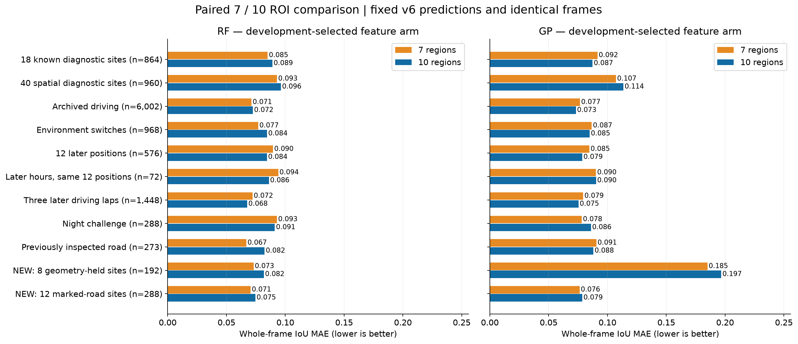

# 7영역·10영역 비교와 기본 ROI 결정

**이후 특징 실험의 기본값은 7영역 `roi7-front-v1`로 정한다.** 시작 입력은 RGB 8개·인지 출력 4개를 7영역과 전체 화면에서 계산한 **96열**이다. 10영역의 동일 구성은 132열이다. RF 기준선의 새 위치 정확도와 같은 예산의 선별 결과, 차원·계산비용을 종합했다. ROI를 고정한 뒤 특징을 줄이고 관계를 추가하거나 좌우를 합치는 순서로 진행한다. [현재 작업 절차](../guides/ROI와_특징추출.md)

이 선택은 모든 도로·모델에서 7영역이 우세하다는 판정과 다르다. 후속 반복주행에서는 10영역 RF가 더 정확했고 같은 특징을 사용하는 GP에서도 10영역의 이득이 있었다. **최종 특징·RF/GP·정책 채택과 온라인 연결은 후속 과제다.** [기준 설정](../../config/spatial_quality_baseline_v1.json)

## 데이터와 비교 조건

- 기존 14,331장을 같은 RGB·고정 v6 출력 맵·정답에서 재집계했다. 품질 학습은 6개 구역 1,728장, 개발은 별도 2개 구역 576장이다. 보정용 576장은 이번 적합·선정에 사용하지 않았다. 기존 진단 9묶음은 총 11,451장이다.
- **추가 A**는 기존 분석 위치에서 최소 64.93m 떨어진 8위치 × 6날씨 × 4시간(8·13·18·23시), 192장이다. 지도 형상만으로 위치를 먼저 고정했다. 수집 후 3위치가 차선 표시가 거의 없는 도로임을 확인했다.
- **추가 B**는 A의 원본 검수 후 지도에 좌·우 차선 표시 참조가 있는 위치를 선택한 보완 수집이다. 새 12위치 × 같은 24조건, 288장이다. 기존 자료와 A에서 최소 53.16m, B 위치끼리 최소 48.56m 떨어졌다. 위치는 지도 메타데이터·형상으로 선정했고 B의 영상·정답·예측을 보고 고르지 않았다. A와 B는 같은 지도에서 얻은 자료다.
- 두 수집 모두 **기존에 동결한 12개 모델**로 채점했다. 새 자료로 특징·하이퍼파라미터를 다시 적합하지 않았다. 원본 RGB·Semantic·Depth·Instance, 해시·조건·실제 위치와 시각을 실험 볼륨에 보존했다. 수집 후 차량·날씨·시간 설정을 복구했다.
- 정답은 v6의 흰색·노란색 차선 argmax와 Semantic의 **전체 프레임 IoU 하나**다. ROI별 정답으로 회귀하지 않았다. GT·설정 날씨·시간·위치는 X에 들어가지 않는다.

기존 진단 자료는 이전 연구에서 이미 살펴본 장면이다. A·B도 이번 ROI 선택에 사용했으므로 이후에는 개발·진단 자료로 취급한다. 11월 30일 최종 평가에는 새 미사용 도로가 필요하다.

## 학습과 특징 구성

| 후보 | 7영역 차원 | 10영역 차원 | 비교 의도 |
|---|---:|---:|---|
| `base12` | 84 | 120 | 기존 RGB 8개+출력 4개를 각 ROI에 동일 적용 |
| `base12_global` | 96 | 132 | 위 구성에 전체 화면의 같은 12개 추가 |
| `robust17` | 119 | 170 | 각 ROI에 어두운 비율·밝기 p10·중앙값·p90−p10·채도 중앙값 추가 |

각 ROI·구성·모델에 동일한 12개 설정, 학습 구역 단위 3-fold CV를 적용했다. 총 144개 후보, 432회 내부 적합이다. RF는 128트리의 잎 크기·열 비율·깊이, GP는 표준화한 Matérn 3/2+WhiteKernel의 길이척도·잡음을 비교했다. GP 내부 optimizer는 사용하지 않았다. 전처리는 각 fold의 학습분에서만 적합했다.

개발 MAE로 각 ROI·모델의 구성을 고르고, 두 ROI의 개발 MAE 평균으로 **주 비교 모델을 RF로 먼저 고정**했다. RF는 양쪽 모두 `base12_global`이었다. GP는 7영역 `base12_global`, 10영역 `robust17`이었다. 추가 RGB 5개의 일괄 투입은 RF 개발 성능을 높이지 않았다. 후보별 전체 수치는 [개발 결과 JSON](../baselines/roi_selection_20261124/development.json)에 있다.

개발 MAE는 RF 7/10영역 **0.0469 / 0.0448**, GP **0.0642 / 0.0533**이었다. 선택 RF는 7영역에서 잎 크기 8·열 비율 0.5·깊이 제한 없음, 10영역에서 잎 크기 2·열 비율 0.5·깊이 12였다. 선택 설정의 시드 3개와 양쪽 공통 설정(128트리·잎 4·열 비율 0.5·깊이 제한 없음)을 추가 비교해 설정 차이의 영향을 점검했다.

## 전체 IoU 예측 결과

MAE는 IoU 0~1 척도의 평균 절대오차다. 표는 모델별로 개발에서 선택한 구성의 결과다. **GP 열은 두 ROI의 특징 구성이 다르다.** ROI 효과를 분리하는 동일 구성 대조도 [전체 결과 JSON](../baselines/roi_selection_20261124/results.json)의 `same_arm`에 보존했다.

| 자료 | 전체 / 정답 정의 수 | RF 7 | RF 10 | GP 7 | GP 10 |
|---|---:|---:|---:|---:|---:|
| 기존 18위치 | 864 / 864 | 0.0850 | 0.0891 | 0.0916 | 0.0873 |
| 공간 진단 40위치 | 960 / 960 | 0.0930 | 0.0963 | 0.1072 | 0.1136 |
| 보관 주행 | 6,002 / 6,002 | 0.0712 | 0.0725 | 0.0766 | 0.0732 |
| 환경 전환 | 968 / 968 | 0.0770 | 0.0845 | 0.0867 | 0.0849 |
| 후속 12위치 | 576 / 576 | 0.0896 | 0.0844 | 0.0846 | 0.0786 |
| 같은 12위치·추가 시간 | 72 / 72 | 0.0940 | 0.0861 | 0.0903 | 0.0903 |
| 후속 3회 반복주행 | 1,448 / 1,448 | 0.0722 | 0.0676 | 0.0794 | 0.0754 |
| 야간 진단 | 288 / 288 | 0.0929 | 0.0911 | 0.0781 | 0.0860 |
| 이미 분석한 별도 도로 | 273 / 273 | 0.0669 | 0.0824 | 0.0906 | 0.0881 |
| 추가 수집 A · 8위치 | 192 / 192 | 0.0731 | 0.0818 | 0.1851 | 0.1967 |
| 추가 수집 B · 12위치 | 288 / 288 | 0.0705 | 0.0746 | 0.0763 | 0.0786 |

기존 주 진단 5묶음의 RF 코호트 평균 MAE는 **0.0813 / 0.0839**, 프레임 가중 평균은 **0.0818 / 0.0821**이었다. 후속 12위치에서는 7영역이 0.0052, 후속 반복주행에서는 0.0046 더 나빴다. 반복주행 차이의 50m 공간 묶음 bootstrap 95% 구간은 **[+0.0008, +0.0087]**로 10영역의 이득을 보였다.

새 수집 A의 RF MAE 차이(7−10)는 **−0.0087**, 8위치 묶음 bootstrap 95% 구간 **[−0.0125, −0.0044]**였다. B의 차이는 **-0.0041**, 12위치 묶음 구간 **[-0.0155, +0.0102]**다. 2,000회 재표집했으며 인접 프레임을 독립 표본으로 세지 않았다.

- 추가 B의 RF selected 설정, 시드 23411·23412·23413의 MAE(7)−MAE(10): -0.0041, -0.0051, -0.0034.
- 추가 B의 RF common 설정, 시드 23411·23412·23413의 MAE(7)−MAE(10): -0.0062, -0.0038, -0.0067.

## 선별 성능과 해석 한계

주 기준은 실제 IoU < 0.7, 예산은 모집단의 `ceil(10%)`다. 예상 IoU가 낮은 순으로 고르고 동점은 같은 ID 규칙으로 처리했다. 미정의 정답도 예산에 남긴다. 5%·20%와 같은 64프레임 창별 선별도 함께 기록했다.

A에서는 두 RF 모두 **20장을 골라 20장의 저IoU 장면**을 찾았다. 전체 저IoU는 143장, 따라서 Recall은 **20/143=14.0%**, 선택 정밀도는 100%다. 무작위 선택의 기대 저IoU 수는 14.9장이다. **저IoU 장면을 전부 감지했다는 뜻이 아니다.** B의 7영역은 29장 중 29장, 10영역은 29장 중 29장을 찾았다. 저IoU 전체 분모와 미정의 선택 수는 JSON에 함께 기록했다.

기존 자료와 A의 10% 전역 선별에서는 ROI에 따른 발견 수 차이가 없었다. 낮은 IoU 장면이 많은 자료여서 이 지표만으로 영역의 선별 우열을 가리기 어렵다. 기존 후속 12위치 자료에서 RF가 찾은 고유 위치 수는 7영역 5곳, 10영역 6곳으로 차이가 있었다. 최종 정책에서는 장면 다양성·정상 분모·환경별 오경보를 함께 확인한다. 0.7은 공통 비교선이며 야간 정상 여부를 확정하는 기준은 후속 정책 연구에서 정한다.

### 차선 GT가 적은 장면의 별도 진단

A의 3위치는 모델 해상도에서 GT 차선이 **8~46픽셀**뿐이었고 나머지 5위치는 약 2,000픽셀 이상이었다. 먼 배경의 소수 차선을 놓쳐도 전체 IoU가 0이 될 수 있다. 이 장면의 저IoU를 곧바로 주행 실패로 단정하지 않는다.

전체 192장의 주 결과를 유지한 채, 사후 진단으로 GT 차선 256픽셀 이상인 **120장·5위치**를 따로 집계했다. RF MAE는 **0.0561 / 0.0623**, GP는 **0.0578 / 0.0714**였다. 이 기준을 512·1,024로 바꿔도 A의 구분은 같았다. 차선이 적은 72장에서 GP MAE는 약 0.40으로 커졌다. [GT 픽셀 수별 전체 집계](../baselines/roi_selection_20261124/support_sensitivity.json)

GP가 선택된 구성으로 A에서 7영역이 좋았다는 결과만으로 ROI 효과를 설명할 수 없다. 동일 `base12_global` GP에서는 A의 7영역 MAE가 10영역보다 **0.0222** 더 컸다. B의 같은 비교 차이는 **-0.0055**다. 원태는 고정 7영역에서 특징군·커널·스케일링·불확실성 보정을 추가 검증한다.

## 비용과 최종 결정

같은 RGB 40장, 3회 반복·교대 순서, CPU 1스레드에서 측정했다. 디스크 읽기와 v6 추론 시간은 제외했다.

| 공통 12개+전체 화면 | 7영역 p50 / p95 | 10영역 p50 / p95 |
|---|---:|---:|
| 특징 추출 | 5.27 / 5.73 ms | 5.60 / 6.09 ms |
| RF 단일 프레임 예측 | 2.94 / 3.16 ms | 3.03 / 3.45 ms |
| 입력 차원 | 96 | 132 |

입력은 27.3% 줄지만 RGB 필터 계산을 공유하므로 실행시간 감소 폭은 그보다 작다. [하드웨어·의존성·전체 타이밍](../baselines/roi_selection_20261124/benchmark.json)

사전 계획에는 7영역 허용 손실 MAE 0.003·Recall 0.02를 적었지만 집계 수준과 정식 비열등성 검정은 확정하지 않았다. 따라서 평균 성적만으로 모든 코호트의 비열등성을 통과했다고 해석하지 않는다. **7영역을 향후 개발의 공통 기준선으로 선택하고, 10영역이 나은 주행·GP 대조를 함께 보존한다.** 새 위치의 RF 결과·반복 시드·비용을 근거로 정한 실용 선택이다. 논문에 사용할 최종 일반화 성적은 따로 확보한다.

이후에는 7영역을 고정해 후보 일괄 추출 → 영역별 열 축소 → 남은 열의 관계 추가 → 좌우 통합 후보를 비교한다. 통합 통계는 원본·맵에서 다시 계산하고, 각 단계의 RF·GP를 같은 데이터·튜닝 예산으로 비교한다. 특징·검수 정책을 확정하고 사후 GT 평가·동일 예산 재학습을 오프라인으로 마친 뒤 온라인에 연결한다.

## 재현과 보존

- [추출기](../../src/quality_estimation/spatial_features.py)와 [RF·GP 비교 스크립트](../../scripts/compare_roi_features.py), [재현 프로토콜](../baselines/roi_selection_20261124/reproduction_protocol.json), [선택 열 96개](../baselines/roi_selection_20261124/selected_schema.json)를 공개했다. 명령과 팩 형식은 [품질모델 가이드](../guides/품질모델_학습과_불확실성.md)에 있다.
- 공개 스크립트로 학습 비교를 다시 실행해 12개 최적 설정과 개발 MAE를 재현했다. 144개 CV 오차 차이도 부동소수점 반올림 수준이다. 7·10영역 CLI 값은 실제 팩의 같은 행과 일치한다.
- 기존 14,331장의 Semantic 바이트 해시와 53개 원래 혼동행렬 팩을 검증했다. 정답 복원 오차의 최댓값은 2.98×10⁻⁸이었다. 새 수집의 4채널 해시·ID·조건 수·기존 RGB 중복과 공간 간격도 검증했다.
- 공간 특징 5개·기존 ROI 11개·GP 3개 검증, 총 19개 테스트가 통과했다. 공개 집계·출처 해시는 [검증 기록](../baselines/roi_selection_20261124/verification.json), [파일 해시](../baselines/roi_selection_20261124/artifact_hashes.json)에 있다.
- 원본 4채널, 프레임별 예측·특징, 모델, 전체 프로토콜·로그·스크립트 스냅샷은 실험 볼륨에 보관한다. 기존 10영역 모델과 X56 계약은 보존한다. 새 기본값을 기존 모델에 자동 적용하지 않는다.
