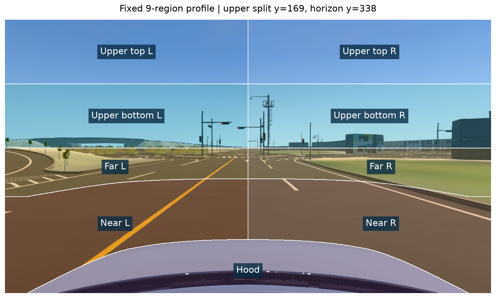
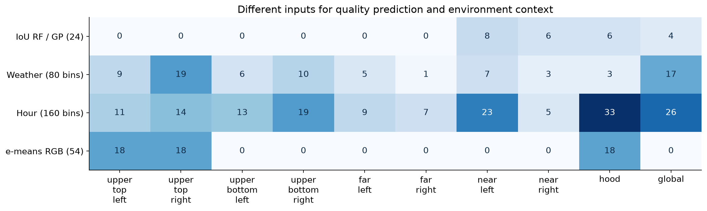
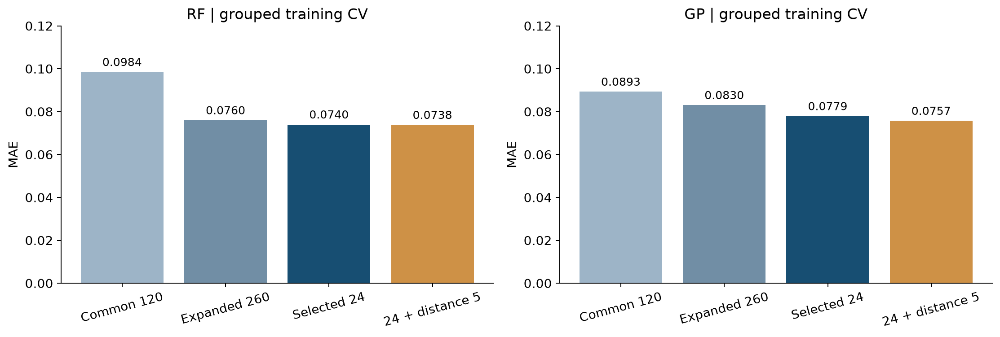
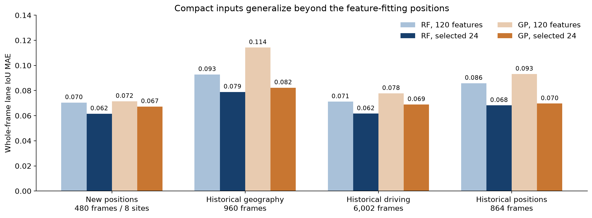
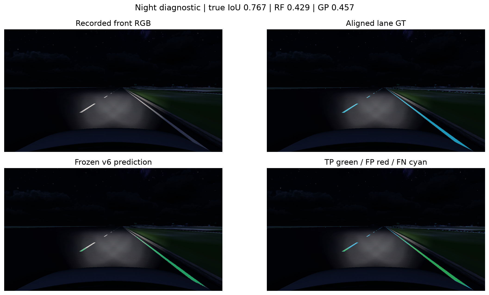
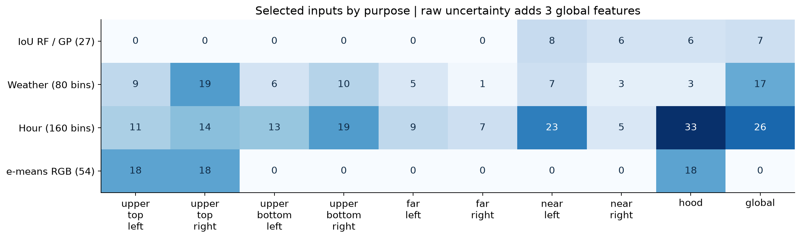
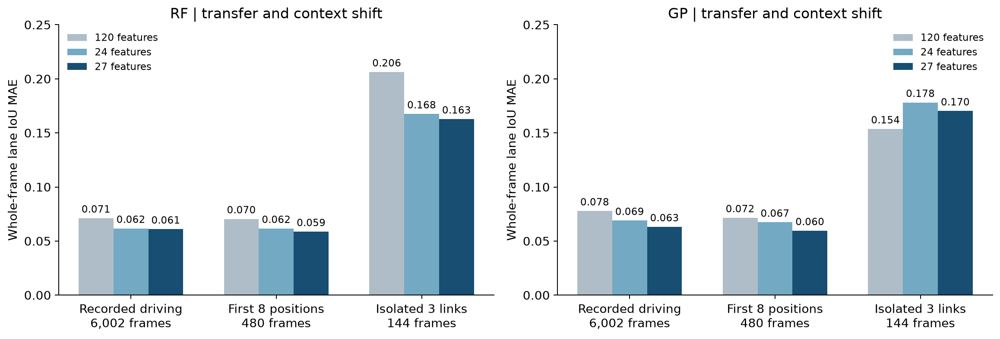
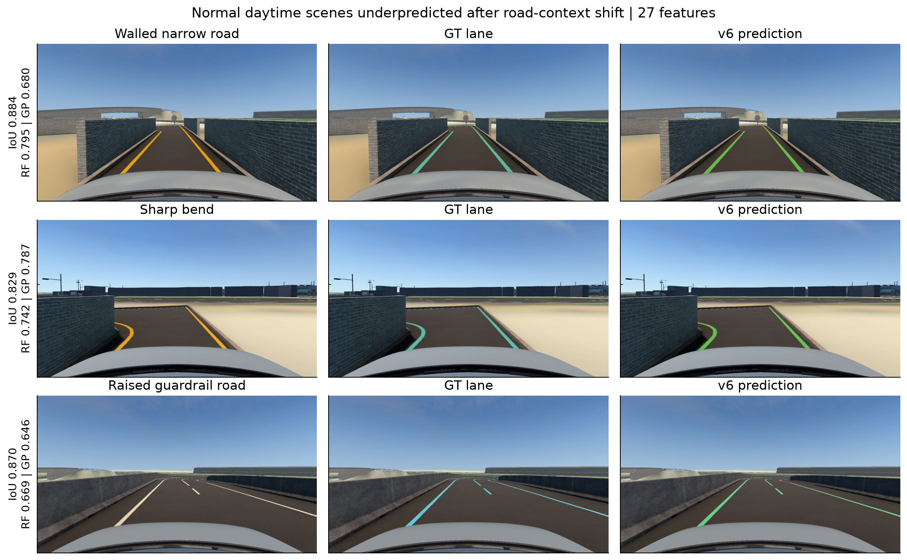
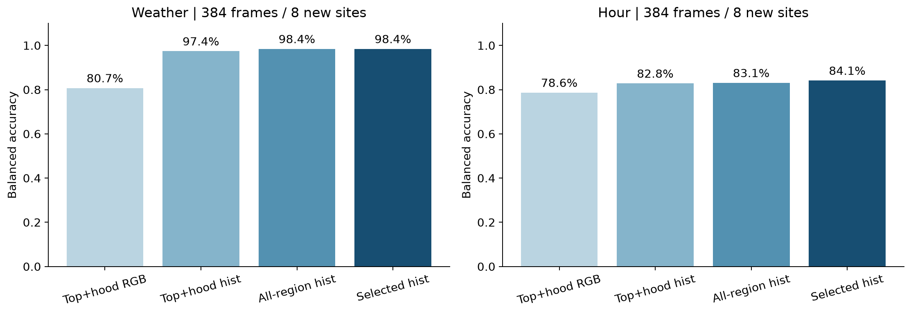

# 9영역 특징 세분화·축소와 RF·GP 비교

11월 24일의 현재 인계 입력은 **RF·GP 공통 27열**이다. 상부를 높이로 반반 나눈 9영역을 고정해 공통 후보, ROI 역할별 축소, 영역 관계, 원본 확률의 불확실성 요약을 순서대로 비교했다. 환경 쪽은 **날씨 분류 80개 히스토그램 성분, 시각 분류 160개 성분, e-means RGB 54열**로 구분한다. 27일 첫 결합에는 이 입력을 사용하고, 오프라인 채택은 30일에 판단한다. [현재 v2 명세와 모델 해시](../../config/region_feature_recipe_v2.json) · [개발 가이드](../guides/ROI와_특징추출.md)

새로 수집한 고유 원본은 11위치 624장이다. 첫 8위치 480장의 27열 MAE는 RF 0.0587·GP 0.0596이지만, 추가 3개 독립 링크 144장에서는 0.1628·0.1703으로 커졌다. **좁은 도로·급커브의 정상 장면을 낮게 평가하는 문맥 전이 문제가 남아 있다.** 현재 입력은 특징 연구의 기준선이며 검수 정책과 GP 불확실성의 보정은 후속 결합 과제다. 아래에 1차 24열 선정과 후속 27열 비교를 함께 보존한다.

## 영역과 자료

상부 위·아래, 원거리·근거리 각 좌우와 보닛을 사용한다. 원본 1280×720에서 상부는 y=169와 338로 나뉜다. 두 상부 층은 각각 169행이다. 원·근거리와 보닛 픽셀 배정은 앞선 프로파일을 상속한다. RGB 요약과 출력 맵은 320×180 작업 격자를 사용하며, nearest-neighbor 배정에서 상부 위·아래의 지원 행은 43·42행이다. 블록 히스토그램은 원본의 10×10 픽셀 블록을 중심 픽셀의 영역으로 배정한다. [마스크 정의](../../config/roi9_front_v1/profile.json)

- 특징·모델 적합은 정지 촬영 6구역 36위치 1,728장, 개발 확인은 별도 2구역 12위치 576장이다. 학습 6구역을 3개 폴드로 나누고, 특징 순위·분산 제거·표준화를 각 폴드의 학습 행에서만 적합했다.
- 이전 연구의 14,331장을 새 마스크에서 재가공했다. 기존 공간·주행 자료는 개발 확인과 전이 진단에 활용했다. 이 자료는 여러 연구에서 이미 열어본 기록이다.
- 새 위치 8곳은 이전 촬영 위치에서 최소 45.47m 떨어져 있고 서로 최소 60.76m 떨어진 지도 링크에서 선정했다. 처음 384장은 6날씨×8시각으로 수집했다. 그중 15·17시는 시각 분류기의 학습 클래스에 없었다. 빠진 16·18시를 96장 추가 수집해 **고유 원본 480장**을 보존했다.
- 전체 480장은 6날씨×10시각×8위치다. 학습 시각 5·8·11·13·16·18·20·23시에 해당하는 384장과 새 시각 15·17시의 96장을 별도 집계한다. 세 집계의 합집합은 480장이다.
- 1차 24열 특징·모델 고정은 14시 7분, 첫 새 위치 추론 시작은 그 이후다. 추가 16·18시 수집에서도 고정된 특징·모델을 사용했다. RGB·Semantic·Instance·Depth 1,920개를 카탈로그에 등록하고 해시·채널 크기·프레임 ID를 검증했다. 두 수집 후 시뮬레이터 위치·제어·날씨·시각의 복원을 확인했다.
- 원본 확률 요약을 추가한 후 기존 촬영점과 첫 8위치를 모두 피한 3개 링크에서 6날씨×8학습시각 144장을 더 수집했다. 링크 전체의 기존 촬영점과의 최소 거리는 각각 28.40·27.07·28.68m 이상이며, 실제 촬영점의 거리는 36.99m 이상이다. 576개 채널 파일을 추가 등록했다. 전체 **624장·4채널 2,496파일**의 원본·조건·프레임 ID·해시와 세 수집의 상태 복원을 보존했다.

인지 모델은 동일한 Medium v6 가중치다. X는 RGB와 고정 인지 출력에서 만들고 y는 전체 흰·노란 차선 합집합 IoU다. GT·날씨·시각·위치는 품질 회귀 입력에서 제외했다. 새 시각의 날씨 라벨도 기존 6개 설정 중 하나다. [집계와 수집 조건](../baselines/roi9_features_20261124/summary.json)

## ROI의 의도와 후보

| 범위 | 관찰하려는 단서 | 시험한 특징 |
|---|---|---|
| 상부 위층 | 하늘·광원·넓은 조명 변화 | 밝기와 분위수, 어둠·과노출 비율, 채도, 청색−적색, 원형 hue, 블록 색상·채도 히스토그램 |
| 상부 아래층 | 지평선 주변 건물·표지·수목, 먼 구조물의 대비 | 다크 채널, 국소 대비, 선명도, 경계·잔차, 블록 밝기·대비 분포 |
| 원거리 | 작은 차선·저대비·가시성 변화 | RGB 대비·선명도·다크 채널과 출력 면적·확률·엔트로피, 근거리와의 차이 |
| 근거리 | 큰 차선, 그림자·노면 반사·눈, 실제 예측 상태 | RGB·경계·잔차와 주행가능 면적, 차선 면적·확률, 예측 차선 가중 통계 |
| 보닛 | 고정 재질에 나타나는 조명·색·반사 변화 | 밝기·분산·분위수·어둠·색·잔차, 상부·노면과의 차이 |
| 전체 화면 | 프레임 전체 노출과 차선 출력량 | 같은 요약 통계와 블록 히스토그램 |

상부에 건물·터널이 들어갈 수 있고 노면 띠에 다른 객체가 들어갈 수 있다. 고정 공간 구획의 실제 내용을 관측하며 해석한다. 중앙값 필터 잔차는 재질·반사·텍스처·압축 영향을 함께 받는다.

공통 RGB 8개에 밝기 분위수·어둠 비율·채도 5개, 색차·채도 IQR·채도 가중 원형 hue 2개·Canny 경계 밀도 5개를 더해 RGB 후보를 영역당 18개로 만들었다. 출력은 기존 4개에 차선 가중 엔트로피·확률, 차선/주행가능 불일치, 예측 지원 여부를 더해 영역당 8개다. 전체 화면을 포함하면 260열이다. 관계 88열과 히스토그램 500열도 별도 캐시에 보존했다. [후보 추출 코드](../../src/quality_estimation/region_candidates.py) · [의도별 비교 구성](../../src/quality_estimation/region_feature_views.py)

차선 가중 통계는 저장된 2×2 평균·바이트 양자화 출력의 차선 점유율을 가중치로 사용한다. 예측 지원이 없으면 두 조건부 통계를 0으로 두고 지원 여부를 함께 후보로 남긴다. 원·근거리 차이에는 예측량·확률·엔트로피를 사용했다.

## 논문에서 적용한 부분

| 원문과 원래 과제 | 확인한 특징 추출 | 이번 적용 |
|---|---|---|
| Roser·Moosmann, IV 2008, 맑음·약한 비·강한 비 | 전체 ROI와 12개 하위 ROI에서 10×10 블록의 최소 밝기·대비·선명도·hue·채도를 10-bin 히스토그램으로 연결하고 SVM 분류 | 9영역+전체 화면의 지역 블록 분포를 비교했다. 최소/최대는 어둡고 밝은 10% 평균, 선명도는 기존 Sobel 요약, hue는 원형 평균으로 구현한 적용 변형이다. [저자 원문](https://www.mrt.kit.edu/z/publ/download/Roser_al2008iv.pdf) |
| Cheng·Zheng·Murase, IV 2018, 날씨와 조명 문맥 | 도로·하늘·좌우 주변의 밝기·chroma와 도로 색 변동 9개, K-means 기반 사전과 sparse coding | 상부·보닛·도로를 따로 비교하고 문맥을 군집 입력으로 선정했다. 원문의 조명 유형과 이번 8개 시각 라벨은 각각의 정의를 따른다. [저자 원문](https://scholarworks.indianapolis.iu.edu/bitstream/1805/20636/1/zheng-2018-sparse.pdf) |
| Lu 등, CVPR 2014, 맑음·흐림 | 하늘·그림자·반사·LCH 채도 대비·지역 dark-channel 단서 | 상부 색, 노면·보닛 반사, 원·근거리 대비와 dark-channel 후보를 시험했다. 이번 분위수·IQR은 자체 요약값이다. [공식 원문](https://openaccess.thecvf.com/content_cvpr_2014/papers/Lu_Two-Class_Weather_Classification_2014_CVPR_paper.pdf) |
| Rottmann 등, MetaSeg | 예측 성분의 softmax 분산·엔트로피 집계로 성분 품질 추정 | 차선 가중 엔트로피·확률과 지원 여부를 고정 영역과 전체 프레임 목표에 적용했다. [원문](https://arxiv.org/abs/1811.00648) |

각 논문의 원래 클래스·분할·학습기와 이번 실험의 차이를 위 표에 명시했다. 수치는 각 연구의 과제·분할·라벨 정의와 함께 해석한다.

## 1차 특징 축소와 24열 회귀 입력

공통 120열 → 확장 260열 → 의도별 구성과 특징 축소 → 관계 추가 순으로 비교했다. RF 중요도와 상호정보량 순위의 top 24·40·64·96을 각 학습 폴드 안에서 다시 선정했다. 최종 비교의 RF·GP에는 같은 12개 설정 예산을 적용했다. 전체 120열·260열 대조군도 같은 예산으로 다시 적합했다. [개발 비교 전표](../baselines/roi9_features_20261124/development_comparisons.json)

1차 24열은 RF 중요도 순위에서 선정했다. 상호정보량으로 고른 64열을 포함해 GP에 유리한 구성도 대조했다. 선정한 24열의 RGB 요약은 10개, 인지 출력은 14개다. RF와 GP가 같은 순서의 열을 받는다.

| 영역 | 열 수 | 선정한 열 |
|---|---:|---|
| `near_left` | 8 | `chroma`, `blue_minus_red`, `edge_density`, `drivable_fraction`, `lane_fraction`, `lane_probability`, `lane_weighted_entropy`, `lane_weighted_probability` |
| `near_right` | 6 | `median_residual`, `drivable_fraction`, `lane_fraction`, `lane_probability`, `lane_weighted_entropy`, `lane_weighted_probability` |
| `hood` | 6 | `intensity`, `dark_channel`, `dark_fraction`, `intensity_median`, `blue_minus_red`, `edge_density` |
| `global` | 4 | `lane_fraction`, `lane_probability`, `lane_weighted_entropy`, `lane_weighted_probability` |

- 상부·보닛의 출력을 모두 사용, 도로 띠만 사용, 도로 출력에 상부·보닛의 차선 면적만 추가, 조건부 경보 통계까지 추가하는 구성을 비교했다. 보관 주행 6,002장 중 1,821장에서 상부·보닛 차선 오검출이 있었고 그 구역 예측 픽셀의 정밀도는 약 0.065%였다. 해당 단서의 물리적 의미는 확인됐지만 전체 프레임 IoU 회귀의 MAE 이득은 자료마다 달랐다. 이번 24열에서는 이 구역의 직접 출력 통계가 선택되지 않았다. 원래 캐시에는 보존했다.
- 원거리–근거리 출력 관계 5개를 추가한 29열은 개발 내부 GP에서 이득이 있었으나 기존 지리·주행 진단에서 일관되지 않았다. 최종 고정 전에 공통 24열을 선택하고 29열도 동결된 대조군으로 평가했다. 새 480장에서 29열−24열 MAE는 RF -0.00038, GP +0.00004였다. 위치 재표집 구간에는 0이 포함됐다.
- 조명 관계·좌우 관계, 영역별 역할 축소, RGB 단독·출력 단독, 전체 화면 제거, 품질 회귀에 히스토그램 추가도 비교했다. 24열의 좌우 비대칭은 현재 자료에서의 학습 선택이다. ROI 역할에 대한 보편적인 규칙으로 해석하지 않는다.
- 특징별 길이를 최적화하는 ARD GP도 별도로 적합했다. 4개 24열 후보의 공간 CV MAE가 약 0.11~0.12로 커져 현재 입력·GP의 기본 적합에는 고정 스칼라 길이의 Matern 1.5를 사용한다.

## 1차 24열 회귀와 선별 결과

| 자료 | 120열 RF | 24열 RF | 120열 GP | 24열 GP |
|---|---:|---:|---:|---:|
| 개발 576장 | 0.0473 | 0.0447 | 0.0683 | 0.0446 |
| 기존 공간 진단 960장 | 0.0929 | 0.0789 | 0.1143 | 0.0823 |
| 보관 주행 6,002장 | 0.0712 | 0.0617 | 0.0778 | 0.0690 |
| 기존 18위치 864장 | 0.0859 | 0.0682 | 0.0932 | 0.0696 |
| 새 8위치 480장 | 0.0705 | 0.0616 | 0.0715 | 0.0673 |
| 그중 학습 시각 384장 | 0.0707 | 0.0640 | 0.0690 | 0.0672 |
| 그중 새 시각 96장 | 0.0694 | 0.0518 | 0.0816 | 0.0679 |

새 480장에서 RF의 관측 MAE 변화는 -0.00890, GP는 -0.00419였다. 8개 물리 위치를 단위로 4,000회 재표집한 95% 구간은 각각 [-0.01831, +0.00035], [-0.01240, +0.00325]다. GP−RF 차이 +0.00574의 구간도 0을 포함한다. 표본 위치 수가 적어 현재 점추정과 불확실성을 함께 인계한다. [전체 지표](../baselines/roi9_features_20261124/quality_metrics.json) · [짝지은 구간](../baselines/roi9_features_20261124/paired_validation.json) · [RF 5시드 반복](../baselines/roi9_features_20261124/seed_summary.json)

새 480장 중 실제 IoU <0.7은 201장이다. 주 검수 예산 10%의 48장은 RF·GP와 120열 대조군 모두 48건을 찾았다. 이 예산에서는 적중률 차이가 드러나지 않았다. 추정 IoU <0.7 경보는 정상 279장 중 RF 41장, GP 58장을 잘못 표시했다. 같은 임계값에서의 검수 적중과 정상 오경보를 함께 본다.

위 사례의 실제 IoU는 약 0.767이고 RF·GP의 예측은 각각 약 0.429·0.457이다. GT와 예측을 동일한 640×360 공간에서 맞춰 시각화했다. 이와 같은 정상 야간 장면의 오경보는 후속 보정·검수 정책의 검증 대상이다. 0.7은 전체 IoU 비교 기준이다. 환경 안에서 통상적인 품질과 취약성의 판정은 별도의 목표로 정의한다.

원·근거리의 GT TP·FP·FN 집계도 보존했다. 보관 주행 6,002장 중 1,893장은 전체 IoU가 0.7 이상이면서 원거리 GT가 50픽셀 이상이고 해당 띠의 recall이 0.5 미만이었다. 영상에서 작은 원거리 누락은 전체 IoU와 함께 살펴야 한다. 입력에 넣어 시험한 원·근거리 차이는 예측량·확률·엔트로피의 차이이며, GT로 측정한 실제 성능 차이는 사후 진단에 쓴다. 현재 회귀의 정답은 전체 IoU 하나이며 원·근거리 진단은 목표의 관측 범위를 설명한다.

## 후속 비교와 현재 27열 입력

재호의 병행 7영역 연구가 추가한 전역 softmax 요약 3개를 현재 9영역에서도 시험했다. 정답에 접근하지 않고 같은 v6의 원본 4×384×640 마킹 확률에서 위아래 패딩 12행씩을 제외해 계산한다. 세 통계는 상위 10% 픽셀의 정규화 엔트로피 평균, stride 16의 32×32 창 최대 엔트로피 평균, 예측 차선 픽셀의 상위 두 클래스 확률 차이 평균이다. 차선 예측이 없으면 마진은 0이며 차선 면적 특징과 함께 해석한다. 바이트 요약 맵으로 이 세 값을 복원하지 않는다. [공유 원본 확률 함수](../../src/quality_estimation/spatial_features.py)

1차 24열에 마진 하나, 엔트로피 둘, 세 통계 모두를 붙인 후보를 RF·GP 각각 같은 12설정의 그룹 CV로 적합했다. 원본 통계 3개 단독, 공통 120+3열, 도로 출력 중심+3열도 대조했다. **현재 공통 입력은 기존 RGB 10열+출력 요약 14열+원본 확률 3열의 27열**이다. `near_left` 8열·`near_right` 6열·`hood` 6열·`global` 7열이다. 정확한 이름과 순서는 [v2 명세](../../config/region_feature_recipe_v2.json), 초기 24열은 [v1 명세](../../config/region_feature_recipe_v1.json)에 있다.

상부·보닛의 직접적인 영역 출력 평균은 현재 입력에서 빠졌지만, 전체 화면 출력과 원본 확률 통계에는 그 위치의 추론도 포함된다. 원거리 출력의 직접 통계와 원·근거리 차이는 대조군과 캐시에 남았다. 이번 표본에서 특징 축소가 선택한 구성이므로 상부·원거리의 물리적 중요도가 없다는 뜻으로 해석하지 않는다.

| 자료와 역할 | 24열 RF | 27열 RF | 24열 GP | 27열 GP |
|---|---:|---:|---:|---:|
| 학습 6구역 내부 3폴드 CV | 0.0740 | 0.0745 | 0.0779 | 0.0773 |
| 별도 개발 576장 | 0.0447 | 0.0438 | 0.0446 | 0.0409 |
| 기존 공간 진단 960장 | 0.0789 | 0.0767 | 0.0823 | 0.0690 |
| 보관 주행 6,002장 | 0.0617 | 0.0610 | 0.0690 | 0.0631 |
| 첫 8위치 480장 | 0.0616 | 0.0587 | 0.0673 | 0.0596 |
| 추가 독립 3링크 144장 | 0.1675 | 0.1628 | 0.1781 | 0.1703 |

첫 8위치는 이번 후속 특징 선택에서 이미 열어본 전이 진단 자료다. 추가 3링크 비교의 20개 후보 모델과 열 순서는 14시 54분에 고정했다. 추가 GT 추론은 15시 3분 31초에 시작했고, 27열 명세 기록은 15시 3분 57초, 집계 비교 저장은 15시 4분 16초다. 명세 기록은 GT 가공 뒤였으므로 이번 결과를 완전 미사용 최종 평가의 성적으로 주장하지 않는다. 이후 면적 제거 대조와 시드 반복도 개발 진단으로 구분했다. [후속 데이터 역할·해시](../baselines/roi9_features_20261124/followup_summary.json)

첫 8위치에서 27열−24열 MAE는 RF -0.00291·GP -0.00775이다. 위치 단위 4,000회 재표집 구간, 27열 GP−RF 차이, 120열 대비 차이를 [짝지은 전표](../baselines/roi9_features_20261124/paired_followup.json)에 남겼다. RF는 같은 27열·설정으로 5시드 반복했으며 기본 모델의 시드를 유지했다. [시드 안정성](../baselines/roi9_features_20261124/seed_followup.json)

### 주행 중 선별과 오경보

기존 주행 24세션 6,002장을 시간순 64프레임 창으로 나눠 각 창의 10%를 올림해 선별했다. 나머지 짧은 창까지 보존해 96창·648개 슬롯이며 실제 예산 비율은 10.8%다. IoU<0.7 장면은 27열 RF 561건·GP 565건, 단독 확률 마진 기준은 552건, 무작위의 기대 적중은 약 399.8건이었다. 적중률은 각각 86.57%·87.19%·85.19%·61.69%다. 이 자료는 특징 연구에서 재사용한 주행 기록이다.

추가 3링크를 같은 날씨·시각의 3장씩 비교하면 10% 올림은 1장으로 실제 예산이 33.3%다. 48개 조건에서 RF·GP는 각각 30건, 마진은 34건을 찾았다. 이 소그룹 결과를 주행 창의 10% 결과와 합치지 않았다. 넓은 날씨·시각을 한꺼번에 섞은 전체 풀의 적중률만으로 선별 능력을 판단하기 어려움을 확인했다. [창별 집계](../baselines/roi9_features_20261124/window_review.json)

27열에서 공통 0.7 경보의 정상 오경보는 첫 480장 정상 279장 중 RF 34장·GP 48장이다. 추가 144장 정상 60장 중에는 RF 49장·GP 48장으로 커졌다. 추가 3링크는 날씨 분류 balanced accuracy가 96.53%여도 품질 회귀가 크게 편향됐다. 환경 태그와 도로 구조의 적용 범위를 함께 다룰 필요가 있다.

위 세 낮 장면의 실제 IoU는 0.884·0.829·0.870이다. GT·v6 차선 마스크를 같은 640×360 공간에서 대조하고 원본 위에 올렸다. 근거리 주행가능 면적 2개를 뺀 25열은 전이 문제를 거의 해결하지 못했다. 주행가능·차선 면적과 영역 평균 차선 확률까지 뺀 19열은 3링크 RF MAE를 약 0.126까지 줄였지만 기존 주행 MAE가 약 0.075로 악화됐고 GP 이득도 유지되지 않았다. 공통 27열을 결합 기준으로 남기고 장면 적용 범위와 정상 장면의 보강을 다음 검수·보정 실험에 인계한다. [면적 제거 진단](../baselines/roi9_features_20261124/coverage_controls.json) · [동일 예산 적합 전표](../baselines/roi9_features_20261124/uncertainty_development.json)

### GP 불확실성의 범위

현재 27열 GP는 Matern 1.5·길이 배수 2.8·정규화 타깃의 관측 잡음 분산 0.05다. 평균은 점수에 사용하고 반환 표준편차는 관측 잡음을 포함한다. 보정하지 않은 평균±1.645σ의 실제 포함률은 첫 480장에서 81.67%, 추가 144장에서 44.44%다. 목표 90%보다 작다. 24열의 잡음 분산 0.15 모델과 혼동하지 않도록 아티팩트·파라미터를 함께 고정했다. GP가 RF에 가까운 점예측을 얻은 것과 σ를 신뢰 가능한 위험도로 사용하는 것은 각각 검증한다.

## 환경 입력 선정

| 용도 | 선정한 입력 | 새 자료의 결과 |
|---|---|---|
| 날씨 6개 설정 분류 | 선명도를 뺀 400-bin 후보에서 내부 순위로 80개 성분 | 전체 480장 balanced accuracy 96.67%, 학습 시각 384장 98.44%, 새 시각 96장 89.58% |
| 지정 8개 시각 분류 | 같은 후보에서 160개 성분 | 학습 시각 384장 balanced accuracy 84.11%. 15·17시 96장은 클래스 범위 밖으로 따로 집계 |
| e-means 문맥 | 상부 위층 좌우·보닛에 RGB 18개씩, 54열 | 표준화 후 K=16 기본 후보. 학습 1,728장에서 적합하고 개발 위치에서 배정·다중 시드 안정성을 확인 |

날씨 80개는 최소 밝기 27·대비 23·채도 19·hue 11개 성분이다. 시각 160개는 최소 밝기 40·대비 39·채도 40·hue 41개다. 선택된 성분은 상부·보닛·노면·전체 화면에 분포한다. 같은 계열 히스토그램의 여러 bin이 각각 입력 한 열을 이룬다. [정확한 목록](../../config/region_feature_recipe_v2.json) · [환경 지표](../baselines/roi9_features_20261124/environment_metrics.json)

상부·보닛 중심 입력은 도로만 사용하는 입력보다 날씨·시각 구분이 좋았다. 다양한 도로로 옮겼을 때는 전체 영역의 분포와 일부 노면 정보가 도움이 됐다. e-means에서는 RGB54와 170열 문맥 히스토그램을 포함한 6개 입력, K=8·16·32, 세 시드, K-means 대조를 확인했다. RGB54의 개발 날씨 AMI 평균은 약 0.603, 시각 AMI 약 0.409, 시드 쌍별 ARI 약 0.746이었다. 170열 후보는 ARI 약 0.901로 더 안정적이어서 정책 연결의 대조군으로 남긴다. [군집 비교](../baselines/roi9_features_20261124/cluster_summary.json)

RGB54로 확인한 범위는 조명·날씨 문맥이다. 좁은 도로·급커브·교차로와 같은 주행상황의 의미 태그는 정의와 검증이 더 필요하다. 추가 3링크의 품질 편향을 환경 라벨만으로 해결했다고 해석하지 않는다.

후속 정책에서는 학습 자료의 날씨·시각 분포로 군집의 의미를 해석한다. 학습은 공식 CPU e-means로, 실행은 저장된 표준화와 최근접 중심 배정으로 처리한다. 이번 비교는 각 알고리즘의 기본 적합 설정에서 입력과 배정 특성을 살핀 단계다. 군집별 IoU 기준·정상 오경보·동일 예산 재학습 이득은 이후 오프라인 결합에서 확인한다.

## 실행 비용과 인계

1차 24열 단일 CPU 호출의 중앙값은 추출 약 5.94ms, RF 예측 약 3.02ms, GP 평균 예측 약 0.22ms, GP 평균·표준편차 약 0.57ms다. 날씨·시각 히스토그램 추출은 각각 약 22.42ms·16.86ms, RGB54 추출은 약 5.15ms다. 이미지 로딩·인지 모델 추론·통신을 제외한 수치다. 24개 개발 영상에서 세 번씩, OpenCV·BLAS·forest 예측을 한 스레드로 측정했다. 필요한 ROI 요약과 히스토그램 채널·bin만 최종 추출기로 전달하며, 공통 픽셀 필드는 공유한다. [비용과 환경](../baselines/roi9_features_20261124/summary.json)

현재 27열의 별도 단일 장면 72회 CPU 측정에서는 추출 약 11~15ms, RF 예측 약 2.95ms, GP 평균 약 0.24ms·평균과 표준편차 약 0.56ms였다. 원본 확률 통계 비용이 포함되고 인지 추론·로딩·통신은 제외한다. 단일 장면의 미시 측정이므로 종단 지연으로 해석하지 않는다. [후속 비용](../baselines/roi9_features_20261124/followup_summary.json)

공개 추출기로 개발 288장을 다시 가공해 현재 27열과 날씨·시각의 선정 입력이 정확히 일치함을 확인했다. 전체 후보의 미세한 선명도 반올림 차이는 최대 1.49×10⁻⁸이며 RGB54의 차이는 최대 1.86×10⁻⁹다. 실제 원본 softmax·맵·RGB로 단일 이미지 CLI의 RF·GP·날씨·시각·군집 다섯 경로의 입력과 결과도 대조했다. 전체 14,955개 관측의 ID·디코딩 픽셀 해시는 각각 고유했고 학습–개발·학습–신규 간 픽셀 중복은 0이었다. 고정 가중치의 원본 확률 재추론은 기존 바이트 맵 27개 값에서 최대 1/255 차이가 있어 보관 맵·정답을 유지한 채 별도 원본 확률 요약을 연결했다. 관련 단위 검증 30개와 수정 문서의 내부 링크를 확인했다. [검증 전표](../baselines/roi9_features_20261124/validation.json) 인계물은 다음과 같다.

- 9영역 원본 마스크·해시, 고정 순서 특징 목록, RF·GP/날씨/시각/e-means 아티팩트 해시.
- 재가공 가능한 전체 후보 캐시, 고정 v6 출력 맵, 원본 4채널 카탈로그, RGB 전용·지연 GT 연결 export.
- 새 추출기·단일 이미지 CLI, 실제 RGB/맵의 특징·예측 대조, 기존 7·10영역 수치·기하 회귀 검증.
- 위 그림 9개와 원본 GT·예측의 대응 기록, 폴드·시드·실패 사례와 이전 29열 후보를 포함한 실험 전표.

안승현·손재호는 이 입력을 기준으로 추가 특징의 필요성과 장면별 동작을 확인하고, 장원태는 GP 불확실성 보정과 RGB54/e-means의 검수 정책을 같은 프레임 ID로 연결한다. 정책 선택·지연 GT 평가·동일 예산 재학습을 오프라인으로 확인한 뒤 온라인에 연결한다. 모델·특징·보정값의 버전은 함께 인계한다.
