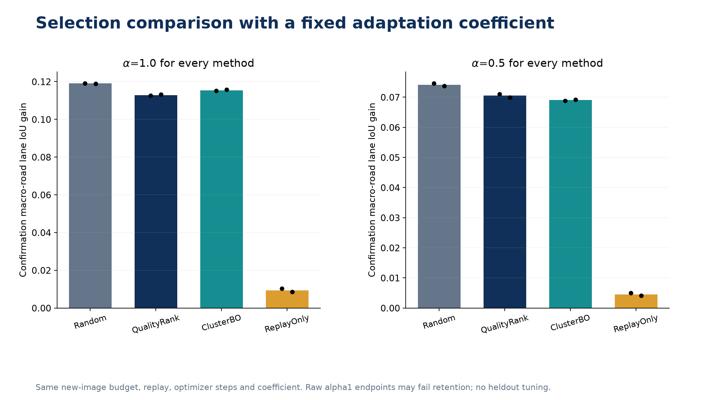
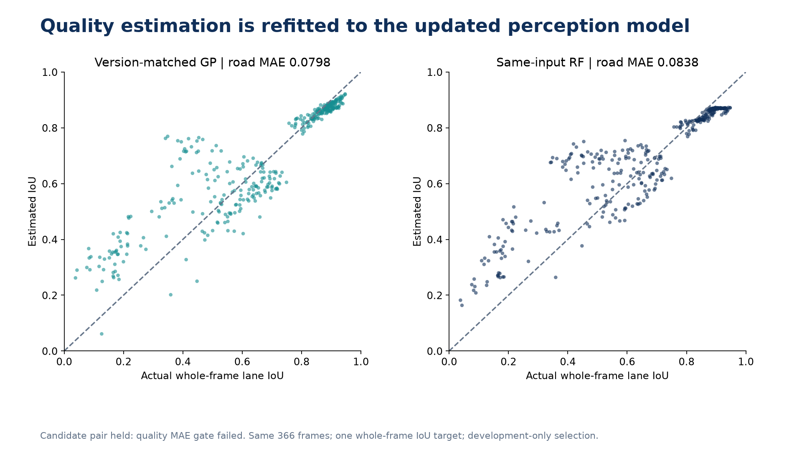
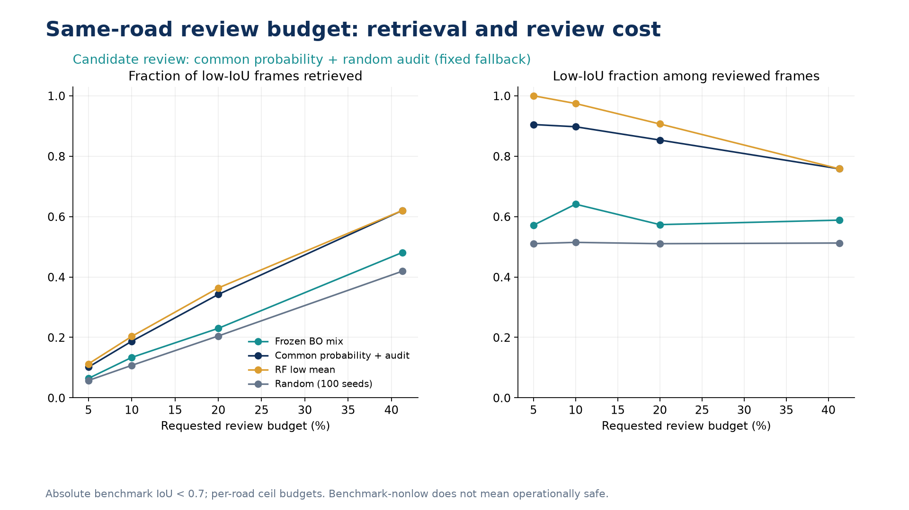
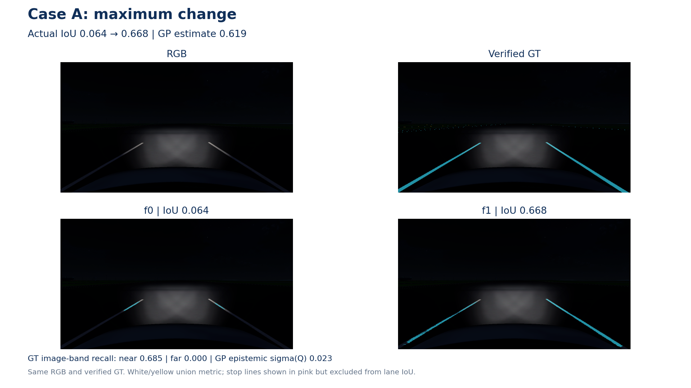
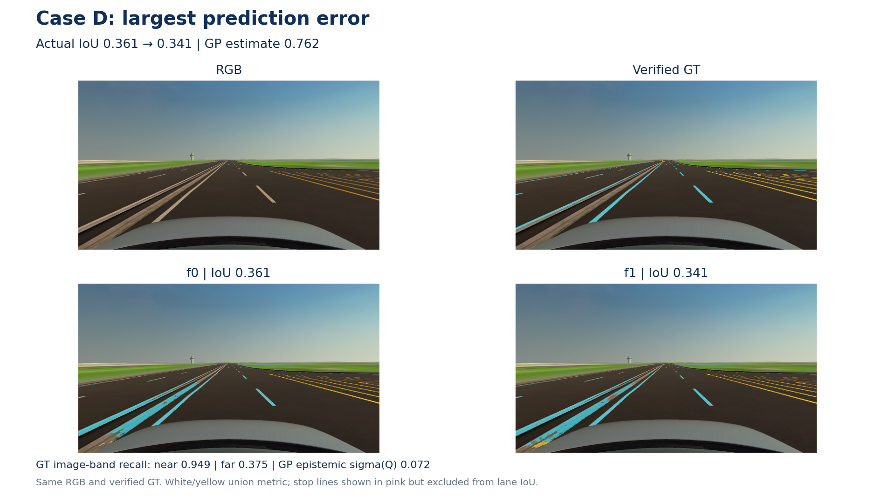

# 환경 군집·검수 정책·동일 예산 인지 재학습 통합 실험

목표는 **전방 RGB와 인지 출력으로 품질을 추정하고, 검수할 데이터를 선별해 인지모델을 개선한 뒤 새 버전의 품질모델도 다시 적합하는 것**이다. 원태에게 배정했던 GP·e-means·BO를 같은 주기로 통합했다. 아래의 실제 개선, 선별 방법 사이의 차이, 운행 실패의 의미를 구분한다.

**이번 판정은 인지모델 개선 확인, f1/g1 통합 교체 보류다.** 기존 f0/g0 기본값을 유지하고 새 가중치·GP·검수 번들은 연구 후보로 보존한다. 모든8학습과24파생 가중치,50개 프레임별 평가를 끝냈다.

| 항목 | 확정한 내용 |
|---|---|
|영역/특징|9영역, 품질28열, 환경 RGB27열(현재24개 활성)|
|환경 군집|공식 e-means K8·고정 중심. 외관 태그와 감사/분포 진단에 사용|
|인지 후보|개발에서 고른 QualityRank alpha0.5·시드261126. 주 확인IoU0.57891→0.64997, 기존lane 손실0.00294|
|품질 후보|해당f1으로 다시 적합한 GP3. 주 확인MAE0.07979, RFQ0.08382. GP버전쌍 유지 기준 실패|
|검수 연구 기준|공통 whole-frame Q<0.7의 확률순+ceil10%감사. 환경 강제할당·σ혼합은 확인 기준을 실패해 사전fallback 적용|
|환경별 하향 임계|개발 이득0.00365<0.01, 확인 이득0. 미채택|
|자동/온라인|자동 학습 승격·기존가중치 교체·liveROS 연결은 하지 않음|

신규 자료 추가학습의 이득은 확인했지만, **품질/군집 선별이 무작위보다 재학습 효과가 크다는 증거는 얻지 못했다.** 검수 적중률과 재학습 이득은 다른 목표다. 먼저 g1의 새 버전 오차·과신을 보완하고 별도 확인을 통과한 뒤 다음 누적 학습/온라인으로 넘어간다.

## 비교와 자료 역할

f0는 원래 **TwinLiteNet+ Medium v6 EMA**다. 원래 train26,001카메라 표본 중 전방은8,667장, validation1,404장 중 전방은468장이다. 신규 전방 후보7,442장에서 다음 bank를 고정했다. 원래 train/val27,405장과 등록된 원본28,971장의 디코딩RGB 중복은0이었다.

| 방법 | 새 슬롯3,072장 | 공통 기존 replay4,096장 |
|---|---|---|
| Random | 후보 무작위 | 원래 train 전·좌·우 카메라 |
| QualityRank | f0/g0 저품질 점수순 | 같은 목록·시드 내 같은 순서 |
| ClusterBO | 환경8군집 균등 할당·품질/σ 점수 | 동일 |
| ReplayOnly v2 | 원래 train의 별도 전방3,072장, 신규0장 | 동일 |

각 bank에 optimizer 시드2개를 적용해 **8회 장시간 학습**했다. 각24,000업데이트·67.91–68.78분이며, 배치16(새 슬롯8+replay8)·BF16 forward/FP32 loss·고정BN 통계·f0 teacher KL을 사용했다. RTX5070Ti16GB에서 수행했고 원래 f0 가중치는 보존했다. 선별 bank는 방법마다 하나이므로 두 시드는 데이터 선별의 독립 반복이 아니다. 전체 후보의41.28%를 넣는 큰 예산이며, 작은 검수 예산의 이득과 동일시하지 않는다. ReplayOnly는 같은 최적화를 더 수행한 효과를 분리하기 위한 대조다.

품질 역할은 fit2,480 / dev937 / cal612 / 확인834장이다. 주 개발은26R1 3도로361장, 나머지 개발576장은 이전 자료다. 확인은 주3도로366장·별도3도로366장·조건전이102장으로 분리한다. 후보와 예약 개발/보정/확인 위치는 최소25.071m 떨어진다. fit/dev/cal/확인 서로도25m 제외 규칙을 적용했다.

인지 추가학습과 quality-fit은 ID·픽셀이 다르지만 대부분 인접한 위치다. 방법별3,051/3,051/3,056개 admission이 quality-fit25m 이내이며,25m 이상 떨어진 quality-fit은779/779/782행이다. **전체 자료가 지리적으로 독립됐다고 주장하지 않는다.** f0 성적을 이미 열었던 같은 지도 도로를 이번에 갱신에서 배제한 paired 진단이며, 처음 보는 최종 시험이 아니다.

분할 목록과 모델/정책은 f1 확인 평가 전에 고정했다. 확인에서 좋은 계수·특징·임계값을 다시 선택하지 않는다. source pack 군집 진단의 dev1,620/cal2,232는 더 넓은 원장이고, 최종 품질 dev937/cal612와 다르다. [모집단 구분](../baselines/selection_cycle_20261127/environment_diagnostics_role_context.json)

## 특징과 e-means 환경 군집

ROI는 **상부 높이를 반분한9영역**이다. 품질 입력은 기존28열을 기준으로, FP 관련6열 추가와 near F1 보조 목표를 개발 자료에서 대조했다. 새 f1의 결과는 다음과 같다. MAE는 IoU/recall의 절대 차이이며0.05는5퍼센트포인트다.

| 입력·모델 | 주 개발 Q MAE | 근거리 recall MAE | 원거리 recall MAE | near F1 MAE |
|---|---:|---:|---:|---:|
| **28열 GP3** | **0.06646** |0.07322|0.08248|—|
|28열 RFQ|0.06787|—|—|—|
|28열 GP4|0.06571|0.07221|0.08249|0.06098|
|28열 RF4|0.06378|0.06192|0.09524|0.05201|
|34열 GP3|0.06545|0.07029|0.08009|—|
|34열 GP4|0.06464|0.07012|0.08001|0.05893|

추가6열의 GP3 Q 이득0.00100은 사전0.003보다 작아 **28열 유지**다. GP4의 near F1도 RF4보다 좋아야 한다는 기준을 통과하지 못해 **GP3 유지**다. RF4가 일부 점 추정에서 더 좋다는 사실도 남긴다. GP의 선택 근거는 불확실성/공간 진단을 제공하면서 RFQ 대비 허용오차0.005 이내라는 조건이며, 모든 지표에서 최선이라는 뜻이 아니다. [열 정의](../guides/ROI와_특징추출.md)

환경은 품질 회귀와 별도로 **상부 위층 좌우·보닛 RGB27열**을 사용한다. 영역마다 밝기 평균/표준편차·glare/어두운 비율·p90−p10·채도 중앙값·blue−red·hue cos/sin9개다. 현재 후보에서 상수인 glare3열을 제외한24열을 표준화한다. 다른 영역에서 새 특징을 모두 복제하지 않는다.

공식 [Faiss e-means](https://github.com/facebookresearch/faiss/blob/main/contrib/e_means/README.md)의 `NumpyEmeans`로4개 RGB 표현×K8/16/32×3시드=36구성을 비교해 RGB27/K8을 선택했다. 최종 중심에서 최근접 배정을 다시 계산했다. 시드 간 평균ARI0.7739, 후보의 날씨 NMI0.49085·시각 NMI0.52048·50m위치 NMI0.03203이었다. **C0–C7은 외관군이며 날씨 클래스가 아니다. NMI는 분류 정확도가 아니다.** 메타데이터는 오프라인 표현 선택/진단에 사용했고 실제 중심 적합·배정은 RGB만 읽는다.

같은 초기 중심3시드에서 e-means5회 MSE는3.2124/3.4700/3.4966, Lloyd 최대25회는3.5151/4.1956/3.5004였다. 작은 CPU 문제의 관측이며 논문의 대규모 GPU 속도 향상을 재현했다고 주장하지 않는다. 추론에는 표준화·고정 중심 최근접 계산만 필요하다.

## 인지 재학습과 기존 성능 보존

5070Ti16GB에서 배치16=새8+replay8,24,000업데이트로 각 bank62.5회·replay46.875회분을 학습했다. BF16 forward·FP32 loss, AdamW1e−5→cosine1e−6, warmup200, decay1e−4, clip10, 고정BN 통계·학습 가능한 affine, replay의 f0 teacher KL0.25/T2를 공통 적용했다. 실제 소요시간·메모리는 [예산 원장](../baselines/selection_cycle_20261127/training_budget.json)에 있다.

첫 Random 원시 endpoint가 기존 성능 유지 기준을 실패한 뒤 다른 f1 개발 결과와 모든 f1 확인 결과를 열기 전에, 모든 방법·시드·대조에 alpha0.25/0.5/0.75 보간을 추가 등록했다. `θα=(1−α)θf0+αθtrained`로 한 네트워크를 만들며 gradient를 더 학습하지 않는다. **8회 학습+24개 파생 가중치 평가**다. [WiSE-FT](https://github.com/mlfoundations/wise-ft)의 가중치 보간에서 차용했으며 원 논문의 zero-shot 모델/과제와 다른 적용 실험이다.

원시 신규6회는 모두 기존 유지 기준을 실패했다. Random alpha0.75는 첫 시드만 통과했으므로 두 시드 반복 기준에서는 보류했다. 개발 선택은 **QualityRank alpha0.5**, 대표 시드는261126이다. 두 시드 평균 개발IoU는QualityRank0.72061·Random0.71829·ClusterBO0.71237이며 f0는0.65081이다. 이 개발 수치가 확인 성과를 대신하지 않는다.

신규 주 도로 macro 이득≥0.005·2/3도로 향상·개별 손실≤0.02, 기존 validation pooled lane/drivable 손실 각각≤0.005, 클래스·시야 손실≤0.01, 두 optimizer 시드 통과를 요구했다. 순수 선별 효과는 **같은 alpha1.0과0.5**에서 비교한다. 방법마다 개발에서 선택한 계수가 다른 표는 파이프라인 비교로 구분한다.

## 확인 결과와 판정

주 확인3도로366장(도로별122)의 macro IoU다. 아래 평균은 두 optimizer 시드 평균이며 f0는0.57891이다. 표의 기존lane 변화는 원래1,404장 validation의 pooled 픽셀 기준이다.

|개발에서 고정한 방법|두 시드 평균 확인IoU|f0 대비|기존lane 변화 범위|두 시드 인지 기준|
|---|---:|---:|---:|---|
|Random@a0.50|0.65308|+0.07418|-0.00301–-0.00196|통과|
|QualityRank@a0.50|0.64943|+0.07052|-0.00338–-0.00294|통과|
|ClusterBO@a0.50|0.64792|+0.06901|-0.00259–-0.00233|통과|
|ReplayOnly|0.58835|+0.00944|-0.00308–-0.00041|통과|

공통alpha0.5에서는 Random 이득+0.07418, QualityRank+0.07052, ClusterBO+0.06901, ReplayOnly+0.00456이다. 원시alpha1.0에서도 품질/군집 선별이 무작위보다 낫지 않았다. 다만 원시 신규6회는 유지 기준을 실패했다. 확인에서Random이 더 높았다고 이미 고른 f1을 교체하지 않았다.

대표f1의 기존lane0.89546→0.89253, drivable0.98344→0.98293이며 white/yellow/stopline도 유지 기준을 통과했다. 주 확인 외의 GT지원이 적은 도로와 조건전이는 별도 집계하며 주 도로의 개선으로 대신하지 않는다.

### 품질모델의 오차와 과신

|평가|새GP Q MAE|새RFQ Q MAE|기존 f0/g0 Q MAE|
|---|---:|---:|---:|
|주 확인366|0.07979|0.08382|0.04982|
|별도도로366|0.15864|0.14942|0.07993|
|조건전이102|0.11629|0.14704|0.03488|

새GP가 새RFQ보다 주 확인 평균은 좋았지만, 사전 유지 한계0.05982(기존0.04982+0.010)를 넘었다. 이미 적합을 다시 했다는 사실만으로 버전 교체를 허용하지 않았다. 일부러 짝을 깨 본 stale g0/f1의 MAE0.07717도 실행 가능한 대안으로 채택하지 않는다.

|주 확인 도로|GP MAE|RFQ MAE|GP 평균 편향(예측−실제)|
|---|---:|---:|---:|
|Road 1 (122장)|0.15240|0.16523|+0.11875|
|Road 2 (122장)|0.05016|0.05619|-0.01222|
|Road 3 (122장)|0.03681|0.03004|-0.02503|

Road1의 오류가 크며 낮 장면에서 실제0.341을0.762로 과신했다. 환경별 야간 임계 조정만으로 해결할 수 있는 문제로 보지 않는다. 도로별/환경별 새 인지 출력의 지원 분포와 GT가 적은 장면을 함께 검토해야 한다. [도로별 집계](../baselines/selection_cycle_20261127/per_road_quality_descriptive.json)

### 같은 검수 장수의 검색 성과

주 확인 저품질187장 중 도로마다ceil10%를 검수해 총39장(10.66%)을 선택했다. 감사는 도로당2장으로 실제6/39=15.38%다. benchmark-nonlow를 운행 오경보로 부르지 않는다.

|고정 정책|발견/39장|Precision|Recall /187장|
|---|---:|---:|
|개발 BO혼합(감사 포함, 미채택)|25.00|64.10%|13.37%|
|공통확률(감사 없음)|39.00|100.00%|20.86%|
|**공통확률+감사(fallback)**|35.00|89.74%|18.72%|
|GP 낮은평균(감사 없음)|39.00|100.00%|20.86%|
|RF 낮은평균(감사 없음)|38.00|97.44%|20.32%|
|σ만(감사 없음)|19.00|48.72%|10.16%|
|무작위100회 평균|20.07|51.46%|10.73%|

혼합의 macro 도로 Recall0.16052는 공통확률+감사의0.27385보다0.02 이상 나빠 사전 기준을 실패했다. 순수 공통확률의 높은 성적은 감사가 없는 값이다. 이 비교를 보고 감사 슬롯을 확인 도로에 맞춰 줄이지 않았다. 이 고정 fallback은 **후보f1/g1 연구 번들의 정책**이며 전체 버전 쌍 교체는 여전히 보류다.

### 불확실성과 공간 확률

주 확인 저품질 AUC는 전체Q확률0.97290·σ단독0.74851이다. 근거리precision/recall 결함167장과 근거리보존·원거리누락173장을 나누는 σ AUC는0.64477이었다. 평균σ는각0.02796/0.01976으로 차이가 있지만 단독 실패유형 규칙으로 충분하지 않다.

명목90% 구간의 실제 포함률은Q72.40%·근recall79.23%·원recall46.99%다. 평균 폭은각0.210/0.229/0.157이며 과신이 남는다. 근/원상태 결합 Brier는전체공분산0.219463·교차항0대조0.219454, 근−원recall차90%폭0.27498/0.27791·포함률79.23%/79.78%로 큰 이득은 없었다. 별도 독립GP를 다시 학습한 실험은 아니다.

근거리 recall만으로 나눈 상태의 정확도0.86339도 근거리precision 보장을 뜻하지 않는다. 한 장에서 전체Q0.947·근recall0.980·원recall0인 사례가 있어 전체Q와 영상 띠 진단이 다른 정보를 줄 수는 있지만, 이를 운행 정상/위험 판정으로 확정하지 않는다.

## GP·BO·검수 기준의 역할

새 f1로 fit/dev/cal의 X·Q/근·원recall을 모두 다시 만들고 g1을 적합했다. Matérn3/2 입력 커널과 task 상관 행렬을 사용하며 선택값은 길이배수2.8·noise분산0.1·ρ0.4다. GP/RF에 같은 지리3fold·25m 제외·8회BO/8회무작위·공통 초기4점을 사용했다. GP CV목표는Q+0.25근recall+0.25원recall MAE, RFQ는Q MAE라 서로 목적함수 절대값을 직접 비교하지 않는다.

| 오프라인 탐색 | BO 최선 | 같은 예산 무작위 최선 | 해석 |
|---|---:|---:|---|
|GP 설정8회|0.108632|0.108820|작은 이득|
|RFQ 설정8회|0.070510|0.070510|동점|
|검수 정책16회|0.547996|0.547996|동점|

BO는 설정→검증손실을 예측하는 별도 GP 대리모델이다. 온라인 프레임 품질 GP와 구분한다. **이번 BO는 실제 재학습 이득을 직접 최적화하지 않았다.** 그 효과는 위 동일 예산 인지 재학습으로 별도 확인한다.

개발 정책은 낮은 평균 점수와 잠재σ 순위를75:25로 섞고 환경 균등 할당·10%무작위감사 ceil을 사용한다. 개발 Brier는 원시0.04330·보정0.05479로 보정을 비활성화했다. 확인에서 사전 기준을 실패하면 공통 Q0.7 확률순+감사로 돌아간다. 최종 정책은 위 채택 표와 번들 `policy.json`을 읽는다.

환경별 상대 기준은 새 f1의 보정612행에서 다시 적합했다. GT지원490행·근거리precision/recall보존328행으로 전체지원/보존참조를 비교하고, 분위수·축소·혼합·할당을 탐색했다. 최소30행·2도로·10개5m셀을 요구하고 부족/OOD에는0.7을 사용한다. 개발 손실 이득0.00365가 사전0.01보다 작아 **주 실행 정책에는 적용하지 않는다.** 낮은 야간 IoU를 정상으로 인정하는 기준으로 해석하지 않는다.

공통 연구 정답은 **whole-frame Q<0.7**이다. 사후GT에서는 근거리precision 또는recall<0.8, 원거리recall<0.5를 보조 진단하고 각 분모50픽셀 이상을 요구한다. 근거리 양호에는 precision/recall 둘 다 필요하다. 가시성·정상/위험 라벨이 없으므로 운행 실패 기준 확정이나 자동 재학습 승인은 별도다. **온라인 GT/ROI별 IoU 계산은 없다.**

GP σ가 높을 때의 탐색 가치와 실패 유형은 별개다. 결합 근/원거리 확률, `Var(near−far)=Σnn+Σff−2Σnf`, 같은 평균·주변분산에서 교차항만 제거한 대조를 평가했다. σ 단독이 전반 저하/원거리 저하를 구별한다는 가정을 검증 결과로 대체한다.

## 데이터 보존·실행·한계

새 원본 수집 없이 D/E 자료를 공유 캐시로 재가공했다. 원래 replay/val/control8,572장의 두 헤드 정답과padding은 기존 학습 캐시와 비트 단위로 일치했다. 원본 RGB/Semantic·GT정책·인지 버전·ROI·열·목록·optimizer/RNG·로그·최종 가중치를 보존한다. E원본을 복사하지 않았고 G는 사용하지 않았다.

검수는 **모든 RGB를 먼저 순위화**한다. 사후GT지원≥100과union≥100을 따로 집계해 GT가 적은 오검출도 남긴다. 주 확인366장은 모두GT≥2,184라 주 채택 분모는 바뀌지 않았다. 보조 도로 두 장면의 원본/GT를 직접 봤을 때 전경은 실제 무표시 도로였다. 이두장면 확인을 전체 annotation 완전성 증명으로 확대하지 않는다.

신규 RGB 후보의 점수·군집·선택 사유를 고정한 뒤 원본/디코딩 해시를 확인해 GT를 연결한다. 예약 dev/cal/확인 역할은 연결 이후에도 남고 `admission_approved=false`다. 인지 체크포인트·selected state dict·GP·보정·정책을 한 버전 신원으로 검증하고 옛 g0를 새 f1과 섞는 실행을 거부한다. RF는 pickle 없이 읽는 portable 배열도 함께 인계한다.

40/50 프로파일은 분리 유지한다. 실제 GPU검증은5070Ti이며40GPU 실측으로 부르지 않는다. 원본/가중치/개별ID는 공개Git에 올리지 않는다. [공개 근거·그림](../baselines/selection_cycle_20261127/README.md), [실행 순서](../../scripts/experiments/selection_cycle_20261126/README.md), [현재 가이드](../guides/인지모델_재학습과_갱신판정.md), [일정·담당 인계](../guides/일정과_역할.md)를 함께 따른다.

## 실행 검증과 다음 단위

RGB96장만 읽는 추론에서 GT 경로를 일부러 없애고 y=-999를 넣어도 동작했다. 검수12장(감사2장)을 고른 뒤 원본 해시를 대조해 GT를 연결했으며 예약 확인 역할과 `admission_approved=false`를 유지했다. 잘못된 f0/f1 짝을 거부하고 portable RF는 두 CPU프로파일에서 동일하게 예측했다.

같은96장·배치 구성의 RGB 단독/paired 특징 차이는0이다. 원래 전체팩과 다른 배치 구성에서는 근소한 argmax 경계로 최대특징차0.00003266·IoU예측차0.00000539가 생겼다. 처음 검증 실패와 미완료 진단도 보존하고 별도 동일배치 검사로 원인을 분리했다. 실제 특징/모델/확인 정답은 바꾸지 않았다.40CPU/50GPU의 IoU예측 차이는0.00001132이며 실제40GPU는 미검증이다.

다음 우선순위는 **g1 품질 유지성 보완 → 새 동결 구간 확인 → 다음 수천장 주기 → ROS shadow 연결**이다.

1. 승현·재호는 새f1의 오차·지원 분포를 검토하고, 낮 차선형상/FP·GT희소·여러환경의 품질 학습 자료를 보강한다. fit에 근recall 분모가 있어야 한다는 조건이 주Q 학습 모집단까지 좁히는 영향을 분리한다. Q모델과 보조목표의 행 마스크를 나누는 후보, 소수 FP/형태 특징, 원래 대비 replay/teacher 제약을 각각 독립 과제로 둔다.
2. 원태는 f1의 Q점추정·관측/잠재σ·보정 선택을 재현한다. 현재 확인을 개발에 쓸 경우 역할을 전환하고 **다시 새 위치를 동결**해 최종 확인한다. 환경 태그가 정상 라벨을 대신하지 않으며, 환경 하향 임계나 GP복잡도를 늘리는 것만으로 성공을 가정하지 않는다.
3. 품질/검수 채택을 통과하면 f1→f2 부모와 누적 노출·중복·GT정책·공통 replay를 구현하고 다음2–3천장 단위를 비교한다. 현재 trainer는f0에서 시작하며 이번8회는 독립 방법/시드 비교이지 연속8주기가 아니다.
4. 이후26R1 ROS 시간 창·프레임 보존·버전 원자전환·지연/드롭을 인수한다. 웹 골격·영문 그림은 병행하고11월30일 오프라인 판정,12월4일 수치/영상/영어 사이트를 완성한다.

실행·사진의 정본은 [근거 모음](../baselines/selection_cycle_20261127/README.md)이다. 개선 최고 사례(A), 감소 사례(C), 큰 품질 오차(D)를 함께 공개하며 개별640×360패널과 나머지 사례는 내부 볼륨에 보관한다. 1920×1080 PNG와SVG를 발표·웹페이지에 사용할 수 있다.

