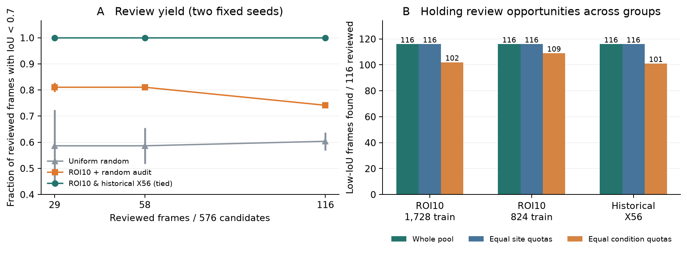
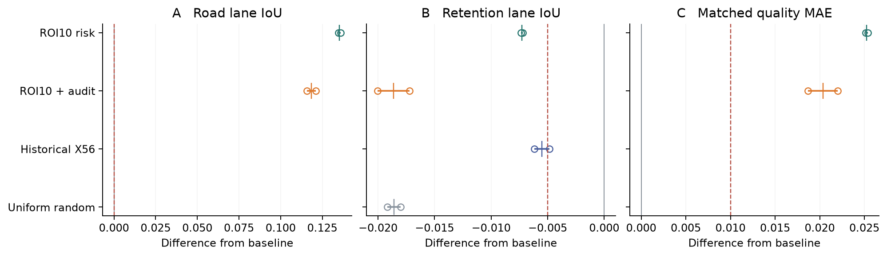
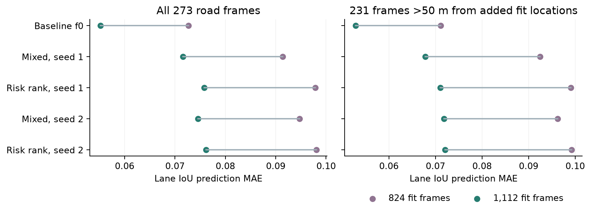
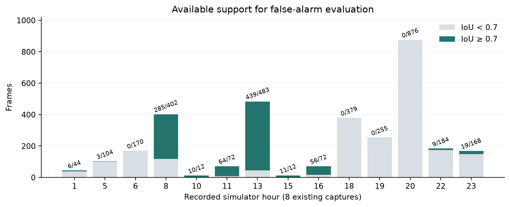

# 11월 23일 저녁 오프라인 검수와 동일 예산 재학습

**기본 모델은 TwinLiteNet+ Medium v6(f0)를 유지하고, 다음 미사용 도로에서 시험할 조건부 갱신 후보 한 쌍을 고정했다.** 혼합 검수 시드 1의 f1을 f0 예측 IoU가 0.7 미만인 프레임에만 적용하고, 해당 f1의 품질 추정기를 1,112장으로 다시 학습했다. 과거 두 회차에서 차선 IoU는 0.4026→0.5293, 기존 1,613장에서 0.8011→0.7991, 실제 선택한 모델 쌍의 도로 품질 MAE는 0.0555→0.0628이었다. 세 변화는 이번 수치 기준 안에 들었다. 두 번째 시드도 주행 IoU +0.1221, 기존 IoU −0.0025, 품질 MAE +0.0090으로 같은 기준을 충족했다. 가중치와 분기 규칙은 해시로 기록했으며, 미사용 도로의 GT와 두 번째 인지 추론의 지연은 다음 검증 항목이다. [다음 도로용 고정값과 근거](../baselines/offline_review_20261123/results.json)

**검수 116장 전부에서 낮은 차선 IoU를 확인했다.** 12개 정지 위치에서 6개 날씨·8개 시각을 조합한 후보 576장 중 실제 저품질은 352장이었다. GT 없이 10영역 추정 IoU가 낮은 순으로 뽑은 116장의 정밀도는 100%, 전체 저품질에 대한 Recall@116은 33.0%다. 기존 X56 위험순도 116장을 찾았다. 최종 모델 판단에는 선별 후 재학습한 모델의 실제 차선 IoU와 품질 추정 오차를 별도로 쓴다.

## 비교 조건

| 용도 | 자료와 통제 조건 |
|---|---|
| 선별 | 후보 RGB 576장만 마운트해 Medium v6 f0와 고정 10영역 추정기로 점수화했다. 5%·10%·20% 예산과 두 시드를 먼저 정하고 프레임 ID·디코딩 RGB 해시를 고정했다. 그 뒤 Semantic을 열었다. |
| 재학습 | 주 비교는 신규 정답 116장, 매 배치 신규 6장과 기존 replay 2장, AdamW 학습률 0.000002, 240회다. 같은 시드의 대조군은 같은 f0에서 출발한다. 전체 배치의 replay 프레임 ID 순서를 대조했다. |
| 개발·기존 성능 | 별도 개발 576장과 기존 조건 1,613장을 모든 모델에서 같은 프레임으로 평가했다. 개발 576장은 검수 후보 576장과 다른 자료다. |
| 도로·품질 전이 | 같은 640m 도로를 다른 환경 순서로 두 번 지난 273장(A 137, B 136)이다. f0와 각 f1의 10영역 품질모델은 재학습·도로 평가와 분리된 과거 세 세션 824장에서 각각 학습했다. f1마다 출력과 GT를 다시 비교해 IoU 정답도 새로 만들었다. |
| 판정 | 도로 평균 차선 IoU 증가 ≥ 0, 기존 차선 IoU 하락 ≤ 0.005, 짝지은 품질모델 MAE 증가 ≤ 0.010을 함께 검사한다. 세션과 도로는 이전 실험에서도 열어 본 자료다. 채택에는 정책을 고정한 뒤 미사용 도로 평가가 필요하다. |

## 선별한 116장의 구성

| 검수 방식 | 실제 저품질 발견 · 시드 1 / 2 | 포함한 정지 위치 · 시드 1 / 2 |
|---|---:|---:|
| 10영역 위험순 | 116 / 116 | 10 / 10 |
| 기존 X56 위험순 | 116 / 116 | 9 / 9 |
| 10영역 위험순 58 + 나머지 중 무작위 58 | 87 / 85 | 12 / 12 |
| 균일 무작위 | 66 / 74 | 12 / 12 |

무작위 점검을 둔 방식은 검수 밖 모집단의 저품질 수까지 추정할 수 있다. 두 시드의 모집단 추정치는 약 317장과 299장, 각각의 95% 구간은 252~382장과 235~365장이었다. 모집단 GT에서 확인한 정답은 352장이다. 이 구간은 고정된 576장 안에서 무작위로 누구를 검수했느냐에 따른 불확실성을 나타낸다.

**같은 촬영 묶음에 대한 의존성도 점검했다.** 1,728장으로 학습한 기존 10영역 선별기는 후보와 프레임·픽셀·정지 위치가 분리돼 있지만 같은 수집 캠페인의 영향을 받는다. 별도 과거 세 세션의 824장으로 적합한 모델도 116장 모두 저품질을 찾아냈고, 선택 ID 100장이 기존 10영역 순위와 일치했다. 두 모델의 후보 MAE는 각각 0.0590과 0.0785였다. 같은 1,728장으로 학습한 X56의 MAE는 0.0727이었다. 검수 적중률이 같은 모델 사이에도 IoU 수치 예측 오차는 차이가 났다.

위치마다 9~10장의 예산을 먼저 배분하고 **각 위치 안에서** 위험순으로 뽑자 12개 위치 모두를 포함하면서 저품질 116장을 유지했다. 세 방식 모두 같은 결과였다. 위치별 균일 추출의 기대 발견 수는 70.6장이다. 반면 48개 날씨·시각 셀에 예산을 배분하면 10영역 기존·과거 세션·기존 X56의 발견 수가 각각 102·109·101장으로 달라졌다. 이 할당은 GT를 대조한 뒤 수행한 추가 분석이다. 위치별 할당으로 재학습한 효과는 다음 비교 대상이다.

## 동일 예산 재학습 결과

각 값은 같은 프레임에서 측정한 평균이다. 앞의 두 IoU는 클수록, 품질 MAE는 작을수록 좋다. MAE의 f0 대조값은 824장으로 맞춰 재학습한 품질 추정기에서 얻었다. 후보 선별 때 사용한 1,728장 추정기의 도로 MAE는 0.0555였다.

| 방법 · 시드 | 개발 IoU (576장) | 기존 IoU (1,613장) | 주행 IoU (273장) | 짝지은 품질 MAE |
|---|---:|---:|---:|---:|
| 갱신 전 f0 | 0.5720 | 0.8011 | 0.4026 | 0.0727 |
| 10영역 위험순 · 1 | 0.5721 | 0.7939 | 0.5373 | 0.0978 |
| 10영역 위험순 · 2 | 0.5723 | 0.7938 | 0.5385 | 0.0981 |
| 10영역 혼합 · 1 | 0.5632 | 0.7839 | 0.5236 | 0.0914 |
| 10영역 혼합 · 2 | 0.5579 | 0.7811 | 0.5185 | 0.0947 |
| 기존 X56 위험순 · 1 | 0.5740 | 0.7963 | 0.5402 | 미측정 |
| 기존 X56 위험순 · 2 | 0.5737 | 0.7949 | 0.5421 | 미측정 |
| 균일 무작위 · 1 | 0.5639 | 0.7831 | 0.5311 | 미측정 |
| 균일 무작위 · 2 | 0.5672 | 0.7820 | 0.5179 | 미측정 |

세 지표를 모두 측정한 240회 갱신 4건 중 사전 수치 기준을 모두 통과한 건수는 0건이다. 기본 운용 쌍은 f0/g0를 유지한다. 회로의 연속 프레임 간 상관을 반영해 두 회차의 같은 50m 구간을 함께 5,000회 재표집했다. 20m·100m로 구간 폭을 바꾼 결과도 [수치 기록](../baselines/offline_review_20261123/results.json)에 있다.

혼합 방식 시드 1의 주행 IoU 변화는 +0.1211, 50m 구간 재표집 범위는 +0.0967~+0.1449였다. 이 구간은 관측한 한 회로 안의 불확실성만 반영한다.

### 라벨 수와 학습 길이

추가 진단에서는 동일 시드로 240회와 1,200회를 비교했다. 576장 실험은 이미 확보한 후보 정답 전부를 허용한 비교다. 116장 실험보다 라벨 비용이 약 다섯 배다. 같은 배치 횟수에서는 모든 허용 프레임이 실제로 뽑히지 않을 수 있어 고유 학습 장수를 함께 센다.

| 방법 · 시드 | 허용 / 실제 사용 신규 장수 | 업데이트 | 개발 IoU | 기존 IoU |
|---|---:|---:|---:|---:|
| 10영역 혼합 · 1 | 116 / 116 | 240 | 0.5632 | 0.7839 |
| 10영역 위험순 · 1 | 116 / 116 | 240 | 0.5721 | 0.7939 |
| 균일 무작위 · 1 | 116 / 116 | 240 | 0.5639 | 0.7831 |
| 기존 X56 위험순 · 1 | 116 / 116 | 240 | 0.5740 | 0.7963 |
| 후보 전량 · 1 | 576 / 523 | 240 | 0.5653 | 0.7813 |
| 후보 전량 · 2 | 576 / 534 | 240 | 0.5684 | 0.7830 |
| 10영역 혼합 · 1 | 116 / 116 | 1200 | 0.5739 | 0.7736 |
| 10영역 위험순 · 1 | 116 / 116 | 1200 | 0.5751 | 0.7715 |
| 균일 무작위 · 1 | 116 / 116 | 1200 | 0.5786 | 0.7690 |
| 기존 X56 위험순 · 1 | 116 / 116 | 1200 | 0.5731 | 0.7753 |
| 후보 전량 · 1 | 576 / 576 | 1200 | 0.5798 | 0.7737 |

전체 배치마다 같은 시드 대조군의 replay 2장 순서를 확인했다. 1,200회 비교는 고정 학습률과 같은 자료 구성에서 학습 길이를 늘린 결과다. 위치 수는 그대로 12곳이어서 라벨 수 확대와 새 도로 다양성 확보는 별도로 검증해야 한다.

후보 576장을 실제로 모두 사용한 1,200회 실험은 개발 IoU 0.5798, 기존 IoU 0.7737였다. 같은 시드의 전량 240회와 비교하면 개발 IoU는 +0.0145, 기존 IoU는 -0.0076 변했다. 이 수집분에서는 라벨 수와 학습 길이만 늘려 기존 성능 유지 문제를 풀지 못했다.

### 품질 추정기 학습 자료 보강

첫 갱신의 도로 품질 MAE 증가를 확인한 뒤, 기존에 품질 학습용으로 예약한 별도 수집 288장을 추가했다. f0와 각 f1의 품질 추정기를 같은 1,112장으로 적합했다. 인지모델 가중치는 각 후보에서 고정했다. 추가 자료는 평가 회차와 세션이 다르지만 평가 프레임 42장이 추가 학습 위치의 50m 이내였다. 나머지 231장도 따로 비교했다. 기존 824장의 최근접 학습 위치와 회로 간 최단 거리는 331m였다.

| 인지모델 | 전체 MAE · 824장 → 1,112장 | 50m 밖 MAE · 824장 → 1,112장 |
|---|---:|---:|
| f0 | 0.0727 → 0.0552 | 0.0711 → 0.0528 |
| 10영역 혼합 · 1 | 0.0914 → 0.0716 | 0.0925 → 0.0679 |
| 10영역 위험순 · 1 | 0.0978 → 0.0758 | 0.0991 → 0.0711 |
| 10영역 혼합 · 2 | 0.0947 → 0.0745 | 0.0962 → 0.0718 |
| 10영역 위험순 · 2 | 0.0981 → 0.0762 | 0.0992 → 0.0720 |

### 낮은 점수에서만 갱신 모델을 쓰는 파일 재생

고정한 1,728장 품질 추정기가 f0의 IoU를 0.7 미만으로 예측한 프레임에서만 f1 출력을 선택했다. 나머지는 기존 f0 출력을 사용했다. 두 모델의 보관 예측과 사후 GT를 같은 프레임에서 결합한 추가 진단이다. 분기 후 인지모델 호출 수는 회로 평균 1.78회/프레임, 기존 자료 평균 1.12회/프레임이다. 실제 지연은 표적 하드웨어에서 측정해야 한다.

혼합 시드 1에서 f1을 고른 장수는 회로 212/273장, 기존 자료 192/1,613장이었다. 전부 f0를 쓴 경우 대비 차선 IoU 변화는 각각 +0.1267, -0.0020였다. 824장으로 짝지은 품질 추정기의 MAE 변화는 +0.0222였다. 품질 학습을 1,112장으로 늘려 같은 선택을 유지했을 때 MAE 변화는 +0.0073였다.

| 1,112장 품질 학습 + 조건부 사용 | 주행 IoU 변화 | 기존 IoU 변화 | 품질 MAE 변화 | 세 기준 |
|---|---:|---:|---:|---|
| 10영역 혼합 · 1 | +0.1267 | -0.0020 | +0.0073 | 충족 |
| 10영역 위험순 · 1 | +0.1383 | -0.0003 | +0.0127 | 보류 |
| 10영역 혼합 · 2 | +0.1221 | -0.0025 | +0.0090 | 충족 |
| 10영역 위험순 · 2 | +0.1394 | -0.0005 | +0.0124 | 보류 |

조건부 사용과 품질 학습 보강의 조합은 탐색 결과다. 프레임별로 f0/g0 또는 f1/g1 중 실제 선택한 쌍의 IoU와 예측 오차를 썼다. 다음 실험에서는 여기서 선택한 정책과 가중치를 먼저 고정하고 미사용 도로·야간 정상 위치·두 번째 추론 비용을 검증한다.

공개 표의 IoU·점수·구간별 오류는 재현용이다. 원본 영상, 위치 좌표, 모델 가중치와 행 단위 학습 목록은 실험 볼륨에 보관했다.

## 야간 오경보를 평가할 수 있는 범위

8개 세션 3,233장을 수집기 내보내기와 프레임·픽셀 해시로 대조했다. 20시~다음 날 5시에 속한 1,376장 중 실제 IoU ≥ 0.7인 정상은 **37장**, 세 세션에 있었다. 50m 격자의 시작점을 바꾸면 정상 장면은 10~13칸에 분포했다. 기존 10영역 품질 학습 위치에서 25m 이상 떨어진 정상 22장은 7~8칸이었다. 격자 수는 촬영 위치의 집중도를 보여 준다. 독립 도로 수는 별도로 확보해야 한다.

20시 876장은 모두 IoU < 0.7이었다. 이 시각의 정상 오경보율은 분모가 0이다. 22시에는 184장 중 9장, 23시에는 168장 중 19장이 정상이었다. 운용상 실패를 정할 때는 가까운 차선의 누락·오검출과 원거리 가시거리 저하를 구분해 검토한다.

기존 640m 도로 273장에는 전체 정상 69장, 저품질 204장이 있었다. 공통 보정값은 정상 1장에 오경보를 내고 실제 저품질 5장을 놓쳤다. 조명별 보정값은 오경보 8장·누락 1장이었다. 고정 0.7 경보는 오경보 8장·누락 0장이었다. 이 결과로 조명별 기준의 일괄 적용을 결정하기는 어렵다.

## GP의 평균 예측과 불확실성 순위

과거 824장으로 학습하고 별도 개발 576장으로 설정을 선택한 GP와 RF에 같은 저장 RGB 특징을 전달했다. 검수 예산 20%에서 후보 116장과 도로 55장 모두 GP 평균순·GP 평균에서 표준편차 하나를 뺀 순위·동일 학습분 RF 평균순이 전부 저품질이었다. GP 표준편차만 큰 순서는 각각 99장과 51장을 찾았다. GP의 IoU MAE는 후보 0.1073·도로 0.0833, 같은 학습분 RF는 0.0923·0.1074였다.

GP의 명목 90% 예측구간은 도로 실제 IoU의 98.2%를 포함했지만 평균 폭이 0.644였다. 도로에서 예측 표준편차와 실제 절대오차의 순위상관은 −0.251이었다. 불확실성 단독 순위로 품질 저하를 판단할 근거는 부족하다. 손재호는 공개 표에서 예산을 5%·10%로 바꿔 평균 예측에 불확실성을 더했을 때 새로 발견하거나 놓친 프레임을 비교할 수 있다.

## CPU로 재현하는 팀 인계

[검수용 RGB 점수](../baselines/offline_review_20261123/scores.csv)와 [사후 GT](../baselines/offline_review_20261123/delayed_gt.csv)는 각각 849행이다. 공개 표로 프레임 IoU, 정책별 선별 적중률, 위치별 정상 분모를 계산할 수 있다. 열 정의와 원본 데이터가 있을 때의 검수·재학습 명령은 [10영역 재현 안내](../development/전방_10영역_실험_재현.md)에 있다.

RGB만 보관한 과거 별도 주행에서도 5개 기록 유형·10개 세션의 전방 320장을 점수화하고 위험순 32장과 무작위 32장을 골랐다. 센서 기록에서 전방 해상도 1280×720, 수평 시야각 90°, 장착 높이 약 1.2m를 확인했다. 해당 세션에는 Semantic이 없어 실제 실패 판정과 모델 평가에서 제외했다.

공개 CSV만으로 세 예산·두 시드·두 방식의 검수 목록 12개를 원래 순서까지 재현했다. 점수표와 사후 GT를 결합한 뒤 849행 모두 영역별 픽셀 수로 원래 차선 IoU를 복원했다. 단일 학습 팩으로 다시 적합한 824장 모델의 파일 해시는 기존 결과와 일치했다. 코드 검증은 ML 153개와 수집 32개 테스트를 통과했다.
