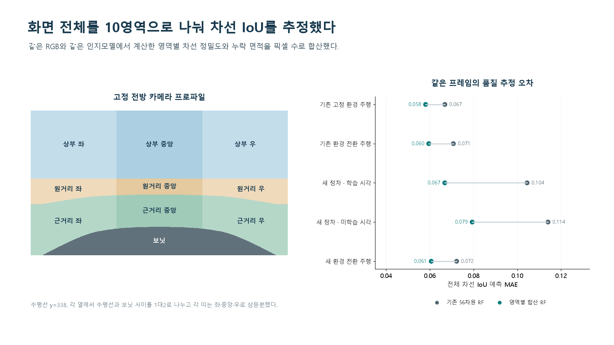
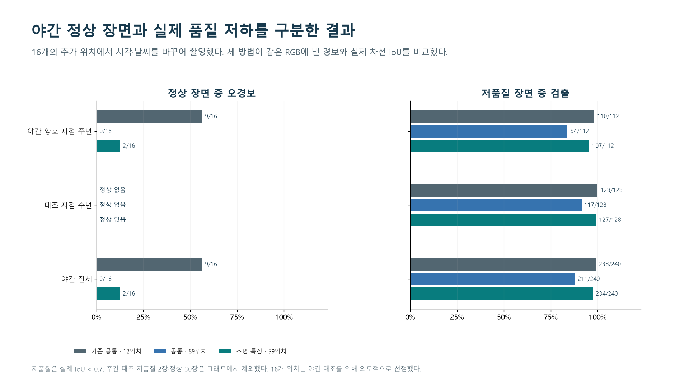

# 전방 10영역에서 환경과 차선 인지 품질을 추정한 결과

**2026년 11월 23일 오후 실험.** 전방 RGB를 열 영역으로 나눈 뒤, 날씨를 설명하는 특징과 실제 차선 오차를 설명하는 특징을 따로 검증했다. 다른 12개 위치의 576장에서 기존 RF의 IoU 예측 MAE는 0.1045, 새 영역별 추정기는 0.0669였다. 이 차이는 12개 위치 중 11개에서 같은 방향이었다. 검수 순위에는 새 추정기를 병행할 근거가 생겼다. 환경별 경보 기준은 기존 보정 위치에서 새 도로로 충분히 이전되지 않았다. [집계·분모·프로토콜 해시](../baselines/roi10_study_20261123.json) · [팀 코드 실행법](../development/전방_10영역_실험_재현.md)

이 전방 카메라에서는 보닛 실루엣과 수평선 기준 1대2 분할을 유지한다. 날씨에는 상부·도로·보닛에서 나온 확률을 띠별로 결합하고, 차선 품질에는 각 영역의 정밀도·누락 면적과 예측 차선 픽셀 수를 쓴다. 새로운 640m 경로에서 검수 적중은 기존·새 모델 모두 25/28장이었다. 기본 RF와 10영역 점수를 함께 기록하고, 자동 경보를 바꿀 때는 야간 정상 위치를 더 확보한다.



## 1. 카메라 공간과 특징

전방 1280×720, 수평 화각 90°, 피치 2°인 고정 카메라에 맞췄다. 24개 과거 학습 위치에서 얻은 자차 실루엣의 픽셀별 과반 마스크를 보닛으로 사용한다. 나머지는 수평선 y=338 위의 상부와, 수평선에서 각 열의 보닛 시작점까지를 1대2로 나눈 원거리·근거리로 구분한다. 보닛이 없는 열에서는 영상 하단이 기준이다. 각 띠를 좌·중앙·우로 삼등분한다. 921,600픽셀 전체가 한 영역에만 속하며 보닛은 118,199픽셀이다. 거리 명칭은 영상 속 위치를 가리킨다. 차선·노면·하늘의 실제 점유율은 별도로 확인한다. [마스크와 카메라 제원](../../config/roi10_front_v1/profile.json)

| 영역 | 채택하거나 비교한 특징 | 측정 근거와 사용처 |
|---|---|---|
| 상부 좌·중앙·우 | 원해상도 블록의 최저 밝기, 대비, 선명도, 색상, 채도 분포. 보조로 예측 하늘의 점유율과 RGB 통계 | 날씨 분류에 사용. 새 576장에서 실제 하늘 점유율은 92.5~96.0%였다. 건물과 수목도 상부 단서에 포함된다. 하늘만 쓰는 27차원 모델은 82.3%를 맞혔다. |
| 원거리 좌·중앙·우 | 다크 채널·국소 대비·Sobel 선명도와 각 영역의 인지 출력·예측 차선 면적 | 안개와 저대비 단서 및 차선 누락을 분리해 살핀다. 실제 주행가능 영역의 점유율은 좌 27.5%, 중앙 48.2%, 우 24.8%였다. 노면만 골라 계산할 때는 예측 주행가능 마스크와 점유율을 함께 기록한다. |
| 근거리 좌·중앙·우 | 밝기·색차·반사광·국소 대비·중앙값 필터 잔차와 모델 출력 | 가까운 차선의 오검출·누락에 사용. 실제 주행가능 영역 점유율은 좌 87.0%, 중앙 98.3%, 우 67.3%였다. 같은 거리에서도 좌우를 합치면 이 차이를 놓친다. |
| 보닛 | 전체 실루엣의 밝기·색차·고휘도 비율·표면 잔차, 도로·상부 대비 및 보닛 위 차선 예측량 | 고정된 재질을 조명의 기준으로 쓴다. 같은 위치·시각에서 다른 날씨의 보닛 특징을 대입하면 해당 날씨 RF의 정확도가 평균 1.53%p 감소했다. 같은 날씨·시각의 다른 위치 보닛을 대입한 감소폭은 0.19%p였다. |
| 영역 간 관계 | 보닛↔중앙 3영역, 수직으로 인접한 띠, 같은 띠의 좌우를 연결한 12쌍. 부호 있는 차이, 분포 거리, 영역별 날씨 확률의 결합을 비교 | 환경 분류와 품질 회귀에서 각각 검증했다. 개발 위치에서는 영역별 정밀도·누락 면적을 따로 추정하는 방식이 선택됐다. 새 정차 자료에서는 이웃 차이가 추가로 도움이 되는 경우도 있어 비교 후보로 보존한다. |

좌우로 굽은 도로, 경사와 차량 자세는 투영을 바꾼다. 고정 1대2, 원거리 비율 1/2·1/4, 수평선 ±16픽셀, 경계 가중 평균, 주행가능 출력에 따른 가변 수평선을 동일한 96차원 RF로 비교했다. 원래 개발 자료에서 1대2의 MAE는 0.0420이었고, 최적값과 0.002 이내면 고정 형상을 유지하는 사전 기준을 충족했다.

## 2. 어떤 원 논문에서 가져왔는가

- Cheng·Zheng·Murase는 차량 가까운 도로, 상부 하늘, 좌우의 밝기와 색도, 도로의 밝기 변화로 9개 특징을 구성했다. 실험에서는 해당 위치·측정량을 근사한 9차원 비교군을 만들고 같은 RF로 평가했다. 저자들의 희소 코딩 단계는 재현 범위 밖이다. [Cheng et al., IEEE IV 2018](https://doi.org/10.1109/IVS.2018.8500385)
- Roser·Moosmann은 10×10픽셀 블록에서 최저 밝기·대비·선명도·색상·채도를 집계하고, 13영역 × 5특징 × 10구간인 650차원 벡터를 만들었다. 저자의 선명도 연산을 일반 Sobel로 근사했다. 블록 측정과 RF를 같게 고정하고 전체 영상, 균등 격자, 물리적 10영역, 상부만 사용하는 경우를 추가 비교했다. [Roser & Moosmann, IEEE IV 2008](https://www.mrt.kit.edu/z/publ/download/Roser_al2008iv.pdf)
- Lu 등은 하늘, 색, 안개·대비 단서를 결합했다. 다중 크기 다크 채널의 84개 통계를 비교하고, 학습 RGB·Semantic으로 깊이 8의 하늘 분류기를 학습했다. 온라인에서는 RGB로 하늘 점유율을 계산한다. 원 논문의 SIFT·그래프 컷 전체를 구현한 결과와 구분한다. [Lu et al., CVPR 2014](https://openaccess.thecvf.com/content_cvpr_2014/html/Lu_Two-Class_Weather_Classification_2014_CVPR_paper.html)
- Lin 등의 RSCM은 장면 내 유용한 영역과 영역 단서의 동시 출현을 학습한다. 고정 10영역에서 나온 날씨 확률을, 학습 도로를 세 묶음으로 나누어 해당 묶음을 빼고 예측한 값으로 결합했다. 영역 확률, 같은 날씨 확률의 쌍별 곱, 띠별 최댓값을 비교했다. 원 논문의 CNN과 지역 선택기는 사용하지 않았다. [Lin et al., IEEE TIP 2017](https://www.cse.cuhk.edu.hk/~leojia/papers/rscm_pami17.pdf)

## 3. 품질 추정과 평가 단위

인지모델은 TwinLiteNet+ Medium v6 f0로 고정했다. 기존 X56 RF와 동일한 프레임·차선 정답을 사용했다. X56에 네 가지 출력 통계의 10영역 평균을 붙인 직접 회귀를 중간 비교군으로 두었다. 네 통계는 주행가능 면적, 차선 예측 면적, 흰·노란 차선의 확률 합, 마킹 엔트로피다.

새 추정기는 한 영역에서 예측된 차선 픽셀 수 (P_j)를 실제로 센다. 영역별 RGB 8통계와 모델 출력 4통계, 예측 면적 비율, 영역 ID, 영상 전체의 기존 8통계로 RF 두 개를 학습한다. 하나는 예측 차선 중 맞은 비율을, 다른 하나는 놓친 차선 면적을 추정한다. 합집합이 작은 상부나 보닛이 전체 품질에 과도하게 반영되지 않도록 픽셀 수를 합산한다.

```text
추정 전체 IoU = Σ(예측 차선 픽셀 수 × 추정 정밀도) / Σ(예측 차선 픽셀 수 + 추정 누락 픽셀 수)
```

정답 집계는 padding을 걷어낸 640×360 모델 격자에서 영역별 TP·FP·FN을 센다. 흰·노란 차선 합집합만 사용한다. 분모가 빈 실제 IoU는 학습·MAE에서 제외한다. 온라인 입력은 전방 RGB와 이 RGB에서 얻은 인지 출력이다. 개발 12개 위치의 MAE는 영역별 지역 특징 0.0406, 이웃 차이 추가 0.0426, 영역 공유 RF 0.0438이었다.

| 평가 자료 | 유효 프레임 | 기존 X56 RF | X56+출력40 RF | 영역별 합산 RF | 직접 GP |
|---|---:|---:|---:|---:|---:|
| 정차 평가 18위치 | 864 | 0.0751 | 0.0723 | 0.0678 | 0.0798 |
| 별도 도로 40위치 | 960 | 0.0817 | 0.0803 | 0.0621 | 0.0846 |
| 고정 환경 24회 주행 | 6,002 | 0.0669 | 0.0644 | 0.0581 | 0.0688 |
| 기존 환경 전환 2회 | 968 | 0.0708 | 0.0691 | 0.0595 | 0.0765 |
| 이전 수집의 환경 설정 검증 주행 20회 | 7,339 | 0.0703 | 0.0683 | 0.0622 | 0.0743 |
| 오후 신규 12위치, 학습 시각 | 576 | 0.1045 | 0.0927 | **0.0669** | 0.0789 |
| 같은 12위치, 학습 밖 시각 | 72 | 0.1141 | 0.0984 | **0.0794** | 0.0915 |

학습 36위치 1,728장, 개발 12위치 576장, 기본 경보 보정 12위치 576장을 분리했다. 새 위치는 등록한 과거 정차 위치·기준 경로 표본에서 최소 29.18m 떨어져 있었다. 같은 날씨·같은 시각에서 실제 IoU 차이가 0.15 이상인 새 위치 쌍 1,134개 가운데 영역별 RF가 낮은 장면을 맞힌 비율은 92.9%, 기존 RF는 88.5%였다. 동일 프레임·위치가 여러 쌍에 반복되므로 1,134쌍을 독립 표본으로 간주하지 않는다. 새 576장에서 기존 RF 대비 MAE 차이의 위치 단위 bootstrap 95% 구간은 −0.0648~−0.0130이다.

## 4. 환경 분류와 처리 기준

날씨 6종과 설정 시각 8종은 별도의 지도학습 과제다. 같은 원해상도 블록 측정량으로 새 576장의 날씨를 분류했을 때 전역 50차원은 97.4%, 물리 10영역 500차원은 99.0%, 보닛 단독 50차원은 90.8%, 영역 간 분포 거리만 사용하면 89.1%였다. 개발 공간 교차검증에서 선택된 경량 조합은 날씨에 상부 전체 150개, 시각에 전 영역의 밝기·대비·색상·채도 400개를 쓴다. 각각 새 576장에서 94.8%, 76.2%였다. 상부만 계산하면 건물과 나무가 하늘을 가리는 새 배경에 영향을 받는다. 띠마다 강한 날씨 단서를 하나씩 선택하는 확률 결합 모델은 같은 자료에서 99.3%, 새 시각 72장에서 91.7%였다. 날씨 설정·시간·도로의 범위를 함께 표시해야 숫자를 해석할 수 있다.

학습 시각은 5·8·11·13·16·18·20·23시이고 새 시각은 1·6·10·15·19·22시다. 학습 범위 밖 72장에서 8종 정확도는 정의하지 않았다. 하늘·영역 분포 조합의 24시간 순환 MAE는 4.49시간이었다. 같은 조합의 설정상 주야 구분은 60/72였다. 예측 신뢰도로 미학습 시각을 가르는 AUROC는 0.638이었다. 추정 시각 하나로 별도 경보를 강제하기에는 불확실성이 크다.

**저품질 정답, 경보 점수, 검수 예산을 분리한다.** 공통 저품질 정답은 실제 IoU < 0.7이다. 환경에 따라 달리 시험한 것은 예측 IoU의 경보 기준이다. 환경·조명별 학습 IoU 하위 20%를 별도 정답으로 정의하는 실험도 진행했다. 새 576장의 절대 저품질은 325장, 상대 저품질은 59장이며 266장은 절대 기준에서만 낮았다. 같은 58장을 검수해 상대 저품질을 찾을 때도 단순 품질 순위가 39장, 환경별 상대 점수가 21장이었다.

기본 경보 보정에서 정상 오경보 목표는 10%였다. 새 576장에서 전체 공통 cutoff 0.7164는 실제 저품질 325장 중 315장을 검출했으나 정상 251장 중 70장(27.9%)에 경보를 냈다. 날씨별 보정은 79장, e-means별 보정은 70장이었다. 이 표본에서 야간 정상은 11장에 불과했다. 같은 위치·날씨에서 13시와 20시를 대조한 72쌍에서는 실제 IoU가 원거리에서 평균 0.238, 근거리에서 0.518 하락했다. 영상의 가까운 도로까지 영향을 받았다. 물리적 시야 또는 운전 안전을 별개로 평가하려면 독립적인 가시거리·가시 차선 정답이 필요하다.

## 5. 군집·GP·베이지안 최적화의 사용처

| 방법 | 적용 단계 | 측정 결과와 결정 |
|---|---|---|
| e-means | 오프라인에서 30차원 색차·다크 채널·국소 대비의 중심 8개를 학습. 주행에서는 최근접 중심·거리·두 번째 중심과의 거리 차이를 기록 | 12표현 × 3개 K × 3시드 × 2방식. 새 576장의 동일 환경 일치·날씨 분리·시각 분리 평균은 같은 30차원에서 e-means 0.776, KMeans 0.762였다. 위치 안에서 배정을 섞은 대조는 0.623·0.618이었다. 100차원에서는 KMeans 0.799, e-means 0.785였다. 군집은 환경 태그와 검수 다양성 비교에 사용한다. |
| GP | RF와 동일한 IoU를 예측하는 비교 회귀기 및 불확실성 평가 | 출력·기존 특징의 거리를 별도로 가중한 Matérn GP가 새 576장에서 MAE 0.0789였다. 세 묶음 공간 교차 예측으로 만든 영역별 RF 잔차에 GP를 붙인 경우도 시험했다. 새 576장의 MAE가 0.0668에서 0.0729로 증가했다. 잔차 GP의 90% 구간 실측 포함률은 90.3%, 평균 폭은 IoU 0.299였다. |
| 베이지안 최적화 | 오프라인에서 ROI 출력 가중치, GP의 길이 척도·잡음 탐색 | 80개 설정을 학습 도로 공간 교차검증으로 실제 측정했다. 같은 네 초기점에서 12개를 더 선택하는 GP-EI와 무작위를 32시드로 재생했다. 전체 최적점 발견은 9/32와 5/32, 최종 평균 MAE는 0.08159와 0.08184였다. 중앙 regret은 각각 0.00112와 0.00109여서 항상 유리하다고 해석하기 어렵다. |

공식 Faiss의 NumPy e-means 구현을 사용했다. 논문의 대규모 GPU 가속 배수는 이 소규모 데이터에서 측정한 수치와 구분한다. [Bessa et al., 2026](https://arxiv.org/abs/2611.09501) · [Faiss 공식 구현](https://github.com/facebookresearch/faiss/tree/main/contrib/e_means) · [Snoek et al., 실험 설정의 베이지안 최적화](https://papers.nips.cc/paper/2012/hash/05311655a15b75fab86956663e1819cd-Abstract.html)

## 6. 새 주행에서 먼저 계산한 점수와 사후 GT

고정 2.1km 경로에서 목표 15km/h로 세 바퀴를 새로 주행했다. A와 B는 같은 날씨·시각 조합의 구간 순서를 반대로 배치했다. C는 학습 밖 시각인 6·19·22시를 사용했다. 주행 중 네트워크가 차단된 CPU 관찰기에 전방 RGB만 전달했다. 위치·날씨·시각·Semantic을 열 수 없는 관찰기가 64프레임 창마다 예산 약 10%를 선택했고, 예산 중 20%는 무작위 검사에 예약했다. 회차 마지막의 짧은 창도 포함했다.

| 주행 | RGB·유효 GT | 실제 IoU < 0.7 | 실제 온라인 MAE | 검수 저품질 / 검수 수 | 상부 150개 날씨 정확도 | 띠별 확률 결합 정확도 |
|---|---:|---:|---:|---:|---:|---:|
| A | 482 | 389 | 0.0780 | 46 / 49 | 93.6% | 98.3% |
| B | 483 | 347 | 0.0526 | 44 / 49 | 88.0% | 94.2% |
| C | 483 | 475 | 0.0514 | 49 / 49 | 61.1% | 77.8% |

날씨 모델별 정확도는 같은 주행의 사후 비교다. 온라인 관찰기는 먼저 고정한 하늘·7패치 100차원 날씨 모델을 사용했다. 1,448장 평균 MAE는 기존 X56 RF 0.0723, 직접 96차원 RF 0.0671, 영역별 합산 0.0607이었다. 실제 검수 147장에서 139장이 저품질이었다. 같은 회차·창·예산의 기존 RF 재생은 136장, 인지모델 confidence는 138장, 균일 추출 기대는 122.5장이었다. 전체의 1,211/1,448장이 저품질이므로 발견 비율과 모집단 비율을 함께 본다. CPU 점수와 사후 GPU 점수의 평균 절대 차이는 0.00000043이었다. 검수 ID 147개가 모두 재현됐다.

연속 프레임 간격 약 1.3초의 이 수집에서, 다음 촬영 요청 전에 직전 점수를 낸 경우는 1,445/1,445회였다. CPU 처리시간 중앙값·95백분위는 188·234ms, 촬영 요청부터 점수까지는 0.636·0.759초였다. 일반 카메라 프레임률의 ROS 운용 지연은 별도 측정이 필요하다.

실제 XY 거리 3m·방향 차이 5° 이내인 20m 경로 지점에서 회차 간 289쌍을 맞췄다. 촬영 위치 차이의 중앙값은 0.72m였다. 실제 IoU가 0.1 이상 달라진 172쌍에서 영역별 RF는 169쌍, 기존 RF는 168쌍의 변화 방향을 맞혔다.

주행 중 e-means 중심이 세 프레임 연속 바뀌어야 전환으로 보면 실제 환경 전환 15번 중 9번을 5초 안에 감지했다. 전환 직후 10초를 제외한 구간에서도 분당 0.88번 바뀌었다. 띠별 확률 결합 날씨 분류기에 같은 확인 규칙을 적용하면 실제 날씨 전환 9번을 모두 감지했으며 안정 구간의 예측 전환은 분당 0.37회였다. 분모에는 각 방법이 관측하려는 날씨 또는 날씨·시각 전환만 포함했다. 장소가 바뀌면서 중심이 바뀐 경우도 있으므로 e-means 태그는 환경 이력과 다양성 분석에 쓴다.

영역 RGB와 인지 출력의 역할도 하나씩 제외해 확인했다. 같은 방식으로 재학습한 새 주행 대조에서 전체 특징 MAE는 0.0607, 영역 RGB 8개를 빼면 0.0690, 근거리 RGB만 빼면 0.0678, 영역별 인지 출력 4개를 빼면 0.0630이었다. 보닛 RGB만 빼면 0.0607이었다. 새 정차 576장에서는 전체 0.0668, RGB 8개 제외 0.0640으로 방향이 달랐다. 보닛과 상부는 날씨 설명에, 근거리 시각 특징과 전역·영역별 인지 출력은 주행 중 품질 추정에 우선 사용한다. 정차 표본 한 묶음에서 특정 채널을 뺐을 때의 순위로 입력을 고정하지 않는다.

**영상 표현과 비용.** 같은 인지모델의 고정 인코더(48×80)의 64채널에서도 평균·표준편차를 추출했다. padding과 부분적으로 겹치는 셀은 유효 영상 점유율로 가중했다. 같은 학습 36위치에서 적합한 선형 날씨 분류기를 새 주행에 적용하면 전역 75.5%, 보닛 56.7%, 10영역 80.5%, 방향이 있는 12쌍 차이 80.9%였다. 새 주행의 원해상도 물리 500특징은 87.2%, 띠별 날씨 확률 결합은 90.1%였다. 이 비교는 영역 표현의 대안 탐색이며 인코더는 기존 차선 과제로 학습된 가중치를 그대로 썼다. 같은 주행에서 뽑은 48장에 대해 한 CPU 코어의 추출·분류 시간 중앙값은 500특징 14.8ms, 띠별 결합 39.8ms였다. 파일 디코딩은 제외했고 띠별 결합에 필요한 인지 출력은 이미 계산된 상태였다.

**이웃 연결 자체의 기여.** 영역 RF와 공간 교차검증은 고정하고 영역별 날씨 확률을 결합하는 방식만 바꿨다. 새 주행에서 4개 띠의 클래스별 최솟값·평균·최댓값(각각 24차원)은 89.4·90.1·90.1%였다. 물리적 인접 12쌍의 클래스별 확률 곱은 90.4%, 연결 수와 영역별 차수를 유지해 24번 재배선한 중앙값은 89.6%였다(10~90백분위 89.1~89.9%). 재배선 분포는 연결도를 바꾼 대조군의 변동이다. 물리적 인접성이 날씨 정확도 향상의 주원인이라고 단정할 근거는 부족하다.

e-means와 Lloyd KMeans에 동일한 30차원 표현·초기 중심·5패스를 주고 20개 시드에서 다시 비교했다. 새 정차 576장의 환경 관계 점수 평균은 0.759 대 0.748, 시드 간 ARI 중앙값은 0.752 대 0.698였다. 이 소규모 CPU 학습의 중앙 시간은 4.63ms와 1.00ms였다.

**분류 오류와 경보 오류를 분리한 대조.** 새 정차 576장에서 실제 날씨를 정확히 제공해도 동일한 12위치 보정 원칙의 날씨별 경보는 정상 251장 가운데 75장에 울렸다. RGB 날씨를 99% 이상 맞히는 분류기를 넣어도 경보 오경보는 줄지 않았다. 오류 원인에는 조건별 정상 점수 분포의 도로 간 이동이 포함된다.

전체 IoU가 0.7 이상인 새 정차 251장 중 60장은 원거리 띠에서 실제 차선 64픽셀 이상이 있었고 그중 80% 이상을 놓쳤다. 원거리만 진단하는 보조 표식으로 기록할 근거다. 최소 정답 픽셀 수 32·64·128, 누락률 60·80·90%도 함께 대조했다. 이 표식의 목적은 데이터 분석이며 주행 안전 기준 검증은 별도다.

**거리 띠와 야간 대비를 실제 GT로 확인.** 새 정차 576장 중 576장에서 유효한 아스팔트 깊이 코드 중앙값은 원거리 띠가 근거리보다 컸다. 같은 위치·날씨 72쌍에서 13시→20시 실제 차선과 주변 아스팔트 간 밝기 대비(0~255)는 원거리 평균 -23.7, 근거리 -37.1만큼 변했다. 실제 흰·노란 차선 각 픽셀에 대해 9×9 이웃의 아스팔트 픽셀 8개 이상을 요구했고, 유효 차선 32픽셀 이상인 띠에서 대비 중앙값을 구한 뒤 위치별로 평균했다. 대비와 거리 GT는 사후 진단에만 썼다. 저장된 깊이 영상은 8비트이며 범위 밖 코드 0은 제외했다. 미터와 물리적 가시거리는 산출하지 않았다. [MORAI 센서 데이터 형식](https://help-morai-sim.scrollhelp.site/en/morai-sim-drive/23.R1.0/-33) · [26.R1 카메라 Depth 설정](https://help-morai-sim.scrollhelp.site/ko/morai-sim-drive/26.R1/-34)

## 7. 보닛이 실제로 담는 정보

오후 정차 조사 중 3개 위치를 다시 방문해 같은 위치에서 방향 −18°·0°·+18°, 맑음·안개·비·눈, 13시·20시를 교차했다. 72개 조건에서 각각 8회씩 총 576장을 연속 촬영했다. 같은 조건 안에서 구분되는 RGB 수의 합은 576장이었다. 연속 촬영 간격 중앙값은 0.53초, 고정 보닛과 실제 자차 마스크의 최소 IoU는 0.9999였다.

0~1 밝기 척도에서 나머지 조건을 맞췄을 때 보닛 평균 밝기의 절대 변화는 시각 0.3400, 날씨 0.0664, 방향 0.0194, 같은 조건의 연속 촬영 0.00067였다. 보닛을 조명의 보조 기준으로 보존한다. 단일 프레임의 중앙값 필터 잔차와 연속 촬영 픽셀 변동은 별도 특징으로 기록한다. 표면 무늬·반사·강수 입자·렌더링 변동이 섞여 있어 물리적인 카메라 잡음량으로 해석하기 어렵다.

동일 위치에서 시야만 돌린 48쌍의 실제 전체 IoU 절대 변화는 평균 0.100였다. 8회 반복을 한 조건으로 먼저 평균해 방향별 장수가 결과를 부풀리지 않게 했다.

## 8. 야간 정상 자료를 늘린 별도 검증

앞서 보정에 이용한 기록에서 야간 IoU가 비교적 높았던 곳 주변 8개 위치와 대조 8개 위치를 지도에서 미리 골랐다. 16개 위치에 야간 16조건과 주간 대조 2조건을 적용했다. 원본 288장, 중복 제거 후 288장, 유효한 차선 정답 288장이었다. 특정 장소를 의도적으로 뽑았으므로 일상 주행의 오경보 발생률로 일반화하지 않는다.



| 야간 표본 | 실제 저품질 / 정상 | 기존 12위치 공통 검출 / 오경보 | 59위치 공통 검출 / 오경보 | 같은 59위치 연속 조명 검출 / 오경보 |
|---|---:|---:|---:|---:|
| 기존 야간 양호 지점 주변 | 112 / 16 | 110 / 9 | 94 / 0 | 107 / 2 |
| 대조 지점 주변 | 128 / 0 | 128 / 0 | 117 / 0 | 127 / 0 |
| 야간 합계 | 240 / 16 | 238 / 9 | 211 / 0 | 234 / 2 |

연속 조명 특징 기준은 상부·원거리·보닛의 밝기, 근거리 대비, 상부 색차가 비슷한 기존 정상 장면들의 예측 점수 분포를 사용한다. 유사 장면이 적으면 전체 분포에 더 가중한다. 59개 보정 위치에서 한 곳씩 제외해 전체 정상 오경보의 위치 bootstrap 90백분위 목표 10%, 야간 목표 15%를 적용했다. 예비 보정으로 선택된 공통 기준은 하위 5%, 조명 특징 기준은 대역폭 0.35·하위 10%였다. 두 방법의 표 차이에는 선택된 분위수의 영향도 들어간다.

야간 256장에서 기존 RF의 MAE는 0.0986, 영역별 합산 RF는 0.0554였다. 조명별 기준의 야간 오경보는 2/16장(12.5%), 검출은 234/240장(97.5%)이었다. 야간 정상이 있었던 위치는 3곳이고, 위치 재표집 90백분위 오경보율은 23.5%였다. 주간 대조 32장은 따로 평가했다.

야간 양호 지점 주변 8곳 중 3곳에서만 실제 IoU가 0.7 이상이었다. 나머지 대조 8곳에서는 정상 0장으로 오경보율을 추정할 수 없다. 조명 기준은 보정에 사용한 야간 15% 상한을 새 자료의 위치 재표집 기준으로 넘었다. 공통 기준의 관측 오경보가 0장인 경우에도 실제로 관측한 정상 위치 세 곳 밖의 위험은 추정하기 어렵다.

같은 보정 위치와 같은 하위 10%에서 RGB 조명을 사용하는 효과만 비교했다. 야간 공통 기준 대비 오경보율 차이는 -25.0%p(위치 재표집 95% 구간 -33.3~+0.0%p), 검출률 차이는 -1.2%p였다. 하위 5% 대조와 추가·취소된 경보 장수도 집계 파일에 남겼다.

기존 12위치 보정 기준으로는 야간 정상에서 공통 경보 9장, 실제 날씨로 나눈 경보 11장, 띠별 분류 날씨 기준 11장, e-means 기준 9장의 오경보가 발생했다. 날씨 인식 정확도와 임계값의 지역 간 이전 가능성은 각각 검수한다.

RGB 날씨 확률이 낮거나 e-means 중심에서 멀면 공통 기준으로 돌아가는 방안도 시험했다. 같은 야간·주간 대조 288장 중 두 조건을 통과한 202장의 날씨 분류 정확도는 100.0%였다. 나머지를 공통 기준으로 처리해도 전체 오경보는 17장으로, 모두 공통 기준을 쓴 14장보다 많았다. 환경을 확실히 분류하는 것만으로 개별 경보 기준의 이전을 보장할 수 없었다.

## 9. 기존 경로 바깥에서의 주행 검증

앞의 2.1km 경로와 지도 중심선 기준 최소 295.1m, 품질 회귀 학습 위치와 최소 295.9m 떨어진 640m 연결도로를 골랐다. 선정에는 지도 기하와 거리만 사용했다. 흐림·비·폭풍, 13·19·20시가 바뀌는 여섯 구간을 주행했다. 영역 모델과 조명 기준은 그대로 적용했고, 이 도로의 결과는 주행 후 원본 RGB와 GT를 연결한 재생 평가다.

| 회차 | 유효 GT / RGB | 실제 저품질 | 기존 RF / 영역 합산 MAE | 기존 RF / 영역 합산 검수 적중 (예산) | 띠별 날씨 정확도 | 조명 기준 오경보 / 정상 |
|---|---:|---:|---:|---:|---:|---:|
| A | 137 / 137 | 94 | 0.0610 / 0.0574 | 12 / 12 (14) | 100.0% | 7 / 43 |
| B | 136 / 136 | 110 | 0.0551 / 0.0541 | 13 / 13 (14) | 81.6% | 1 / 26 |

두 경로 모두 같은 시뮬레이터 지도·차량·카메라를 사용했다. 회차별 실제 저품질 비율과 정상 분모가 달라지므로, MAE와 검수 적중 장수를 별도로 해석한다.

두 회차 273장을 합친 기존 RF의 MAE는 0.0580, 영역별 모델은 0.0558로 측정했다. 같은 도로의 50m 구간을 두 회차에서 함께 재표집한 오차 차이 95% 구간은 -0.0091~+0.0049로 0을 포함했다. 검수 28장에서 두 모델 모두 저품질 25장을 찾았다. 다른 도로로 옮겨도 정차에서 관측한 개선폭이 그대로 유지된다고 보기 어렵다.

공용 명령으로도 이 도로의 RGB 273장만 별도 컨테이너에 제공해 품질·날씨를 먼저 계산했다. 점수 단계에 Semantic·Depth·날씨·시각과 네트워크를 제공하지 않았다. 이후 GT를 다른 작업에서 ID·픽셀 해시로 연결한 MAE는 0.0555, 날씨 정답은 249/273장이었다. 전체 후보에서 점수가 낮은 순으로 고른 28장은 모두 저품질이었다. 위 표의 25/28은 64프레임 창과 무작위 대조 예산을 유지한 다른 검수 절차다.

직접 GP의 MAE는 이 도로의 A·B에서 0.0881·0.0855, 90% 구간의 실측 포함률은 94.9·95.6%였다. 학습 공간 교차검증으로만 고른 BO·무작위 각 32개 결과를 새 자료에 적용했다. 야간 검증 288장에서 시드 평균 MAE는 0.0754·0.0773였고 BO가 좋았던 경우 16개, 무작위가 좋았던 경우 13개, 동률 3개였다. 시드는 도로 표본 수에 포함하지 않는다.

## 다음 개발 순서

1. **공통 입력으로 보존** — 카메라별 보닛 실루엣·수평선·1대2 띠, 영역 RGB 8통계, 모델 출력 4통계, 모델 격자의 차선 예측 면적을 버전과 함께 저장한다. 카메라가 바뀌면 재보정한다.
2. **품질 점수와 설명** — 영역별 정밀도·누락 면적을 합산한 점수를 기존 RF와 병행하고, 원거리 누락·보닛 오검출을 사례 태그로 기록한다. 근거리 차선의 누락까지 빈번했던 야간을 일괄 면제하지 않는다.
3. **환경 태그와 기준** — 우선 날씨 확률과 e-means 중심·거리를 로그에 담는다. 야간 정상 위치의 표본 수를 늘린다. 예를 들어 위치당 사전 지정한 정상 한 장에 대해 독립 위치의 오경보 확률을 평가한다면, 29개 위치에서 오경보 0개일 때 단측 95% 이항 상한이 9.8%다. 이는 독립 위치에서 경보가 한 번도 발생하지 않은 경우의 목표 장수이며, 같은 장소의 반복 촬영 수를 더해 채울 수 없다. 같은 날씨에서도 저품질을 찾는 능력, 야간 정상 분모, 도로별 오경보 편차를 함께 본다. 날씨 확률이 높은 경우에도 새 지역의 기준을 검증한다.
4. **플라이휠 연결** — 새 차량·독립 경로·다른 지도에서 같은 검수 예산과 무작위 대조군을 유지한다. 선별·라벨링한 자료가 충분히 쌓이면 기존 자료 혼합비를 통제해 인지모델을 재학습하고, 인지 IoU·기존 성능 유지·바뀐 인지모델용 품질 추정기를 함께 검증한다. 품질 추정 오차, 같은 예산의 검수 적중, 재학습 후 인지 성능은 각각 기록한다. 이번 오후 실험에서 인지모델 가중치 갱신은 수행하지 않았다.
