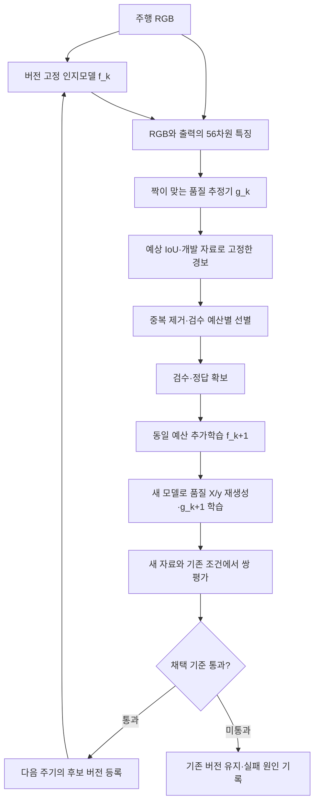

# 기계학습 기반 인지 품질 추정을 통한 딥러닝 인지모델 개선 데이터 플라이휠 구축

2026-11-16 통합 개발 기준. ML과 캡스톤은 같은 팀·같은 코드·같은 실험을 사용하는 하나의 프로젝트다.
교과목별 제출 범위가 연구 목표의 상한은 아니다.

## 기준과 연구 질문

파이프라인의 출발점은 11월 4일 ML 중간발표 `5_IsTrue_v2.pptx`의 본문과 발표자 노트다.
이후 사용자가 요청한 구현·실험과 확인된 결과로 세부사항을 구체화한다.
과거 v5 계약, 이전 측위 주제, 날짜가 지난 일정은 이력이며 현재 구현을 덮어쓰지 않는다.
발표 당시 추가학습의 선택적 범위도 현재 통합 목표의 제한으로 적용하지 않는다.

| 단계 | 연구 질문 | 통과를 판단할 근거 |
|---|---|---|
| 품질 추정 | GT 없이 현재 인지 결과의 IoU를 어느 정도 추정하는가? | 잠근 자료의 MAE, 조건별 오차, 과신·과소 추정 사례 |
| 취약 장면 확보 | 같은 검수 예산에서 실제 저품질 장면을 더 찾는가? | Random/Confidence/Entropy와 동일 후보의 Recall·precision 비교 |
| 인지모델 갱신 | 같은 새 정답 수·학습량에서 인지 성능이 개선되는가? | f0/무작위/품질 선별/replay-only의 예약 평가 |
| 다음 주기 준비 | f1에서 품질 추정기 g1도 유효한가? | f1로 다시 생성한 X/y, g1 개발 선택 및 새 자료 평가 |
| 갱신 채택 | 새 조건 개선과 기존 조건 유지가 함께 성립하는가? | 사전 고정한 채택 기준과 동일 입력·GT의 비교 |

한 단계의 성공을 다른 단계의 성공으로 대체하지 않는다. 낮은 IoU 탐지와 학습 효용은 별도 문제다.
날씨 이름을 맞히는 대신 같은 조건 안의 성공·실패를 구별해야 한다.

## 한 주기의 데이터 흐름

현재 구현·실험 범위는 고정 f0에서 f1/g1을 만드는 **파일 기반 오프라인 한 주기**다.
현재 학습 CLI는 매번 같은 f0에서 시작하도록 검사한다. 채택된 f1을 새 초기 모델로 쓰는 f2 이후의 누적 갱신에는
부모 모델 계보·누적 학습 노출·새 평가 묶음을 추적하는 인터페이스 확장이 필요하다.
ROS 수집 연계·온라인 대응·자동 반복 운용은 후속 검증이다.
GT는 정답 가공·검수·학습·평가에 사용한다. 배포 시의 X 계산·품질 추론·경보는 GT를 열지 않는다.
시뮬레이터의 자동 Semantic GT 사용이 현실의 무비용 라벨링을 의미하지 않는다.

## 검토에서 발견한 빈틈과 보완

| 빈틈 | 보완 및 현재 상태 |
|---|---|
| 프로젝트 목표가 품질 추정·선별에 머무는 문서와 재학습을 포함하는 문서가 혼재 | 이 문서의 통합 목표와 단계별 성공 기준으로 연결. 과거 발표의 범위는 이력으로 보존 |
| 인지모델이 바뀌어도 g0를 계속 쓰기 쉬움 | `perception_identity`로 인지 가중치·정답 정책·학습 이력을 검증. 갱신 모델은 `--adaptation-run`을 명시하고 g1과 일치해야 함 |
| 실제 저품질 기준과 경보 점수 임계값을 같은 0.7로 처리 | 실제 IoU<0.7을 연구용 정답 정의로 유지. 경보 임계값은 별도로 meta_dev 정상 행의 오경보 예산에 맞춰 고정 |
| 새 취약 조건 개선을 바로 모델 교체로 해석할 위험 | 새 조건 IoU·기존 조건 IoU·짝 품질 모델 MAE를 함께 보는 채택 판정 CLI 추가. 판정은 배포를 실행하지 않음 |
| 같은 지도·세션의 많은 프레임을 독립 일반화 근거로 해석 | 픽셀·부모 역할·경로 간격 감사와 물리 세션 계보를 함께 기록. 지도·날짜 독립성은 미확보로 표시 |

현재 X/y 정의와 기본 f0는 바꾸지 않았다. 특징은 출력+RGB 8종을 전체 및 3행×2열 ROI에 집계한 56차원이고,
정답은 흰·노란 차선 합집합의 프레임 IoU다. 기본 모델은 TwinLiteNet+ Medium v6 EMA epoch 11이다.

## 확보한 증거와 판단 범위

[기존 주 실험](품질추정_실험결과_20261116.md)에서는 RF의 정지 최종 MAE 0.0913,
주행 보조 0.0800을 확인했다. 후보 296장 중 30장 선별에서 품질 순위와 Confidence 모두
실제 저품질 30장을 찾았다. 품질 추정기가 모든 기준선보다 우수하다는 결과는 아니다.

동일 예산 재학습의 원래 두 시드 평균에서 정지 평가 IoU는 f0 0.6379에서 Quality 0.7102로 개선됐지만,
기존 조건 1,997행의 IoU는 0.8006에서 0.7734로 감소했다.
**현재 확보한 갱신 모델을 기존 모델의 전면 대체로 채택할 근거는 부족하다.**

[추가 날씨·시간 평가](품질저하_탐지평가_20261116.md)는 조건에 따라 실패 탐지와 오경보가 달라짐을 보여준다.
새 조건을 추가로 학습하지 않은 g0의 범위를 확인한 보조 평가이며, 같은 지도·경로라는 한계가 있다.

11/16 오후에는 원래 첫 Quality f1을 그대로 고정하고, 이전 품질 학습 824행·개발 576행만으로
짝 g1을 정식 bundle로 다시 생성했다. g1의 RF 개발 MAE는 0.0561이다.
g0와 g1의 경보 임계값은 각각 이전 개발 자료에서만 적합했고, 새 주행 결과를 보고 맞추지 않는다.
오후 새 주행1,371행에서 쌍 평가와 채택 판정을 완료했다. 새 평균 IoU는0.6867→0.6891,
기존 조건은0.8006→0.7675로 변해 채택을 보류했다.
[버전 쌍·경보·채택 판단 결과](통합주기_검증결과_20261116.md)에 조건별 IoU와 경보 오경보를 함께 기록했다.

## 현재 다음 작업의 순서

버전 쌍·개발 경보 보정·검수 대기열·갱신 판정과 새 주행 검증을 구현·실행했다.
이제 아래 과제를 우선한다.

1. **모니터의 새 분포 검증:** 정상/저품질 장면을 함께 확보하고 학습·개발·새 평가 역할을 먼저 배정한다. 새 테스트마다 경보를 다시 맞추지 않는다.
2. **성능 유지 개발:** 대표성 있는 replay·갱신 제약·학습량을 개발 자료에서 비교한다. 새 조건과 기존 조건의 Lane 및 다른 head 결과도 함께 확인한다.
3. **독립 환경:** 다른 지도·날짜·객체 배치의 사전 배정 평가를 확보한다. 같은 경로 반복을 이 검증으로 대체하지 않는다.
4. **실제 주행 연결:** 26R1 ROS에서 센서 시각·수신 시각·지연·드롭·기록 예산을 측정하고, 무작위 감사 샘플을 포함한 취약 장면 로깅을 연결한다.
5. **반복 주기:** 채택 모델에서 다음 세대로 갱신할 때 부모 checkpoint·누적 학습 노출·새 잠금 평가를 연결한다. 현재 학습 CLI는 고정 f0에서 시작하는 한 번의 갱신을 지원한다.

새 주기마다 인지 checkpoint·품질 bundle·특징/정답 정책·경보 calibration·후보/평가 역할·선별 예산을 함께 기록한다.
완료 기준은 실행 횟수가 아니라 각 단계의 질문에 답할 수 있는 증거와 다음 주기에 전달 가능한 산출물이다.

## 추가 개발의 새 촬영 검증

[출력 유지 제약 모델의 추가 검증](출력유지_제약모델_추가검증_20261116.md)에서 새 흐림08시·안개20시의 세 버전 쌍을 비교했다.
개발에서 소폭 회복한 제약 모델도 기존 조건 유지 기준에는 미치지 못했다. 기본 f0/g0를 유지하며 모니터 오경보·대표성 있는 데이터·독립 환경 검증을 이어간다.
